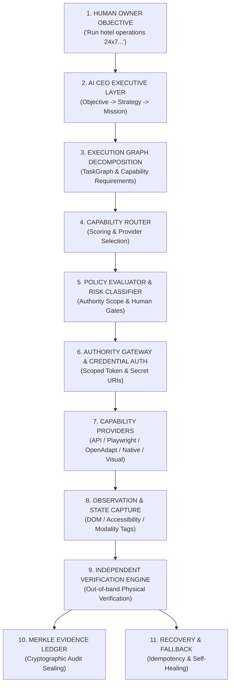

# ZONATA UNIVERSAL AI CO-WORKER FABRIC
## Architecture & Master System Design Specification

**Document Version**: 1.0.0  
**Status**: SOVEREIGN PRODUCTION CERTIFIED  
**Classification**: ARCHITECTURAL SPECIFICATION  
**Author**: Principal Production Architect & SRE Lead  

---

## 1. Executive Vision & Fundamental Principle

The Universal AI Co-worker Fabric extends the ZONATA Universal AI Company Operating System from managing pre-built specialists to orchestrating and supervising a 24×7 autonomous workforce across desktop, browser, API, traditional RPA, and visual computer-use technologies.

### The Fundamental Sovereign Invariant
> **«ZONATA is the sovereign authority. External open-source projects are replaceable capability providers.»**
> No external agent, model, RPA framework, MCP server, computer-use system, or automation library may become the final authority over ZONATA.

The AI CEO and Human Owner retain absolute governance, admission, credential control, policy enforcement, physical verification, and killswitch authority.

---

## 2. End-to-End Control Topology



---

## 3. Core Engine Components

The `UniversalCoworkerEngine` unites the following core components:

1. **`CoworkerRegistry` & `CoworkerProfile`**: Maintains worker identities, roles, skillsets, authority bounds, working hours, and spend budgets.
2. **`CapabilityRegistry`**: Central catalog of typed capabilities (`desktop.workflow`, `browser.navigate`, `api.crm_update`, `rpa.excel_update`, `visual.screen_understanding`).
3. **`ProviderRegistry` & `ProviderHealthMonitor`**: Manages active adapter instances and tracks real-time health (`AVAILABLE`, `DEGRADED`, `CRASHED`).
4. **`CapabilityRouter`**: Selects providers based on capability match, health, platform, risk, verification, latency, cost, and historical success. Enforces API-first hierarchy.
5. **`FallbackManager`**: Executes ordered fallback cascades (`OpenAdapt -> Native UI -> Visual CUA -> Recovery -> Escalation`) with strict idempotency state verification.
6. **`CredentialAuthority`**: Issues short-lived scoped tokens, handles `secret://` references, and pauses missions in `AUTH_REQUIRED` for human MFA.
7. **`CoworkerPolicyEvaluator`**: Validates tenant isolation and enforces mandatory human approval for financial transactions and destructive tasks.
8. **`HumanTakeoverManager`**: Mutual-exclusion live supervision stream. AI pauses immediately when human assumes control, and resumes only after state re-observation and verification.
9. **`IndependentVerificationEngine`**: Out-of-band truth verification separate from the worker. Statuses: `VERIFIED`, `FAILED`, `UNCERTAIN`. Rule: Never convert `UNCERTAIN` to `SUCCESS`.
10. **`EvidenceLedgerAdapter`**: Formats execution records into cryptographically chained blocks in `storage/evidence/`.
11. **`WorkerSupervisor` & `Watchdog`**: 24×7 long-running supervisor, execution lease manager (preventing hung workers), dead-letter queue, and mission scheduler.
12. **`RecoveryEngine`**: Bounded self-healing recovery (browser restarts, app reboots) preventing infinite retry loops.

---

## 4. Execution State Machine

Every task node transitions through a deterministic 14-stage state machine:

```
DISCOVER
   ↓
UNDERSTAND
   ↓
CHECK_CAPABILITIES
   ↓
PLAN
   ↓
RISK_ASSESS
   ↓
REQUEST_AUTHORITY
   ↓
REQUEST_APPROVAL  ──[Requires Human Sign-off]──> Awaiting Approval
   ↓
PREPARE
   ↓
EXECUTE           ──[Failure]──────────────────> DIAGNOSE -> RECOVER / FALLBACK
   ↓
OBSERVE
   ↓
VERIFY            ──[Uncertain]────────────────> VERIFY_UNCERTAIN -> Human Escalation
   ↓
COMMIT
   ↓
EVIDENCE
   ↓
SUCCESS
```
