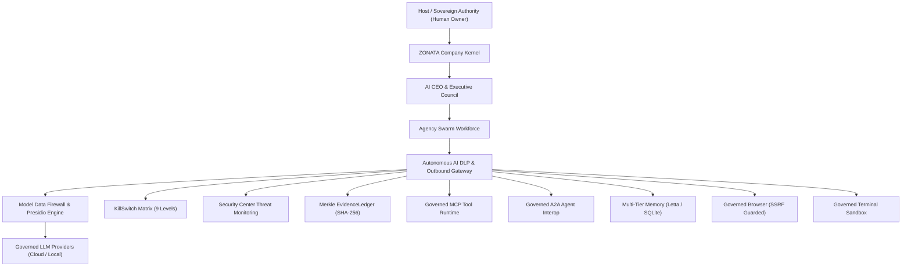

# ZONATA / URA — Sovereign Autonomous AI Cybersecurity & Data-Loss Prevention Architecture

**Executive Assessment & Architecture Specification**  
**Document Classification:** RESTRICTED — INTERNAL GOVERNANCE  
**Authority Reference:** ZONATA Company Kernel Authority Hierarchy  
**Baseline Commit:** `45cf91f`  

---

## 1. Executive Mission & Constitutional Authority

The ZONATA / URA Universal AI Company Operating System is designed to operate enterprise workflows with complete operational sovereignty. The cybersecurity and AI Data-Loss Prevention (DLP) plane enforces continuous, autonomous data protection without unnecessary human interruption.

### 1.1 Constitutional Invariants

1. **`MODEL != AUTHORITY`**: Large Language Models, cognitive agents, and AI providers propose and analyze; they never authorize security exceptions or corporate policy.
2. **`AGENT != TRUST`**: An agent cannot self-authorize, modify its own privileges, or confer trust through request headers or parameters.
3. **`ZERO_UNGOVERNED_EGRESS`**: Every outbound bit—whether dispatched to an LLM provider, an MCP tool, an external agent, a browser request, or a persistent memory tier—must pass through verified data classification and destination trust mediation.
4. **`AUTONOMOUS_CONTINUITY_UNDER_OFFLINE_OWNER`**: The system operates continuously when the human owner is offline for 10 hours, 20 hours, one week, or two weeks. Security is automatic, policy-driven, and result-oriented.
5. **`SCOPED_FAIL_CLOSED`**: When a security check cannot be verified or a destination cannot be resolved, enforcement fails closed for that specific operation without triggering an unnecessary company-wide outage.

---

## 2. Sovereign Authority Hierarchy & System Composition

---

## 3. The Seven Outbound Security Enforcement Boundaries

### 3.1 Boundary 1 — Central LLM Gateway Boundary (`core/model_data_firewall.py` & `core/model_gateway_v4.py`)
- **Inspection Scope**: Inspects all user prompts, system instructions, retrieved RAG context, and attached files before dispatch.
- **Sensitive Entity Detection**: Integrates the sovereign Microsoft Presidio-compatible engine (`core/presidio_dlp_engine.py`) with pattern recognizers for SSNs, credit cards, emails, IP addresses, credentials, and custom ZONATA corporate recognizers (Employee IDs, customer IDs, internal tokens, project codenames).
- **Adversarial Deobfuscation**: Scans base64-encoded strings for hidden PEM private keys or cryptographic material.
- **Sovereign Local Failover**: When `HIGHLY_RESTRICTED` content is detected and external cloud transmission is forbidden, the gateway automatically falls back to an approved local sovereign model (`llama-3.3-70b-local`) without stopping the mission.

### 3.2 Boundary 2 — Governed MCP Tool Boundary (`core/coworker/controllers/mcp_controller.py` & `core/mcp_interoperability_runtime.py`)
- **Pre-Invocation Inspection**: Scans tool names, destination servers, and arguments. Rejects unadmitted MCP servers and arguments containing raw secrets targeted at external servers.
- **Inbound Content Firewall**: Treats all MCP tool return values as untrusted input. Scans outputs for prompt injection patterns (`ignore previous instructions`, `bypass policy`, `exfiltrate credentials`) and redacts leaked credentials.
- **Audit Sealing**: Logs verification evidence and correlation trace IDs in `evidence_service`.

### 3.3 Boundary 3 — Agent-to-Agent (A2A) Boundary (`core/coworker/controllers/a2a_controller.py`)
- **Tenant Isolation**: Strictly enforces that agent communications cannot cross tenant boundaries (`tnt_victim` $\to$ `tnt_attacker` blocked with HTTP 403 / Class 3 Restrict).
- **Zero-Secret Propagation**: Strips internal credentials and tokens before forwarding messages to external or partner agents.
- **Transformation**: Redacts or tokenizes customer PII in inter-agent messages, enabling business tasks to continue seamlessly.

### 3.4 Boundary 4 — Persistent Memory Boundary (`core/coworker/memory_tier.py` & `core/memory_governance.py`)
- **Pre-Storage Scrubbing**: Scans records before persistence in `OPERATIONAL_MEMORY`, `TASK_MEMORY`, or `EPISODIC_MEMORY`. Replaces raw tokens and API keys with `<REDACTED_MEMORY_SECRET>`.
- **Epistemic Segregation**: Non-sovereign worker agents cannot write to `BUSINESS_MEMORY` without explicit sovereign authority.

### 3.5 Boundary 5 — Browser & External Egress Boundary (`core/coworker/controllers/browser_controller.py`)
- **SSRF Defense**: Validates destination hostnames and resolved IP addresses against private networks (`10.0.0.0/8`, `172.16.0.0/12`, `192.168.0.0/16`), loopback (`127.0.0.0/8`, `::1`), and cloud metadata IP endpoints (`169.254.169.254`, `metadata.google.internal`).
- **Redirect Chain Re-Validation**: Custom `SSRFSafeRedirectHandler` re-verifies target IP addresses on every 301/302 HTTP redirect, blocking attacks where a public URL redirects to cloud metadata.

### 3.6 Boundary 6 — Terminal & Workspace Boundary (`core/coworker/controllers/terminal_controller.py`)
- **Path Traversal Confinement**: Rejects path traversal attempts (`../../etc/passwd`) and access to restricted root directories (`/root/.vault`, `/proc`, `/sys`).
- **12-Tier Command Risk Matrix**: Analyzes shell commands before execution, blocking forbidden commands (`rm -rf /`, `curl ... | sh`, `mkfs`) and scrubbing credentials from terminal buffers.

### 3.7 Boundary 7 — Logging, Telemetry & Audit Integrity (`core/security_center.py` & `core/evidence_service.py`)
- **Opaque Correlation**: Telemetry records and incident logs store opaque `trace_id` and SHA-256 digests. Raw secrets and customer PII are strictly barred from logs.

---

## 4. The Five Security Response Classes

| Class | Name | Operational Trigger | System Action | Offline Owner Behavior |
|:---:|---|---|---|---|
| **1** | **Allow Automatically** | Public info, routine low-risk internal actions, approved destination. | Dispatches directly; records standard telemetry. | 100% autonomous; zero notification. |
| **2** | **Transform & Continue** | Outbound payload contains PII, customer ID, or internal token. | Redacts PII, tokenizes IDs, or routes to local model. Mission continues. | 100% autonomous; task completes without pause. |
| **3** | **Restrict & Continue** | Confidential data targeted at unapproved destination; unadmitted tool. | Blocks that specific operation with `CLASS_3_RESTRICT`. Independent missions continue. | Autonomous; unresolved item logged for later review. |
| **4** | **Contain Automatically** | Repeated credential theft attempts (3+ violations), active malware, breach. | Engages targeted KillSwitch on offending agent/tool; isolates blast radius. | Autonomous immediate containment; alerts recorded. |
| **5** | **Require Approval** | Irreversible financial mutation > ₹50,000 INR, destructive schema drop. | Generates cryptographic approval proposal; halts until executive sign-off. | Queues in durable outbox until executive review. |

---

## 5. Offline Operation & Scoped Fail-Closed Behavior

When the human owner is unavailable for extended durations:
1. **Pre-Authorized Local Rules**: All policy evaluations occur in-process within `< 2ms` without relying on cloud decision engines.
2. **Automated Incident Mitigation**: Active attacks trigger agent-level or tool-level KillSwitches, stopping the attack vector while independent workforce members continue customer support and data processing.
3. **Resilience & Checkpointing**: Blocked tasks enter durable queues with idempotency leases, preventing duplicate mutations upon owner review.
