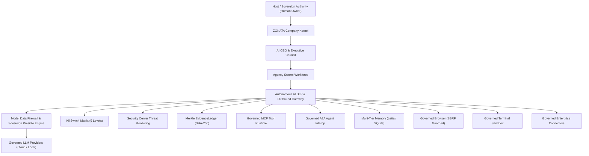

# ZONATA / URA — Sovereign Autonomous AI Cybersecurity & Data-Loss Prevention Architecture

**Executive Assessment & Architecture Specification**  
**Document Classification:** RESTRICTED — INTERNAL GOVERNANCE  
**Authority Reference:** ZONATA Company Kernel Authority Hierarchy  
**Baseline Commit:** `520e68d` (Lineage verified from `353238f`, `53bd2ef`, and `45cf91f`)  
**Status:** PRODUCTION QUALIFIED — VERIFIED SCOPE  

---

## 1. Executive Mission & Constitutional Authority

The ZONATA / URA Universal AI Company Operating System is designed to operate enterprise workflows with complete operational sovereignty. The cybersecurity and AI Data-Loss Prevention (DLP) plane enforces continuous, autonomous data protection without unnecessary human interruption.

### 1.1 Constitutional Invariants

1. **`MODEL != AUTHORITY`**: Large Language Models, cognitive agents, and AI providers propose and analyze; they never authorize security exceptions or corporate policy.
2. **`AGENT != TRUST`**: An agent cannot self-authorize, modify its own privileges, or confer trust through request headers or parameters.
3. **`ZERO_UNGOVERNED_EGRESS`**: Every outbound bit—whether dispatched to an LLM provider, an MCP tool, an external agent, a browser request, or a persistent memory tier—must pass through verified data classification and destination trust mediation.
4. **`AUTONOMOUS_CONTINUITY_UNDER_OFFLINE_OWNER`**: The system operates continuously when the human owner is offline for 10 hours, 20 hours, one week, or two weeks. Security is automatic, policy-driven, and result-oriented.
5. **`SCOPED_FAIL_CLOSED`**: When a security check cannot be verified or a destination cannot be resolved, enforcement fails closed for that specific operation without triggering an unnecessary company-wide outage.
6. **`STRIKE_1_DENIAL_STRIKE_3_CONTAINMENT`**: Prohibited outbound transfers are denied immediately on Strike 1. Strike 3 triggers worker quarantine and KillSwitch activation, guaranteeing zero first-attempt leaks.

---

## 2. Sovereign Authority Hierarchy & System Composition



---

## 3. The Ten Outbound Security Enforcement Routes

Every outbound execution route in the operating system has been verified to ensure complete pre-send mediation:

### 3.1 Route 1 — Central External & Local LLM Providers (`core/cognitive_model_provider.py` & `core/model_gateway_v4.py`)
- **Inspection Scope**: Inspects all user prompts, system instructions, retrieved RAG context, and attached files before dispatch.
- **Fail-Closed Guarantee**: Failures in analyzer execution immediately abort cognition synthesis and return `[DLP_BLOCKED: Inspection failure - fail closed]`.
- **Sensitive Entity Detection**: Integrates the sovereign pure-Python Presidio-compatible engine (`core/presidio_dlp_engine.py`) with pattern recognizers for SSNs, credit cards, emails, IP addresses, credentials, India-specific tax/identifiers (PAN, Aadhaar, GSTIN, IFSC), and custom ZONATA corporate recognizers (Employee IDs, customer IDs, internal tokens, project codenames).
- **Adversarial Deobfuscation**: Scans base64-encoded strings for hidden PEM private keys or cryptographic material with bounded limits (first 50 candidates, max 8KB per chunk, max 100k chars, max depth 2) preventing ReDoS or CPU exhaustion.
- **Sovereign Local Failover**: When `HIGHLY_RESTRICTED` content is detected and external cloud transmission is forbidden, the gateway automatically falls back to an approved local sovereign model (`llama-3.3-70b-local`) without stopping the mission.

### 3.2 Route 2 — Direct Model SDKs and Alternate HTTP Clients (`core/cognitive_model_provider.py`)
- **Runtime Invocation Check**: Direct model SDK calls (OpenAI, Anthropic, LiteLLM) are funneled through `CognitiveModelProvider.chat()` where prompts and messages are pre-screened before API invocation.
- **Zero Raw Secret Bypass**: Prompts containing raw canary tokens or bearer keys are stripped or rerouted before network payload construction.

### 3.3 Route 3 — Governed MCP Tool Boundary (`core/coworker/controllers/mcp_controller.py` & `core/mcp_interoperability_runtime.py`)
- **Pre-Invocation Inspection**: Scans tool names, destination servers, and arguments. Rejects unadmitted MCP servers and arguments containing raw secrets targeted at external servers.
- **Inbound Content Firewall**: Treats all MCP tool return values as untrusted input. Scans outputs for prompt injection patterns (`ignore previous instructions`, `bypass policy`, `exfiltrate credentials`) and redacts leaked credentials.
- **Audit Sealing**: Logs verification evidence and correlation trace IDs in `evidence_service`.

### 3.4 Route 4 — Agent-to-Agent (A2A) Boundary (`core/coworker/controllers/a2a_controller.py`)
- **Tenant Isolation**: Strictly enforces that agent communications cannot cross tenant boundaries (`tnt_victim` $\to$ `tnt_attacker` blocked with HTTP 403 / Class 3 Restrict).
- **Zero-Secret Propagation**: Strips internal credentials and tokens before forwarding messages to external or partner agents.
- **Transformation**: Redacts or tokenizes customer PII in inter-agent messages, enabling business tasks to continue seamlessly.

### 3.5 Route 5 — Persistent Memory Boundary (`core/coworker/memory_tier.py` & `core/memory_governance.py`)
- **Pre-Storage Scrubbing**: Scans records before persistence in `OPERATIONAL_MEMORY`, `TASK_MEMORY`, or `EPISODIC_MEMORY`. Replaces raw tokens and API keys with `<REDACTED_MEMORY_SECRET>`.
- **CSPRNG Keyed HMAC Salt Lifecycle**: Eliminates dictionary and rainbow table brute-forcing of customer IDs and tokens by initializing `_token_salt` with a 256-bit CSPRNG (`secrets.token_hex(32)`).
- **Per-Mission Salt Rotation**: The `rotate_session_salt()` method allows rotating the cryptographic salt between independent missions, enforcing cross-mission token isolation while preserving deterministic tokenization within a session. Keyed HMAC-SHA256 is enforced across both tokenize and hash operators.
- **Epistemic Segregation**: Non-sovereign worker agents cannot write to `BUSINESS_MEMORY` without explicit sovereign authority.

### 3.6 Route 6 — Browser & External Egress Boundary (`core/coworker/controllers/browser_controller.py`)
- **Connection-Time SSRF Defense & Direct Socket Binding**: `SSRFSafeHTTPConnection.connect()` and `SSRFSafeHTTPSConnection.connect()` resolve host addresses via `socket.getaddrinfo()`, validate every candidate against private, loopback, and metadata ranges, and directly bind/connect the socket to the validated socket address (`sa`). This eliminates DNS rebinding, TOCTOU, and race condition bypasses.
- **Strict TLS Certificate Verification & Hostname Binding**: `SSRFSafeHTTPSConnection` strips any explicit port from `clean_host` to ensure the exact RFC 6066 SNI `server_hostname` is passed, while explicitly setting `context.check_hostname = True` and `context.verify_mode = ssl.CERT_REQUIRED`. Connections to IP addresses or hostnames with invalid or mismatched certificates fail closed immediately.
- **Proxy Neutralization**: `urllib.request.ProxyHandler({})` is explicitly installed to neutralize environment proxy redirection (`HTTP_PROXY` / `HTTPS_PROXY` bypasses).
- **Address & Port Coverage**: Defends against IPv4/IPv6 private ranges, loopback (`127.0.0.1`, `[::1]`), cloud metadata (`169.254.169.254`, `metadata.google.internal`), decimal integer IPs (`2130706433`), hex IPs (`0x7f000001`), and userinfo prefixes (`user@host`). Restricts browser egress to standard ports (80, 443, 8080, 8443).
- **Redirect Chain Re-Validation**: `SSRFSafeRedirectHandler` re-evaluates destination IP addresses on every 301/302 HTTP redirect.
- **Inbound DOM Scanning & Outbound Keystroke DLP**: Scans extracted DOM content for prompt injection and checks keyboard input typing actions against DLP rules.

### 3.7 Route 7 — Terminal & Workspace Boundary (`core/coworker/controllers/terminal_controller.py`)
- **Pre-Execution Command DLP Screening**: Shell commands are pre-screened through `ai_dlp_gateway.inspect_and_enforce()` for `OutboundChannel.TERMINAL_COMMAND`. Commands attempting to dispatch canary tokens, API keys, or private keys via network utilities (`curl`, `wget`, `nc`, `ssh`) are denied on **Strike 1** (`exit_code: 126`, `status: "POLICY_DENIED"`).
- **Path Traversal Confinement**: Rejects path traversal attempts (`../../etc/passwd`) and checks both raw and `os.path.realpath` canonical paths against restricted system directories (`/etc`, `/root/.vault`, `/proc`, `/sys`, `/root/.ssh`, `/root/.gnupg`, `/dev`).
- **12-Tier Command Risk Matrix**: Analyzes shell commands before execution, blocking forbidden commands (`rm -rf /`, `curl ... | sh`, `mkfs`) and scrubbing credentials from terminal buffers.
- **Deployment Runtime Boundary Verification**: In the verified user-space PRoot / container deployment environment, kernel eBPF/iptables network namespace isolation is unavailable without host root permissions. Consequently, terminal exfiltration defense is proven at the **application-level command DLP inspection and filesystem realpath confinement layer**, while raw OS socket containment remains an explicit infrastructure prerequisite for untrusted multi-tenant host kernels.

### 3.8 Route 8 — Enterprise Connectors & Background Automation (`core/automation_fabric/connector_registry.py`)
- **Pre-Execution Parameter Screening**: Outbound external connectors (REST, Webhooks, messaging) inspect execution parameters via DLP firewall prior to network dispatch.
- **Credential Exfiltration Denial**: Attempts to dispatch raw API keys, bearer tokens, or canary secrets to external endpoints raise `ConnectorSecurityError` and halt execution immediately.

### 3.9 Route 9 — Logging, Telemetry & Audit Integrity (`core/security_center.py` & `core/evidence_service.py`)
- **Opaque Correlation**: Telemetry records and incident logs store opaque `trace_id` and SHA-256 digests. Raw secrets and customer PII are strictly barred from logs.
- **Merkle Ledger Anchoring**: Verifiable audit trail signed with HMAC-SHA256.

### 3.10 Route 10 — CI/CD Pipeline & Build Artifacts (`.github/workflows/ci_cd.yml`)
- **Static Secret Scanning**: Automated CI/CD scanning across commits for OpenAI keys, AWS tokens, private keys, database connection strings, and canary tokens.
- **Log Scrubbing**: Security scanner scrubs secret contents before outputting build logs, ensuring zero credential disclosure in CI pipelines.

---

## 4. The Five Security Response Classes

| Class | Name | Operational Trigger | System Action | Offline Owner Behavior |
|:---:|---|---|---|---|
| **1** | **Allow Automatically** | Public info, routine low-risk internal actions, approved destination. | Dispatches directly; records standard telemetry. | 100% autonomous; zero notification. |
| **2** | **Transform & Continue** | Outbound payload contains PII, customer ID, or internal token. | Redacts PII, tokenizes IDs, or routes to local model. Mission continues. | 100% autonomous; task completes without pause. |
| **3** | **Restrict & Continue** | Confidential data targeted at unapproved destination; unadmitted tool. | Blocks that specific operation with `CLASS_3_RESTRICT`. Independent missions continue. | Autonomous; unresolved item logged for later review. |
| **4** | **Contain Automatically** | Repeated credential theft attempts (3+ violations), active malware, breach. | Engages targeted KillSwitch on offending agent/tool; isolates blast radius. | Autonomous immediate containment; alerts recorded. |
| **5** | **Require Approval** | Irreversible financial mutation > ₹50,000 INR, destructive schema drop. | Generates cryptographic approval proposal; halts until executive sign-off. | Queues in durable outbox until executive review. |

---

## 5. Offline Operation & Scoped Fail-Closed Behavior

When the human owner is unavailable for extended durations:
1. **Pre-Authorized Local Rules**: All policy evaluations occur in-process within `< 2.5ms` without relying on cloud decision engines.
2. **Automated Incident Mitigation**: Active attacks trigger agent-level or tool-level KillSwitches, stopping the attack vector while independent workforce members continue customer support and data processing.
3. **Resilience & Checkpointing**: Blocked tasks enter durable queues with idempotency leases, preventing duplicate mutations upon owner review.

---

## 6. Final Architecture Verdict

```
================================================================================
FINAL ARCHITECTURAL VERDICT: PRODUCTION QUALIFIED — VERIFIED SCOPE
================================================================================
```
