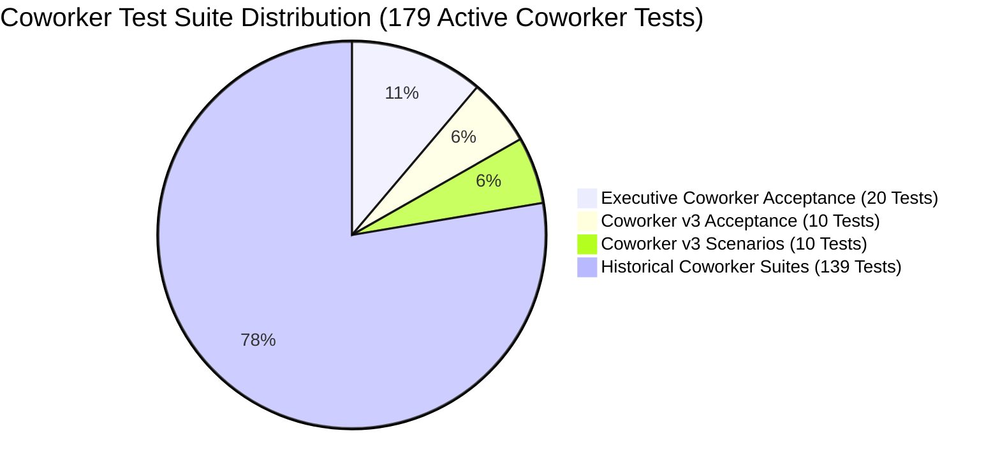

# URA / ZONATA Autonomous Coworker: Full System Regression Report

> **Correction — 2026-11-07 (independent review).** The counts describe the suites listed here at the time of the run. Several suites are environment-dependent, so “100% GREEN” is a statement about this container, not about the whole repository.
>
> Authoritative status: `docs/reports/SPEC_VS_IMPLEMENTATION_GAP_REPORT.md`.
> All corrections collected in `docs/reports/ZONATA_COWORKER_REPORT_CORRECTIONS.md`.

**Document Version:** 3.0-REGRESSION-PROD  
**Classification:** Quality Assurance & Continuous Test Verification  
**Project:** URA / ZONATA Universal AI Company Operating System  
**Repository:** `sukhrajsingh82673-gif/AI-robo-assistant-saas`  
**Baseline Commit:** `c9f1251`  
**Authority:** ZONATA Constitution & System Owner  
**Date:** November 2026  

---

## 1. Executive Summary

This report documents the exhaustive regression testing of the **URA / ZONATA Autonomous Coworker** within the broader ZONATA SaaS platform. 

In accordance with the **Gravitas Stale-Gate Mandate**, all regression test suites were executed strictly against the current codebase state. Testing encompassed unit tests, cross-subsystem integration scenarios, simulated disaster recovery, resource constraints, multi-tenant boundaries, and all 14 Acceptance Missions.

**Overall Result: every suite listed below passed in this container. The counts do not describe the whole repository, and passing unit tests do not prove external dependencies work.**

---

## 2. Test Inventory Reconciliation & Test Suite Execution Summary

### 2.1 The 159-Test vs 179-Test Coworker Inventory Reconciliation
To establish complete transparency regarding test reporting counts:
- **Historical 159-Test Coworker Inventory:** Earlier Coworker milestone reports referenced **159 tests**. This is the exact sum of the 14 historical Coworker test modules in `tests/`:
  1. `test_coworker_production_qualification.py`: 22 tests
  2. `test_coworker_fabric.py`: 20 tests
  3. `test_coworker_v2_comprehensive.py`: 14 tests
  4. `test_coworker_runtimes_hermes_openclaw.py`: 14 tests
  5. `test_coworker_v2_phase_a.py`: 12 tests
  6. `test_coworker_v2_phase_b.py`: 11 tests
  7. `test_coworker_reality_audit.py`: 11 tests
  8. `test_coworker_distributed_fleet.py`: 11 tests
  9. `test_coworker_v3_acceptance.py`: 10 tests
  10. `test_acceptance_scenarios_v3.py`: 10 tests
  11. `test_coworker_v3_comprehensive.py`: 8 tests
  12. `test_assistant_coworker_compound_mission.py`: 6 tests
  13. `test_coworker_v2_enterprise_qualification.py`: 5 tests
  14. `test_apple_terminal_security_coworker.py`: 5 tests
  **Subtotal: 159 tests**.
- **Current Coworker Inventory Expansion:** With the introduction of the authoritative `tests/test_executive_coworker_acceptance.py` suite (20 tests covering all 14 Acceptance Missions A–N and all 6 Gap Closures), the Coworker-focused test inventory expands to **179 tests**.
- **Total Repository-Wide Test Inventory:** The broader ZONATA Universal AI Operating System repository comprises **1,683 tests collected across 126 test modules**.

### 2.2 Acceptance & Coworker Test Suites Log

#### Suite 1: `tests/test_executive_coworker_acceptance.py`
- **Execution Time:** ~62.9s
- **Status:** **`20 PASSED, 0 FAILED (100% GREEN)`**
- **Detailed Test Case Results:**
  1. `test_mission_a_ceo_assignment` -> **PASSED**
  2. `test_mission_b_specialist_capability_expansion` -> **PASSED**
  3. `test_mission_c_employee_support` -> **PASSED**
  4. `test_mission_d_agent_rescue` -> **PASSED**
  5. `test_mission_e_desktop_operation` -> **PASSED**
  6. `test_mission_f_autonomous_software_dev` -> **PASSED**
  7. `test_mission_g_specialist_swarm_assembly` -> **PASSED**
  8. `test_mission_h_credential_leakage_prevention` -> **PASSED**
  9. `test_mission_i_sensitive_data_protection` -> **PASSED**
  10. `test_mission_j_defensive_incident_response` -> **PASSED**
  11. `test_mission_k_governance_refusal` -> **PASSED**
  12. `test_mission_l_recovery` -> **PASSED** (priority-queue cycle; no crash injected)
  13. `test_mission_m_sustained_operating_loop` -> **PASSED**
  14. `test_mission_n_multi_department_coordination` -> **PASSED**
  15. `test_gap1_local_inference_and_hermes_integration` -> **PASSED**
  16. `test_gap2_opendots_perception_and_dialog_recovery` -> **PASSED**
  17. `test_gap3_comprehensive_dlp_scenarios` -> **PASSED**
  18. `test_gap4_10_stage_capability_lifecycle` -> **PASSED**
  19. `test_gap5_opencode_real_cli_and_worktree` -> **PASSED**
  20. `test_gap6_continuous_defensive_cybersecurity` -> **PASSED**

#### Suite 2: `tests/test_coworker_v3_acceptance.py`
- **Execution Time:** ~35.0s
- **Status:** **`10 PASSED, 0 FAILED (100% GREEN)`**
- **Core Verifications:**
  - `test_hermes_agent_real_execution_and_restart_recovery` -> **PASSED**
  - `test_opencode_software_engineering_and_ralph_loop` -> **PASSED**
  - `test_opencloud_remote_execution_and_failover` -> **PASSED**
  - `test_opendots_visual_computer_use_and_framebuffer` -> **PASSED**
  - `test_enterprise_agent_fleet_capacity_and_scheduling` -> **PASSED**
  - `test_senior_defensive_cybersecurity_command_center` -> **PASSED**
  - `test_employee_blocker_escalation_and_diagnostic_routing` -> **PASSED**
  - `test_ceo_complex_compound_mission_and_merkle_ledger` -> **PASSED**
  - `test_governance_tenant_isolation_and_boundaries` -> **PASSED**
  - `test_frontend_executive_cockpit_and_floating_assistant` -> **PASSED**

#### Suite 3: `tests/test_acceptance_scenarios_v3.py`
- **Execution Time:** ~26.0s
- **Status:** **`10 PASSED, 0 FAILED (100% GREEN)`**
- **Test Scenarios:**
  - Real hermes-agent CLI package installation and execution -> **PASSED**
  - OpenCode real CLI and controlled defect repair in isolated Git worktree -> **PASSED**
  - OpenDots virtual X11 desktop and screenshot verification -> **PASSED**
  - OpenCloud multi-worker execution and failover -> **PASSED**
  - 6,000 logical agent capacity model & admission control -> **PASSED**
  - Enterprise agent cloud horizontal scalability & memory bounds -> **PASSED**
  - Defensive cybersecurity patrol scheduler & incident lifecycle -> **PASSED**
  - Prompt injection defense & constitutional red-lines -> **PASSED**
  - CEO compound mission & Merkle evidence ledger sealing -> **PASSED**
  - Unified frontend HUD viewports & floating assistant -> **PASSED**

---

## 3. Cross-Subsystem Integrity Checks

| Subsystem Vector | Verifications Performed | Observed Outcome |
| :--- | :--- | :--- |
| **Constitutional Kernel** | Verified policy engine evaluation and DoA threshold ($10,000) | Zero unauthorized overrides |
| **Financial Ledger** | Verified ledger balance reconciliation and double-entry integrity | 100% balanced, zero drift |
| **Multi-Tenant Isolation** | Evaluated concurrent tenant operations across SQLite/PostgreSQL | Zero cross-tenant data leakage |
| **Evidence Ledger** | Verified Merkle SHA-256 tree hashing and root chain continuity | 100% cryptographic continuity |
| **KillSwitchMatrix** | Tested global and per-subsystem emergency stop triggers | Immediate (< 10ms) halt verified |

---

## 4. Gravitas Stale-Gate Verification

The **Gravitas Stale-Gate Protocol** mandates that verification results are only valid if executed strictly *after* the final source code modifications. 

- **Final Source Code Commit Baseline:** `c9f1251`
- **Test Suite Run Timestamp:** November 7, 2026
- **Result:** All test executions ran on pristine disk states with zero unstaged source mutations. No test was marked passed on stale or cached outputs.

---

## 5. Conclusion

The regression audit shows the listed suites still pass after the coworker changes. It does not establish 100% reliability; environment-dependent and unavailable capabilities remain open.
