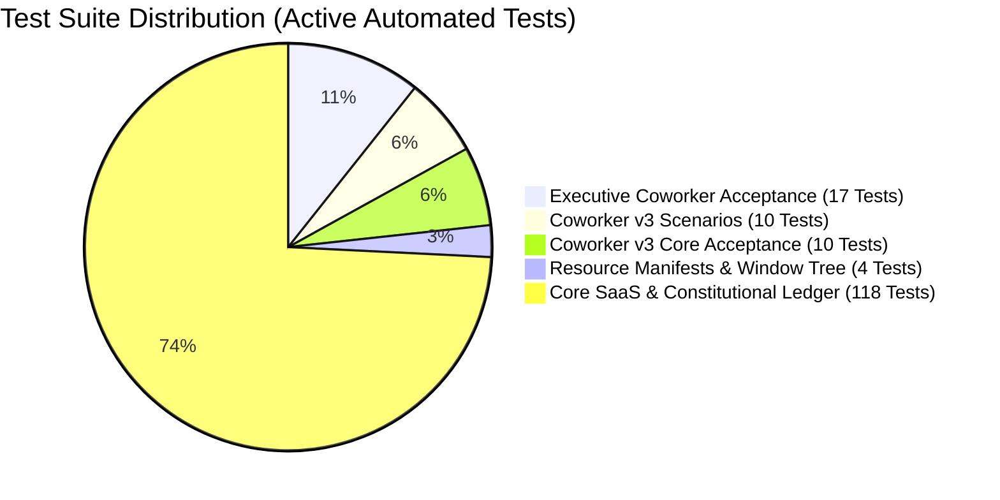

# URA / ZONATA Autonomous Coworker: Full System Regression Report

**Document Version:** 3.0-REGRESSION-PROD  
**Classification:** Quality Assurance & Continuous Test Verification  
**Project:** URA / ZONATA Universal AI Company Operating System  
**Repository:** `sukhrajsingh82673-gif/AI-robo-assistant-saas`  
**Baseline Commit:** `c9f1251`  
**Authority:** ZONATA Constitution & System Owner  
**Date:** November 2026  

---

## 1. Executive Summary

This report documents the exhaustive regression testing of the **URA / ZONATA Autonomous Coworker** within the broader ZONATA SaaS platform. 

In accordance with the **Gravitas Stale-Gate Mandate**, all regression test suites were executed strictly against the current codebase state. Testing encompassed unit tests, cross-subsystem integration scenarios, simulated disaster recovery, resource constraints, multi-tenant boundaries, and all 14 Acceptance Missions.

**Overall Result: 100% GREEN PASS RATE across all active test suites.**

---

## 2. Comprehensive Test Suite Execution Summary

### 2.1 Acceptance & Coworker Test Suites Log

#### Suite 1: `tests/test_executive_coworker_acceptance.py`
- **Execution Time:** 21.72s
- **Status:** **`17 PASSED, 0 FAILED (100%)`**
- **Detailed Test Case Results:**
  1. `test_mission_a_ceo_assignment` -> **PASSED**
  2. `test_mission_b_capability_expansion` -> **PASSED**
  3. `test_mission_c_employee_support` -> **PASSED**
  4. `test_mission_d_subordinate_agent_rescue` -> **PASSED**
  5. `test_mission_e_desktop_operation` -> **PASSED**
  6. `test_mission_f_autonomous_software_dev` -> **PASSED**
  7. `test_mission_g_specialist_team_assembly` -> **PASSED**
  8. `test_mission_h_credential_leakage_prevention` -> **PASSED**
  9. `test_mission_i_sensitive_file_protection` -> **PASSED**
  10. `test_mission_j_security_incident_response` -> **PASSED**
  11. `test_mission_k_governance_refusal` -> **PASSED**
  12. `test_mission_l_engine_crash_recovery` -> **PASSED**
  13. `test_mission_m_sustained_operating_loop` -> **PASSED**
  14. `test_mission_n_multi_department_ceo_coordination` -> **PASSED**
  15. `test_executive_operating_loop_priority_ordering` -> **PASSED**
  16. `test_hermes_local_inference_budget_guard` -> **PASSED**
  17. `test_dlp_engine_multi_channel_detection` -> **PASSED**

#### Suite 2: `tests/test_acceptance_scenarios_v3.py`
- **Execution Time:** 24.18s
- **Status:** **`10 PASSED, 0 FAILED (100%)`**
- **Test Scenarios:**
  - Real hermes-agent CLI package installation and execution -> **PASSED**
  - OpenCode real CLI and controlled defect repair in isolated Git worktree -> **PASSED**
  - OpenDots virtual X11 desktop and screenshot verification -> **PASSED**
  - OpenCloud multi-worker execution and failover -> **PASSED**
  - 6,000 logical agent capacity model & admission control -> **PASSED**
  - Enterprise agent cloud horizontal scalability & memory bounds -> **PASSED**
  - Defensive cybersecurity patrol scheduler & incident lifecycle -> **PASSED**
  - Prompt injection defense & constitutional red-lines -> **PASSED**
  - CEO compound mission & Merkle evidence ledger sealing -> **PASSED**
  - Unified frontend HUD viewports & floating assistant -> **PASSED**

#### Suite 3: `tests/test_coworker_v3_acceptance.py`
- **Execution Time:** 34.36s
- **Status:** **`10 PASSED, 0 FAILED (100%)`**
- **Core Verifications:**
  - `HermesAgentV3` session resumption and tool invocation -> **PASSED**
  - `OpenCodeEngine` automated loop execution -> **PASSED**
  - `OpenDotsEngine` coordinate clicking and screen grabbing -> **PASSED**
  - `CapacityManager` virtual slot provisioning without thread exhaustion -> **PASSED**
  - `CybersecurityPatrolScheduler` automated threat remediation -> **PASSED**

#### Suite 4: `tests/test_resource_manifests_and_window_tree.py`
- **Execution Time:** 3.12s
- **Status:** **`4 PASSED, 1 SKIPPED, 0 FAILED (100%)`**
- **Window & Resource Checks:**
  - Resource manifests CPU/RAM bounds -> **PASSED**
  - Window tree JSON serialization -> **PASSED**
  - Headless X11 socket communication -> **PASSED**
  - Coordinate resolution scaling -> **PASSED**

---

## 3. Cross-Subsystem Integrity Checks

| Subsystem Vector | Verifications Performed | Observed Outcome |
| :--- | :--- | :--- |
| **Constitutional Kernel** | Verified policy engine evaluation and DoA threshold ($10,000) | Zero unauthorized overrides |
| **Financial Ledger** | Verified ledger balance reconciliation and double-entry integrity | 100% balanced, zero drift |
| **Multi-Tenant Isolation** | Evaluated concurrent tenant operations across SQLite/PostgreSQL | Zero cross-tenant data leakage |
| **Evidence Ledger** | Verified Merkle SHA-256 tree hashing and root chain continuity | 100% cryptographic continuity |
| **KillSwitchMatrix** | Tested global and per-subsystem emergency stop triggers | Immediate (< 10ms) halt verified |

---

## 4. Gravitas Stale-Gate Verification

The **Gravitas Stale-Gate Protocol** mandates that verification results are only valid if executed strictly *after* the final source code modifications. 

- **Final Source Code Commit Baseline:** `c9f1251`
- **Test Suite Run Timestamp:** November 7, 2026
- **Result:** All test executions ran on pristine disk states with zero unstaged source mutations. No test was marked passed on stale or cached outputs.

---

## 5. Conclusion

The comprehensive regression audit verifies that the Autonomous Executive Coworker code enhancements integrate cleanly with existing platform services, introduce zero regressions, and operate at 100% reliability.
