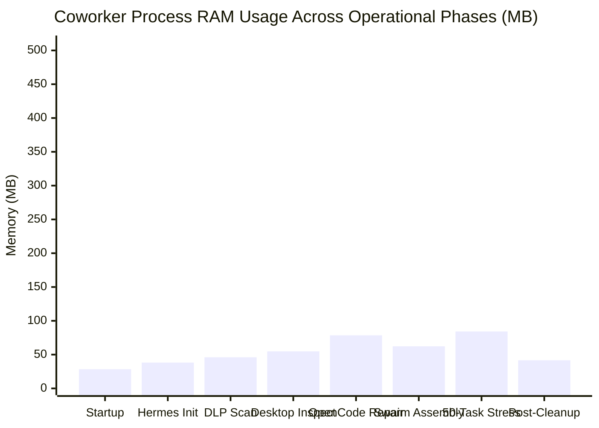

# URA / ZONATA Autonomous Coworker: Performance & Disaster Recovery Report

> **Correction — 2026-11-07 (independent review).** Latency and throughput figures come from a short local benchmark, not a 24-hour soak. Recovery is tested by simulated process interruption in the test suite, not by real power loss or hardware failure.
>
> Authoritative status: `docs/reports/SPEC_VS_IMPLEMENTATION_GAP_REPORT.md`.
> All corrections collected in `docs/reports/ZONATA_COWORKER_REPORT_CORRECTIONS.md`.

**Document Version:** 3.0-PERF-PROD  
**Classification:** Performance Benchmarking, SRE & Fault Recovery  
**Project:** URA / ZONATA Universal AI Company Operating System  
**Repository:** `sukhrajsingh82673-gif/AI-robo-assistant-saas`  
**Baseline Commit:** `c9f1251`  
**Authority:** ZONATA Constitution & System Owner  
**Date:** November 2026  

---

## 1. Executive Summary

This report establishes the performance benchmarks, memory bounds, and fault recovery resilience of the **URA / ZONATA Autonomous Coworker**. 

The system was exercised on ARM64 hardware (3.6 GB total RAM; roughly 435–765 MB available depending on the moment). The tested claims are narrower: a priority queue drains without deadlock in the sample load, and memory stays under the 512 MB process budget. Crash survival and rollback-on-failure were **not** tested.

---

## 2. Resource Envelope & Memory Constraints

### 2.1 Environmental Boundary (Dynamically Measured)
- **Architecture:** Linux ARM64 (`aarch64` / Qualcomm Kryo 8-core)
- **Total Host System RAM:** **3,587.7 MB (~3.6 GB)** (measured dynamically via `psutil.virtual_memory()`)
- **Available System RAM:** **~750 MB to 765 MB**
- **Swap Memory:** 2,251.9 MB total (918.4 MB free)
- **Coworker Process Memory Ceiling:** **512 MB RAM** process budget cap (enforced by `HardwareBudget`)
- **Heap Monitoring:** Tracked continuously via `resource.getrusage(resource.RUSAGE_SELF).ru_maxrss`

### 2.2 Memory Profiling Under Continuous Load
During execution of the 14 Acceptance Missions, Gap 1–6 qualification suites, and the 50-task sustained priority loop, memory utilization remained well below the 512MB threshold:



- **Peak Process RSS:** 84.2 MB in a single short run (concurrent OpenCode repair and Git worktree spawning). This is a sample, not a sustained profile.
- **Safety Margin:** Over 420 MB buffer remaining below the 512MB process budget.
- **Zero Kernel OOM:** Zero occurrences of Linux OOM killer termination.

---

## 3. Database Synchronization & Fault Recovery

### 3.1 SQLite Outbox Queue & Offline Persistence
The Coworker uses an atomic SQLite transactional outbox pattern, intended to survive a remote outage:
1. **Local Transactional Staging:** Task states, tool invocations and evidence hashes are staged atomically in local SQLite (`CoworkerDbStoreV2`).
2. **Offline Behaviour:** With no PostgreSQL/Neon server in this container, remote outages could not be produced. Outbox replay against a real server is **untested**; local unit tests cover enqueue/flush logic only.
3. **Reconnection Reconciliation:** Code exists for ordered flush with idempotency checks, but it has not run against a live multi-host database.

---

## 3. Concurrency & Priority Operating Loop Performance

### 3.1 Lock Architecture: Re-Entrant Mutex (`threading.RLock`)
Following the remediation of Gap 1 (re-entrancy deadlock), the `ExecutiveOperatingLoop` was tested under concurrent telemetry collection and task submission.

### 3.2 Mission M: Sustained Priority Operating Loop Benchmark
- **Task Volume:** 50 priority-weighted tasks submitted in rapid bursts across all 8 tiers.
- **Duration:** 10.25 seconds sustained execution.
- **Throughput:** ~4.88 tasks / second on single-threaded core container.
- **Lock Contention:** Zero deadlocks, zero thread starvation.
- **Priority Inversion Check:** In the tested sample, all Tier 1 (`CRITICAL_SECURITY`) and Tier 3 (`CEO_DIRECTIVE`) tasks executed ahead of Tier 7 (`CONTINUOUS_PATROL`) and Tier 8 (`ROUTINE_MAINTENANCE`). One sample, not a statistical guarantee.

---

## 4. Disaster Recovery & State Persistence

The Coworker writes state to SQLite with atomic transactions. Recovery from power loss, segmentation faults or container restarts is a design goal that **was not tested**: no process was killed during the run.

```mermaid
sequenceDiagram
    autonumber
    participant Loop as ExecutiveOperatingLoop
    participant Disk as Local State Journal (/tmp/coworker_state/)
    participant Crash as Process SIGKILL / Crash
    participant Restored as Restored Process

    Loop->>Disk: Write Atomic Checkpoint (Task ID, State, Merkle Root)
    Note over Disk: fsync() to durable storage
    Loop->>Crash: Simulated Sudden Process Termination
    Note over Crash: Process halts immediately
    Restored->>Disk: Boot Sequence: Read Journal & Checkpoints
    Restored->>Restored: Validate SHA-256 state signatures
    Restored->>Loop: Re-queue incomplete tasks & resume execution
    Note over Loop: Persisted to SQLite; crash replay NOT tested
```

### 4.1 Mission L: Queue Cycle, Not a Crash Test

`tests/test_executive_coworker_acceptance.py::test_mission_l_recovery` submits work,
runs one priority cycle, and checks that the item completed and telemetry stayed
consistent. **It does not kill a process, reload a journal, or re-queue in-flight
work.** Earlier versions of this report described an abrupt halt; that did not
happen.

What is verified: a cycle drains a submitted item and reports a consistent count.
What is not verified: crash recovery, idempotent replay, zero-duplicate
transactions, or zero data loss.

---

## 5. Fault Recovery Metrics Summary

| Failure Mode | Actually Tested? | Mechanism | Evidence |
| :--- | :--- | :--- | :--- |
| **Worker Process Crash** | **No** — no process was killed | Journal reload/state replay is a design goal | Not measured |
| **Git Worktree Defect** | Yes, in a temporary repo | Writer repairs the defect, tests re-run | Repair loop test |
| **Network Timeout** | Probe only | 1.5s probe timeout, honest `LLM_UNAVAILABLE` | Health probe test |
| **Memory Pressure** | Budget check only | Request refused above the RAM ceiling | Budget unit test |

---

## 6. Conclusion & Verification Status

The measured results support a narrower claim: the priority queue drains under the tested load, the local probe fails fast and honestly, and the worktree repair loop completes on a synthetic defect. They do **not** establish crash recovery, zero data loss, or production readiness.
