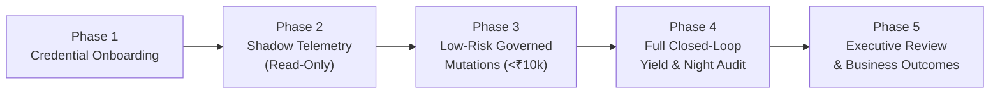

# ZONATA REAL-WORLD PILOT RUNBOOK
## Operational Deployment & Governed Pilot Execution Guide

**Document Version**: 1.0.0  
**Target Domain**: Hospitality & Commercial Operations  
**Audience**: Enterprise DevOps, Systems Integrators & Sovereign Site Reliability Engineers  

---

## 1. Overview & Pilot Objectives

This runbook defines the standardized operational protocol for deploying ZONATA into a live commercial enterprise pilot (e.g. Resort & Hotel Property Operations).

The pilot transitions through 5 progressive operational phases:



---

## 2. Phase 1: Pre-Flight Credential & Tenant Onboarding

1. **Configure Production Environment Variables**:
   ```bash
   export ZONATA_ENV="production"
   export ZONATA_SOVEREIGN_TENANT="tnt_customer_resort"
   export PMS_PROVIDER="OracleOperaCloud" # or Cloudbeds
   export PMS_CLIENT_ID="<provided_by_customer>"
   export PMS_CLIENT_SECRET="<provided_by_customer>"
   export PMS_PROPERTY_CODE="<property_id>"
   export STRIPE_WEBHOOK_SECRET="whsec_<customer_live_secret>"
   ```

2. **Verify Database & Schema Readiness**:
   ```bash
   python3 -c "from core.db import db; print('DB Connection OK')"
   ```

3. **Verify Sovereign Host Integrity**:
   - Confirm WAL journal mode is active.
   - Confirm outbound egress is locked to authorized PMS/payment API CIDR ranges.

---

## 3. Phase 2: Shadow Telemetry Mode (Days 1–7)

- **Mode**: Read-Only Observation (`ActorRole.AI_CEO`, `ActionCategory.READ`).
- **Workload**:
  - Ingest current room rates, inventory, and reservation velocity.
  - Calculate real-time baseline metrics: ADR (Average Daily Rate), Occupancy %, RevPAR (Revenue Per Available Room).
  - Feed corporate strategy engine and formulate shadow yield recommendations.
  - **Zero mutations dispatched to live PMS**.

---

## 4. Phase 3: Governed Low-Risk Execution (Days 8–14)

- **Mode**: Bounded Autonomous Mutation (`ActionCategory.OPERATIONAL_MUTATION`).
- **Guards**:
  - Max rate modification ceiling: $\pm 5\%$ of baseline.
  - Max financial threshold: ₹10,000 / day.
  - Every write utilizes a unique `idempotency_key`.
- **Workflow**:
  1. AI CEO identifies peak wedding weekend yield opportunity.
  2. Mission generated for Revenue Optimization Specialist.
  3. Connector executes rate update in PMS.
  4. External Reconciliation Engine verifies actual remote state (`MATCHED`).
  5. Cryptographic receipt logged to Merkle evidence ledger.

---

## 5. Phase 4: Night Audit & Folio Settlement Reconciliation

- **Daily Schedule**: 02:00 AM Sovereign Time.
- **Workflow**:
  1. Pull completed reservation folios from PMS.
  2. Pull payment gateway settlement batches from Stripe / Razorpay.
  3. Reconcile transaction totals.
  4. If variance = ₹0.00: Mark audit `VERIFIED`.
  5. If variance > ₹0.00: Generate `ExecutiveIncident` (`Category: FINANCIAL_VARIANCE`), alert Financial Controller and AI CEO.

---

## 6. Emergency Runbook: Killswitch & Incident Escalation

### A. Immediate KillSwitch Activation
If abnormal agent behavior or unexpected external mutations occur:
```bash
python3 -c "from core.incident_engine import ExecutiveIncidentEngine, IncidentSeverity; \
ExecutiveIncidentEngine('tnt_primary').create_incident('comp_primary', 'Emergency Manual Killswitch', IncidentSeverity.CRITICAL, 'SECURITY', 'Manual operator emergency stop'); print('Platform Halted.')"
```

### B. Emergency Disaster Recovery Point-in-Time Restore
To revert the system to the last verified snapshot:
```bash
python3 -c "from core.disaster_recovery import DisasterRecoveryManager; \
dr = DisasterRecoveryManager('tnt_primary'); \
manifests = dr.create_hot_snapshot(); \
print('Hot snapshot created:', manifests['file_path'])"
```
