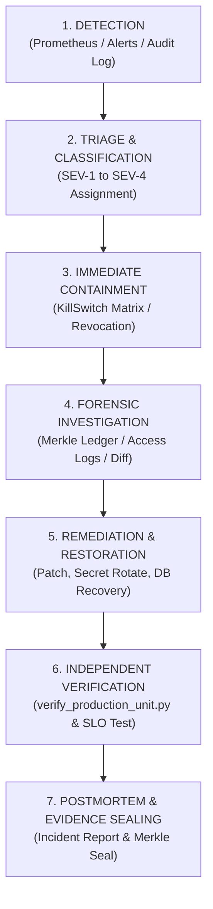

# ZONATA V10 INCIDENT RESPONSE RUNBOOK
## Enterprise Production Incident Management, Containment & Forensic Recovery

**Document Version**: 1.0.0  
**Target Audience**: Security Operations Center (SOC), Platform SREs, Incident Commanders & Executive Governance  
**Classification**: CRITICAL OPERATIONAL PROCEDURES  
**Effective Date**: October 2026  

---

## 1. Incident Management Overview & Invariants

ZONATA operates under a strict sovereign security and governance regime. In any production incident involving automated AI operations, the following hard invariants supersede all operational convenience:

1. **Safety Over Liveness**: If an autonomous system misbehaves, it must be contained or halted immediately via the multi-level KillSwitch. Liveness is always secondary to tenant isolation, sovereign security, and transactional integrity.
2. **AI CEO Subordination**: The AI CEO possesses zero authority to override, suppress, acknowledge, or mitigate security or operational incidents. Incident response is governed strictly by Human Incident Commanders and deterministic SRE runbooks.
3. **Cryptographic Tamper-Evidence**: No log, evidence record, or Merkle block may be deleted, truncated, or overwritten during incident mitigation. All recovery operations must record corrective blocks to the evidence ledger.

---

## 2. Incident Classification & Severity Matrix

| Severity | Definition | Target MTTA | Target MTTC (Containment) | Target MTTR | Escalation Path |
| :--- | :--- | :--- | :--- | :--- | :--- |
| **SEV-1 (Critical)** | Cross-tenant data breach, sovereign key leakage, unauthorized external real-world mutation, Merkle chain corruption, or uncontained runaway AI loop. | < 5 mins | < 10 mins (Auto or Manual KillSwitch) | < 2 hours | Executive SRE Lead, Sovereign Key Custodian, Human Owner |
| **SEV-2 (High)** | Worker crash loop, outbox congestion (>100 pending), budget exhaustion breach, database WAL latency >500ms, or model provider 100% outage. | < 15 mins | < 30 mins | < 4 hours | Senior Platform Engineer, SRE On-Call |
| **SEV-3 (Medium)** | Single-tenant prompt injection containment, transient API rate limit (>5%), non-critical tool failure, single-mission reconciliation drift. | < 1 hour | < 2 hours | < 8 hours | On-Call Engineer, Domain Specialist |
| **SEV-4 (Low)** | Metric reporting jitter, cosmetic dashboard discrepancy, non-fatal cache misses. | < 4 hours | N/A | Next Sprint | Platform Team |

---

## 3. Incident Lifecycle Workflow



---

## 4. Specific Incident Response Procedures

### IRP-01: Cross-Tenant Isolation Breach or Data Leakage Attempt
- **Trigger**: `AIFirewallRejectedException` with violation type `CROSS_TENANT_LEAK` or Prometheus alert `SecurityAlertCrossTenantViolation`.
- **Preconditions**: Security alert logged with source tenant, destination payload, and actor ID.
- **Immediate Containment (Step 1)**:
  Engage tenant-level KillSwitch to quarantine the offending tenant:
  ```bash
  python3 -c "from core.killswitch_matrix import KillSwitchMatrix, KillSwitchLevel; \
  ks = KillSwitchMatrix('tnt_compromised'); \
  ks.activate(KillSwitchLevel.TENANT, 'tnt_compromised', 'Quarantine: Suspected cross-tenant leak'); \
  print('Tenant quarantined.')"
  ```
- **Forensic Investigation (Step 2)**:
  Examine the AI Data Firewall audit log and Merkle ledger:
  ```bash
  sqlite3 storage/roboassistant.db "SELECT timestamp, tenant_id, source_tenant, risk_score, violation_details \
  FROM ai_firewall_audit_log WHERE decision = 'REJECTED' ORDER BY timestamp DESC LIMIT 20;"
  ```
- **Remediation (Step 3)**:
  Revoke all active approval envelopes and active tokens for the tenant:
  ```bash
  python3 -c "from core.approval_revocation import ApprovalRevocationEngine; \
  eng = ApprovalRevocationEngine('tnt_compromised'); \
  count = eng.revoke_tenant_approvals('tnt_compromised', 'Security quarantine'); \
  print(f'Revoked {count} approvals.')"
  ```
- **Post-Incident Verification (Step 4)**:
  Run independent verification to ensure tenant boundary enforcement:
  ```bash
  python3 independent_verification/verify_production_unit.py
  ```

---

### IRP-02: Secret Vault Compromise or Credential Leakage
- **Trigger**: Secret leakage detected by `SecretVault.scan_text_for_leaks()` or unauthorized `secret://` URI dereference.
- **Immediate Containment (Step 1)**:
  Immediately revoke the leaked credential at the external provider and deactivate the secret record:
  ```bash
  python3 -c "from core.secret_vault import SecretVault; \
  vault = SecretVault('tnt_primary'); \
  vault.rotate_secret('secret://tnt_primary/sec_leaked_key', 'REVOKED_DEACTIVATED_EMERGENCY'); \
  print('Secret revoked.')"
  ```
- **Forensic Trace (Step 2)**:
  Audit secret access logs to identify every actor that dereferenced the secret in the past 48 hours:
  ```bash
  sqlite3 storage/roboassistant.db "SELECT timestamp, actor_id, secret_uri, purpose \
  FROM secret_access_logs WHERE secret_uri LIKE '%sec_leaked_key%' ORDER BY timestamp DESC;"
  ```
- **Remediation (Step 3)**:
  Provision replacement key with least-privilege scoping, update secret vault, and invalidate prior execution caches.

---

### IRP-03: Autonomous Runaway Execution or Outbox Replay Storm
- **Trigger**: Spend rate > $10.00/min, outbox queue length > 150 items, or Prometheus alert `SpendCeilingExceededWarning`.
- **Immediate Containment (Step 1)**:
  Activate Execution-Level and Tool-Level KillSwitches:
  ```bash
  python3 -c "from core.killswitch_matrix import KillSwitchMatrix, KillSwitchLevel; \
  ks = KillSwitchMatrix('tnt_primary'); \
  ks.activate(KillSwitchLevel.EXECUTION, 'outbox_worker', 'Halt outbox dispatch'); \
  ks.activate(KillSwitchLevel.TOOL, 'all_external_tools', 'Emergency tool blackout'); \
  print('Execution halted.')"
  ```
- **Triage (Step 2)**:
  Inspect pending outbox envelopes and worker states:
  ```bash
  sqlite3 storage/roboassistant.db "SELECT id, mission_id, tool_name, status, attempts \
  FROM transactional_outbox WHERE status = 'PENDING' ORDER BY created_at DESC LIMIT 30;"
  ```
- **Remediation (Step 3)**:
  Drain duplicate pending outbox actions:
  ```bash
  sqlite3 storage/roboassistant.db "UPDATE transactional_outbox SET status = 'CANCELLED', \
  error_message = 'Cancelled by SRE Incident Commander - runaway containment' \
  WHERE status = 'PENDING' AND attempts > 2;"
  ```
- **Recovery (Step 4)**:
  Deactivate the killswitch once the root cause loop in the agent mission is patched.

---

### IRP-04: External Mutation Ambiguity (UNKNOWN Outcome State)
- **Trigger**: Outbox worker timeout after dispatching a real-world mutation, leaving the action in `UNKNOWN` state.
- **Immediate Containment (Step 1)**:
  Lock the specific reconciliation record to prevent blind replay:
  ```bash
  python3 -c "from core.reconciliation_engine import ReconciliationEngine; \
  rec = ReconciliationEngine('storage/roboassistant.db'); \
  status = rec.get_status('tx_unconfirmed_action_id'); \
  print('Action state:', status)"
  ```
- **Deterministic Reconciliation (Step 2)**:
  Execute out-of-band verification against the external provider using idempotent lookup keys:
  - If external mutation DID occur: Call `rec.record_success(tx_id, external_receipt_id, provider_state)`.
  - If external mutation DID NOT occur: Call `rec.record_failure(tx_id, 'Verified absent on external system')`.
  - Under NO circumstances replay without deterministic verification.

---

### IRP-05: Merkle Ledger Integrity Violation
- **Trigger**: `verify_production_unit.py` reports Merkle block hash mismatch or broken chain pointer.
- **Immediate Containment (Step 1)**:
  Engage Global Read-Only Mode. Halt all new ledger writes.
- **Investigation (Step 2)**:
  Run forensic ledger chain diagnostic:
  ```bash
  python3 -c "from core.evidence_ledger import EvidenceLedger; \
  ledger = EvidenceLedger('tnt_primary', 'storage/roboassistant.db'); \
  status = ledger.verify_chain_integrity(); \
  print('Chain verification:', status)"
  ```
- **Remediation (Step 3)**:
  If disk corruption occurred, recover the ledger from the latest verified snapshot (`storage/backups/ledger_snapshot_*.db`) and replay write-ahead journal records signed by the Sovereign Key Manager.

---

## 5. Postmortem & Evidence Archival Standard

Every SEV-1 and SEV-2 incident requires a completed Blameless Postmortem document within 48 hours containing:
1. **Executive Summary & Impact**: Time detected, time contained, time resolved, tenants affected, financial cost.
2. **SLO Impact Analysis**: Total downtime or latency degradation against target 99.9% SLO.
3. **Root Cause Analysis (5 Whys)**: Deep structural cause identified without superficial blame.
4. **Corrective Action Items**: P0/P1 engineering tickets assigned with clear owners and due dates.
5. **Ledger Evidence Snapshot**: Hash of the postmortem document appended to the Merkle Evidence Ledger.
