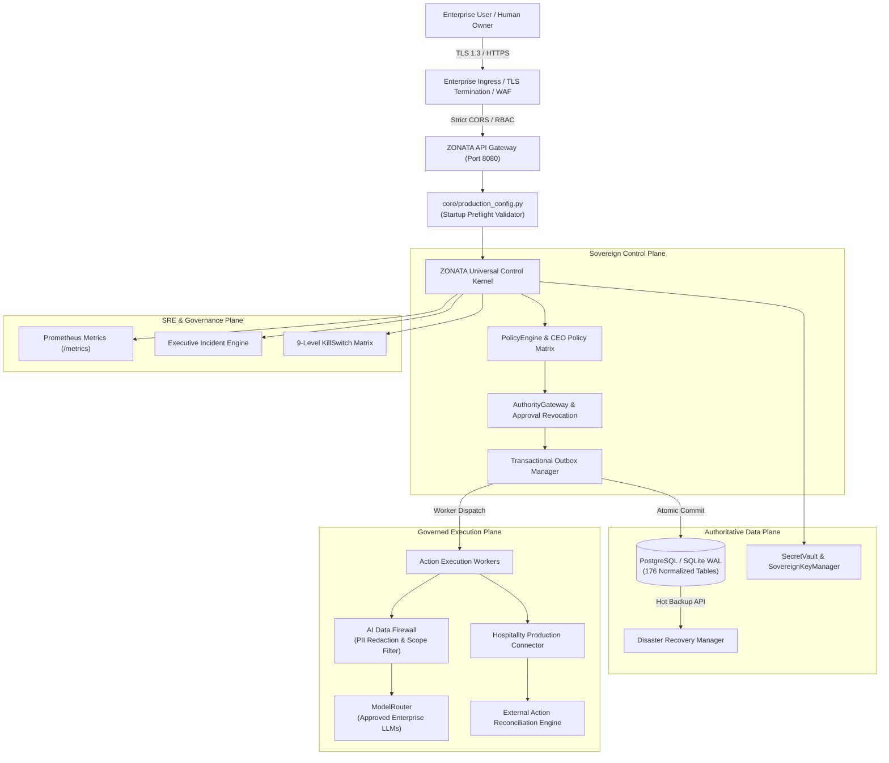

# ZONATA V10 PRODUCTION DEPLOYMENT REPORT
## Enterprise Deployment Topology, Preflight Validation & Operational Topology

**Document Version**: 1.0.0  
**Target Environment**: Enterprise Production Operating Unit  
**Classification**: INFRASTRUCTURE & ARCHITECTURE SPECIFICATION  

---

## 1. Enterprise Deployment Topology

---

## 2. Startup Preflight & Fail-Closed Validation

The startup preflight validator (`core/production_config.py`) enforces strict gates prior to accepting HTTP ingress:

1. **DEBUG Mode Rejection**: If `ZONATA_ENV == "production"`, `DEBUG=true` halts process startup.
2. **Weak Secret Rejection**: `SECRET_VAULT_KEY` and `APPLICATION_SIGNING_KEY` must be at least 32 characters and cannot match known defaults (`changeme`, `admin`, `password`).
3. **Sovereign Root Key Requirement**: `SOVEREIGN_ROOT_KEY_ID` must be configured.
4. **Ingress CORS Restriction**: Wildcard `*` in `ALLOWED_ORIGINS` is rejected in production.
5. **Database Connectivity & Table Verification**: Actively executes ping and table discovery.

---

## 3. Deployment Artifacts
- **Configuration Schema**: [`production_config_schema.json`](file:///root/roboassistant/production_config_schema.json)
- **Environment Template**: [`production.env.example`](file:///root/roboassistant/production.env.example)
- **Preflight Engine**: [`core/production_config.py`](file:///root/roboassistant/core/production_config.py)
