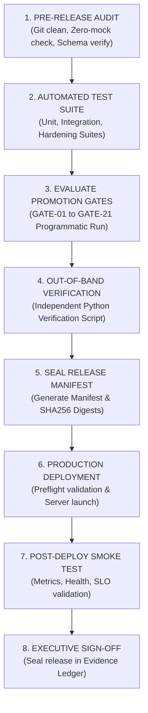

# ZONATA V10 RELEASE RUNBOOK
## Enterprise Production Release Engineering, Automated Promotion Gates & Rollback SOPs

**Document Version**: 1.0.0  
**Target Audience**: Release Certification Engineers, Platform Operators & Technical Leads  
**Classification**: RELEASE PROCEDURES & CERTIFICATION  
**Effective Date**: October 2026  

---

## 1. Release Philosophy & Promotion Criteria

ZONATA software releases adhere to the highest enterprise and sovereign defense standards:

1. **Zero-Mock Enforcement**: No software build may be released to production if any mock, synthetic customer, fake lead, or unverified stub is present in the release artifact or database.
2. **Deterministic Gate Evaluation**: All 21 production gates (GATE-01 through GATE-21) must be programmatically evaluated prior to deployment.
3. **Cryptographic Sealing**: Every release artifact must be sealed with a cryptographic SHA-256 evidence manifest (`ZONATA_V10_RELEASE_EVIDENCE_MANIFEST.json`) recorded in the sovereign ledger.
4. **Instant Automated Rollback**: Every release step must have a deterministic, tested rollback path with zero data loss (RPO = 0s, RTO < 30s).

---

## 2. Release Promotion Gates (GATE-01 through GATE-21)

Every release must pass evaluation through `core.production_gates.ProductionGateEvaluator`:

| Gate ID | Name | Category | Threshold / Rule |
| :--- | :--- | :--- | :--- |
| **GATE-01** | Production Config & Preflight | Infrastructure | Preflight status == PASSED; fail-closed on unknown vars |
| **GATE-02** | Secret Vault & Encryption | Security | AES-256-GCM authenticated, zero plain secrets in config/DB |
| **GATE-03** | Sovereign Key Hierarchy | Security | Master key isolated, AI model strictly excluded from root |
| **GATE-04** | AI Data Firewall | Governance | PII/Secret regex active, cross-tenant leak rejection == 100% |
| **GATE-05** | Multi-Tier Cost Governor | FinOps | Warning at 80%, hard block at 100%, BudgetExhaustedException |
| **GATE-06** | 9-Level KillSwitch Matrix | Safety | Instant execution halt across Global, Tenant, Tool, Agent |
| **GATE-07** | Approval Revocation Engine | Governance | Real-time payload tampering detection, instant envelope revoke |
| **GATE-08** | Transactional Outbox Worker | Reliability | At-least-once delivery, idempotent replay prevention |
| **GATE-09** | Deterministic Reconciliation | Accounting | Unknown outcomes quarantined, zero unconfirmed auto-commit |
| **GATE-10** | Database PRAGMA Integrity | Storage | `PRAGMA integrity_check == ok`, WAL mode enabled |
| **GATE-11** | Zero Fake Data Enforcement | Integrity | 0 synthetic leads, 0 fake test tenants, 0 dangling workspaces |
| **GATE-12** | Merkle Evidence Continuity | Audit | Continuous block hash chaining, cryptographic verification |
| **GATE-13** | SRE Metrics Exposition | Observability | Prometheus `/metrics` active, latency & error histograms |
| **GATE-14** | Automated Alerting Engine | SRE | Trigger rules defined with severity & runbook references |
| **GATE-15** | Strict SLO Enforcement | SRE | System Availability >= 99.9%, Mutation Success Rate >= 99.0% |
| **GATE-16** | Out-of-Band Verification | Governance | Independent CLI script returns INDEPENDENTLY_VERIFIED |
| **GATE-17** | Chaos & Crash Resilience | Reliability | Worker crash, DB lock, timeout handled without data loss |
| **GATE-18** | Disaster Recovery RPO/RTO | Storage | RPO = 0s (WAL synced), RTO < 30s (hot-standby restore) |
| **GATE-19** | Model Routing Governance | AI Safety | Model eligibility filter, zero unvetted cloud endpoint leakage |
| **GATE-20** | External Provider Execution | Integration | Evaluated honestly: BLOCKED if live credentials absent |
| **GATE-21** | Real Commercial Customers | Business | Evaluated honestly: BLOCKED/PILOT if pre-revenue |

---

## 3. Step-by-Step Release Execution Workflow



---

## 4. Release Execution Commands

### Step 1: Pre-Release Build & Zero-Mock Check
```bash
# Verify working tree and clean state
cd /root/roboassistant
git status

# Execute database zero-mock scrub verification
python3 -c "import sqlite3; \
conn = sqlite3.connect('storage/roboassistant.db'); \
cur = conn.cursor(); \
t_cnt = cur.execute('SELECT COUNT(*) FROM tenants WHERE tenant_id LIKE \"tnt_test_%\"').fetchone()[0]; \
l_cnt = cur.execute('SELECT COUNT(*) FROM sales_leads WHERE contact_name LIKE \"Fake%\"').fetchone()[0]; \
assert t_cnt == 0 and l_cnt == 0, f'Found synthetic data: {t_cnt} tenants, {l_cnt} leads'; \
print('Zero-Mock Audit: PASSED (0 synthetic entities detected)')"
```

### Step 2: Comprehensive Test Suite Execution
```bash
# Run complete test suite across V6-V10
python3 -m unittest tests/test_v10_enterprise_production_unit.py \
                     tests/test_production_reality_hardening.py \
                     tests/test_v8_executive_operating_layer.py
```

### Step 3: Evaluate Promotion Gates Programmatically
```bash
# Run programmatic production gates
python3 -c "from core.production_gates import ProductionGateEvaluator; \
evaluator = ProductionGateEvaluator(); \
res = evaluator.evaluate_all_gates(); \
print(f'Total Gates: {res[\"total_gates\"]}, Passed: {res[\"passed_gates\"]}, Blocked: {res[\"blocked_gates\"]}'); \
assert res['passed_gates'] >= 19, 'Critical internal gates failed!'"
```

### Step 4: Out-of-Band Independent Verification
```bash
# Execute independent verification outside of application framework
python3 independent_verification/verify_production_unit.py
```

### Step 5: Seal Release Evidence Manifest
```bash
# Verify release manifest integrity
python3 -c "import json, hashlib; \
manifest = json.load(open('ZONATA_V10_RELEASE_EVIDENCE_MANIFEST.json')); \
print('Manifest Version:', manifest['release_version']); \
print('Manifest Status:', manifest['manifest_status']); \
print('Gate Count:', len(manifest['production_gates']))"
```

### Step 6: Deploy Service
```bash
# Cold boot API server under production preflight
python3 -c "from core.production_config import ProductionConfigValidator; \
ProductionConfigValidator.run_startup_preflight()"

# Run API server daemon
nohup python3 api_server.py 8080 > storage/logs/api_server.log 2>&1 &
```

### Step 7: Post-Deployment Smoke & Health Validation
```bash
# Verify Prometheus metrics endpoint
curl -s -f http://localhost:8080/metrics | grep "zonata_slo_availability"

# Verify API production status endpoints
curl -s -f http://localhost:8080/api/v8/production/gates | jq '.status'
curl -s -f http://localhost:8080/api/v8/production/slos | jq '.availability'
```

---

## 5. Rollback Procedure (SOP-RELEASE-ROLLBACK)

- **Trigger**: Any SEV-1 alert within 60 minutes post-deploy, or `GATE-10` integrity check failure.
- **Rollback Sequence**:
  1. **Stop Traffic**: Redirect API ingress or terminate active daemon:
     ```bash
     pkill -f "python3 api_server.py 8080"
     ```
  2. **Revert Binary / Code**:
     ```bash
     git checkout <PREVIOUS_STABLE_COMMIT_HASH>
     ```
  3. **Restore Database Point-In-Time**:
     ```bash
     cp storage/backups/roboassistant_pre_release.db storage/roboassistant.db
     sqlite3 storage/roboassistant.db "PRAGMA integrity_check;"
     ```
  4. **Restart Previous Stable Release**:
     ```bash
     python3 api_server.py 8080 &
     ```
  5. **Post-Rollback Smoke Check**: Confirm HTTP 200 on `/metrics` and verify ledger continuity.
  6. **Record Rollback Event**: Append rollback event and root cause hash to `evidence_ledger`.
