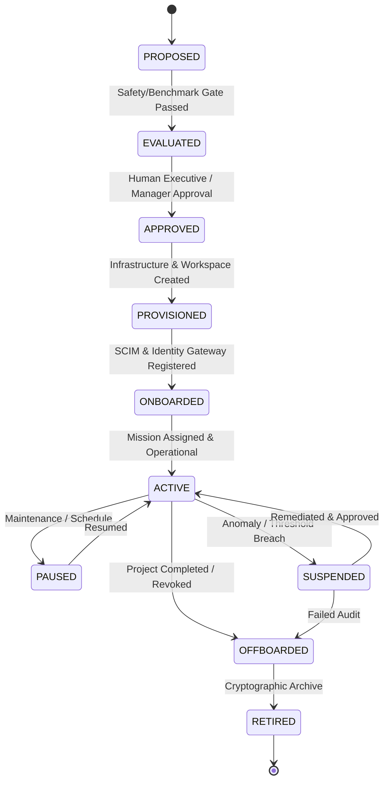

# ZONATA V4 — AI EMPLOYEE OPERATING SYSTEM
**Lifecycle State Machine, Role Tiers, Capability Bindings, & Delegation Invariants**

## 1. The 10-Stage Lifecycle State Machine
AI Employees in ZONATA are not informal agent loops. They are corporate digital workers governed by a formal 10-stage lifecycle state machine (`core/ai_employee_os.py`):

### Lifecycle Invariants
- `PROPOSED`: AI Employee exists only as a proposed configuration; has ZERO operational authority.
- `EVALUATED`: Passed behavioral red-teaming, prompt-injection defense, and capability verification.
- `APPROVED`: Explicit sign-off by an authorized human manager or policy engine rule.
- `PROVISIONED`: Sandboxed workspace and resource limits created.
- `ONBOARDED`: Cryptographic identity registered with Identity Gateway.
- `ACTIVE`: Fully operational within assigned authority and budget constraints.
- `PAUSED`: Execution suspended; active tokens held in abeyance.
- `SUSPENDED`: Triggered by spend anomaly, DLP breach, or human intervention. Killswitch tripped.
- `OFFBOARDED`: Identity revoked, all active tokens invalidated, all child workers terminated.
- `RETIRED`: Terminal state; immutable audit package archived. Cannot be reactivated.

---

## 2. Mathematical Delegation Containment
When an active AI Employee spawns a child worker (`core/workforce_manager_v4.py`), the following invariants are strictly enforced:
- **Authority Containment**: `CHILD_AUTHORITY ⊆ PARENT_AUTHORITY` (Child risk class cannot exceed parent).
- **Tool Scope Containment**: `CHILD_TOOL_SCOPE ⊆ PARENT_TOOL_SCOPE` (Child cannot execute tools unavailable to parent).
- **Data Scope Containment**: `CHILD_DATA_SCOPE ⊆ PARENT_DATA_SCOPE` (Child cannot access data domains unavailable to parent).
- **Budget Containment**: `DELEGATED_BUDGET <= PARENT_REMAINING_BUDGET` (Delegated funds are immediately deducted from parent's budget).
