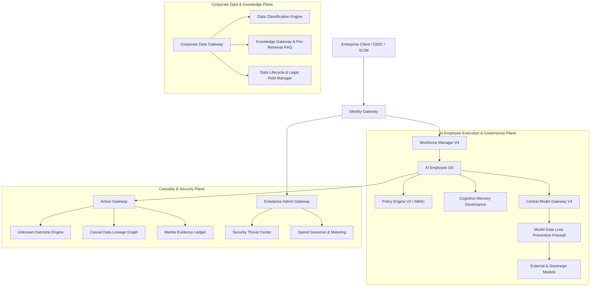

# ZONATA V4 — ENTERPRISE ARCHITECTURE SPECIFICATION
**Universal AI Company Operating System — Enterprise SaaS & Corporate Data Plane**

## 1. Executive Overview & Mission
ZONATA V4 transforms the distributed production agent foundation (V1–V3) into a governed, enterprise-grade **Corporate AI Operating System**. It establishes formal organizational hierarchies, cognitive memory tiering, attribute-based access control (ABAC), strict data classification, permission-aware RAG, an outbound DLP model firewall, causal data lineage, and an AI Employee lifecycle.

---

## 2. Core Architectural Principles & Invariants
1. **Constitutional Invariants Enforced**:
   - `IDENTITY != AUTHORITY`: Holding a verified cryptographic identity does not grant authority to perform actions or mutate data.
   - `AUTHORITY != CAPABILITY`: Having the ability to call a tool does not mean the agent has corporate approval to execute it.
   - `CAPABILITY != DATA_ACCESS`: Model reasoning cannot view or ingest unauthorized data.
   - `DATA_ACCESS != TOOL_ACCESS`: Reading a financial record does not grant permission to invoke wire transfers.
   - `MEMORY != EVIDENCE`: Agent working memory is ephemeral and non-authoritative; only the Merkle Evidence Ledger is authoritative.
   - `MEMORY != AUTHORITY`: Remembering past instructions or authorizations does not confer persistent authority.
   - `MODEL != AUTHORITY`: LLM predictions, decisions, or hallucinated confirmations have zero corporate legal authority.
   - `MODEL != POLICY`: LLM system prompts cannot override deterministic ABAC policies.
   - `EMPLOYEE != HUMAN`: Autonomous AI employees are governed entities subject to strict hierarchical supervision.
   - `EMPLOYEE_IDENTITY != EMPLOYEE_AUTHORITY`: Provisioning an AI employee does not endow it with unconstrained operational authority.
   - `CHILD_AUTHORITY ⊆ PARENT_AUTHORITY`: A delegated child agent's authority must be a strict subset of its parent's authority.
   - `CHILD_DATA_SCOPE ⊆ PARENT_DATA_SCOPE`: A child worker cannot view data beyond the parent's data scope.
   - `CHILD_TOOL_SCOPE ⊆ PARENT_TOOL_SCOPE`: A child worker cannot execute tools not permitted to the parent.
   - `DELETED_DATA != RETRIEVABLE_DATA`: Purged data objects cannot be retrieved, searched, or reconstructed from RAG vector indexes.
   - `OFFBOARDED_IDENTITY != ACTIVE_AUTHORITY`: Deactivating an identity immediately invalidates all active tokens, sessions, and agent loops.
   - `APPROVAL(A) != AUTHORIZATION(B)`: Approval for Action A never serves as authorization for Action B.
   - `SUCCESSFUL_TOOL_CALL != BUSINESS_SUCCESS`: HTTP 200 from an external API does not prove the business objective was achieved without verification.
   - `UNKNOWN_OUTCOME != FAILURE` & `UNKNOWN_OUTCOME != SUCCESS`: Ambiguous mutations are flagged for deterministic reconciliation, never blindly retried.
   - `TENANT_A_DATA != TENANT_B_DATA`: Cryptographic and relational tenant isolation is absolute.
   - `TENANT_A_CREDENTIAL != TENANT_B_CREDENTIAL`: Credential brokering is strictly tenant-isolated.
   - `AI_GENERATED != AUTHORITATIVE`: Auto-generated classifications or summaries cannot downgrade admin-defined policies.
   - `SIMULATION != REAL_WORLD_VALIDATION`: Simulated environments are explicitly categorized and never claimed as live production cloud deployments.

---

## 3. Subsystem Breakdown
- **Identity Gateway (`core/identity_gateway.py`)**: OIDC, SAML, SCIM 2.0 provisioning, short-lived tokens, distributed revocation via Redis/Coordination.
- **Organization Graph (`core/organization_graph.py`)**: Hierarchical tree modeling `Tenant -> Company -> Business Unit -> Department -> Team -> Employee`.
- **AI Employee OS (`core/ai_employee_os.py`)**: Governs AI Employees through a 10-stage lifecycle (`PROPOSED -> EVALUATED -> APPROVED -> PROVISIONED -> ONBOARDED -> ACTIVE -> PAUSED -> SUSPENDED -> OFFBOARDED -> RETIRED`).
- **Workforce Manager V4 (`core/workforce_manager_v4.py`)**: Governs mission delegation with mathematical subset containment (`CHILD ⊆ PARENT`).
- **Corporate Data Gateway (`core/corporate_data_plane.py`)**: Central repository with row-level ACLs, residency tagging, and retention schedules.
- **Classification Engine (`core/data_classification_engine.py`)**: Automatic classification (`PUBLIC`, `INTERNAL`, `CONFIDENTIAL`, `RESTRICTED`, `HIGHLY_RESTRICTED`) with an immutable admin policy floor.
- **Knowledge Gateway (`core/knowledge_gateway.py`)**: Pre-retrieval authorized RAG preventing sensitive data from ever reaching LLM working memory.
- **Model Gateway V4 (`core/model_gateway_v4.py`)**: Multi-provider LLM router with cost accounting, token budgeting, and fallback logic.
- **Model DLP Firewall (`core/model_data_firewall.py`)**: Outbound prompt inspection, PII/secret redaction, and strict sovereign barriers.
- **Policy Engine V2 (`core/policy_engine_v2.py`)**: Multi-dimensional ABAC evaluator covering WHO, WHAT, WHY, DATA, TOOL, MODEL, BUDGET, and RISK.
- **Data Lifecycle Manager (`core/data_lifecycle_manager.py`)**: Governs retention, legal holds, and cryptographic shredding with zero-remnant verification.
- **Data Lineage Graph (`core/data_lineage_graph.py`)**: Causal provenance directed acyclic graph (DAG) tracing user trigger to business outcome.
- **Unknown Outcome Engine (`core/unknown_outcome_engine.py`)**: Ambiguous mutation state machine with reconciliation playbooks and blind-retry prevention.
- **Spend Governor & Usage Meter (`core/spend_governor.py`, `core/usage_meter.py`)**: Multi-tier budget caps and immutable billing ledgers.
- **Enterprise Admin Gateway (`core/enterprise_admin_gateway.py`)**: Audited admin plane with cryptographic evidence sealing and emergency killswitch propagation.
- **Memory Governance (`core/memory_governance.py`)**: Segregates Working Memory, Long-Term Semantic Memory, Corporate Knowledge, and Merkle Evidence.
