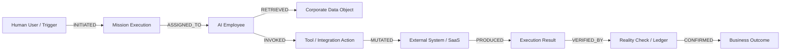

# ZONATA V4 — ENTERPRISE DATA LINEAGE & AI ACTION PROVENANCE
**Causal DAG, Upstream Backtracing, & Audit Trail Binding**

## 1. Causal Lineage Architecture
Every enterprise business outcome must be verifiable from its original trigger down to the physical execution. The Data Lineage Graph (`core/data_lineage_graph.py`) models causality as a Directed Acyclic Graph (DAG):

---

## 2. Invariants & Auditing
- **Constitutional Invariants**:
  - `NO_ORPHAN_ACTIONS`: An action cannot execute without linking to an active mission and authenticated identity.
  - `NO_ANONYMOUS_AI_MUTATIONS`: Every database mutation or SaaS API call must record its causal parents.
  - `EVERY_BUSINESS_OUTCOME_MUST_TRACE_TO_IDENTITY_AND_EVIDENCE`: Backtracing an outcome via `data_lineage_graph.get_provenance_trail()` yields the complete cryptographic chain of causality.
