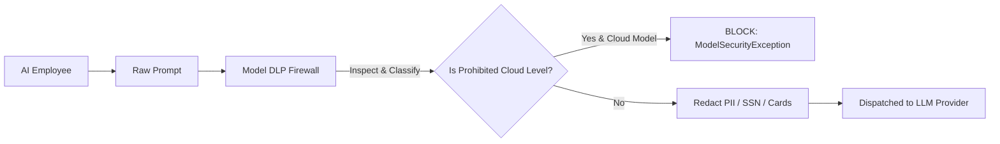

# ZONATA V4 — MODEL DATA LOSS PREVENTION (DLP) FIREWALL
**Outbound Prompt Sanitization, PII Redaction, & Sovereign Boundary Enforcement**

## 1. Outbound DLP Barrier
The Model Data Firewall (`core/model_data_firewall.py`) sits strictly between ZONATA AI Employees and LLM Providers. Before any prompt payload leaves the customer perimeter, it is subjected to deep lexical and structural inspection.

---

## 2. Prohibited Cloud Data & Sovereign Local Inference
- **Prohibited Levels**: Data classified as `HIGHLY_RESTRICTED` (RSA keys, tokens, certificate bundles) is strictly forbidden from external cloud providers (`ANTHROPIC`, `OPENAI`, `GOOGLE`).
- **Sovereign Local Routing**: Queries requiring `HIGHLY_RESTRICTED` context must route exclusively to sovereign, on-premise local models (`LOCAL_SOVEREIGN`). Attempting to send such data to cloud endpoints throws `ModelSecurityException`.
- **Automatic Redaction**: Customer SSNs, credit card numbers, and API tokens appearing in general operational prompts are automatically sanitized using tokens like `[REDACTED_SSN]` and `[REDACTED_CREDIT_CARD]`.
