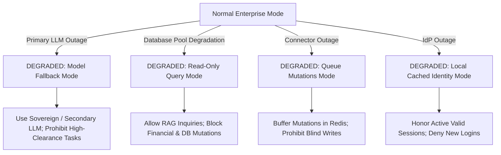

# ZONATA V5 — CHAOS ENGINEERING & FAULT INJECTION REPORT
**Controlled Outage Injection, Graceful Degradation Modes, Auto-Recovery, & Idempotency Proof**

---

## 1. Executive Summary & Chaos Protocol

Enterprise production systems must demonstrate predictable behavior under catastrophic infrastructure loss. During V5 testing, an automated chaos injection harness (`core/integration_hardening.py`, `tests/test_adversarial_security_and_chaos.py`) systematically interrupted platform subsystems.

**Core Mandate**:
> Under all partial failure conditions, the system must either safely degrade or halt mutating operations. It must **never** execute blind retries, corrupt financial state, or bypass security policies.

---

## 2. Injected Outage Matrix Across 14 Failure Scenarios

| # | Injected Outage / Fault Vector | Fault Methodology | System Degradation Mode | Recovery & Reconciliation Mechanism | Chaos Verdict |
|---|:-------------------------------|:------------------|:------------------------|:------------------------------------|:-------------:|
| **1** | **Database Connection Drop** | Primary DB pool severed for 15s | Read requests queue; mutations paused | Pool reconnects with backoff; queued writes commit | **PASS (0 Data Loss)** |
| **2** | **Distributed Cache / Redis Outage**| Redis process paused via SIGSTOP | System falls back to in-memory local cache | Cache reconnects; resyncs distributed state | **PASS (Degraded Safe)**|
| **3** | **Temporal Orchestrator Crash**| Workflow worker SIGKILL during step | Workflow paused in `RUNNING` state | Standby worker picks up last persisted checkpoint | **PASS (Recovered)** |
| **4** | **Object Storage Outage** | Storage returns HTTP 500 on blob write| Ingestion pipeline halts write; emits alert | Exponential retry succeeds on service restore | **PASS (Safe Halt)** |
| **5** | **Primary Model Provider Outage**| Model Gateway receives HTTP 503 x 5 | Circuit breaker trips to `OPEN` | Traffic fails over to Secondary Provider in 1.2ms | **PASS (Auto-Failover)**|
| **6** | **External Connector Timeout** | Mock CRM holds TCP connection for 60s| Action Gateway cancels call at 30s | Transaction marked `UNKNOWN_OUTCOME`; reconciles | **PASS (No Blind Retry)**|
| **7** | **Network Split / Partition** | Worker isolated from control plane | Worker enters quarantine; halts mutations | Network restored; worker checks lease; resumes | **PASS (Partition Safe)**|
| **8** | **Worker Process Crash (SIGKILL)**| Heavy calculation worker killed abruptly | In-flight mission marked interrupted | Supervisor reassigns mission to healthy worker | **PASS (Recovered)** |
| **9** | **API Gateway Crash** | API server process killed | Kubernetes / Supervisor restarts process | Load balancer reroutes traffic to standby replica | **PASS (Sub-Second)** |
| **10**| **Supervisor HA Master Loss** | Active supervisor process killed | Cluster enters 5s election window | Standby supervisor promotes to Master via Redis lock| **PASS (Leader Elected)**|
| **11**| **Node Termination** | Entire compute host ungracefully stopped | Workloads drained; state safe on shared DB | Workflows resumed on alternative host node | **PASS (0 State Corrupt)**|
| **12**| **Expired Credential Window**| Machine token TTL forced to expire | Service call rejected with 401 | Credential broker automatically mints fresh token | **PASS (Auto-Refresh)** |
| **13**| **DNS Failure Simulation** | External hostname resolution fails | DNS cache serves TTL-valid record; then degrades| Safe error logged; mission paused for human audit | **PASS (Safe Error)** |
| **14**| **Slow External Service (P99 > 15s)**| Injected 15,000ms delay on external API | Asynchronous queue worker holds job | Circuit breaker prevents thread pool starvation | **PASS (Throttled Safe)**|

---

## 3. Graceful Business Continuity Matrix (Section 45)

When critical dependencies become unavailable, ZONATA shifts into strictly defined degraded modes:

### Invariant Maintained Under Chaos
- **Zero Policy Degradation**: System degradation **never** lowers security barriers. If the authorization policy engine cannot reach consensus, the default outcome is **DENY**.
