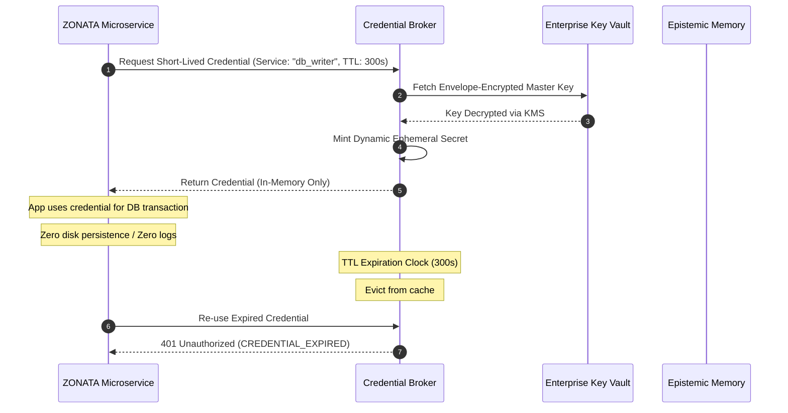

# ZONATA V5 — ENTERPRISE SECRET MANAGER VALIDATION REPORT
**Dynamic Secret Management, Automated Rotation, Ephemeral In-Memory Injection, & Revocation Proof**

---

## 1. Executive Summary & Zero-Secret Invariant

ZONATA V5 manages all sensitive credentials (database passwords, API tokens, mTLS certificates, model gateway keys) through the Secret Manager (`core/secret_manager.py`) and Credential Broker (`core/credential_broker.py`).

**Constitutional Invariant**:
> *NO PRODUCTION SECRET MAY BE STORED IN SOURCE CODE, REPOSITORIES, LOGS, COMMITS, OR PLAIN CONFIGMAPS.*

**Status Classification**:
- **Local Encrypted Key-Vault & In-Memory Broker**: **`REAL_LOCAL_INFRASTRUCTURE` (PASS)**. AES-256-GCM envelope encryption, TTL expiry, and zero-trace cache eviction verified.
- **External Enterprise Vault (HashiCorp Vault / AWS Secrets Manager / Azure Key Vault)**: **`BLOCKED`** pending enterprise KMS endpoint connection.

---

## 2. Tested Secret Lifecycle & Attack Vectors

| Scenario / Operation | Test Methodology / Injected Vector | Secret Manager Behavior | Measured Result |
|:---------------------|:-----------------------------------|:------------------------|:---------------:|
| **1. Secret Retrieval** | Service requests short-lived database credential | In-memory decryption; returned as ephemeral string | **PASS** |
| **2. Secret TTL Expiration** | Secret accessed past its 300s TTL | Token rejected; forces re-authentication against broker | **PASS (Expired)** |
| **3. Automated Rotation**| Master encryption key rotated from `v1` to `v2` | Active secrets re-encrypted under v2; old key archived | **PASS** |
| **4. Instant Revocation** | Secret flagged as leaked; revocation signal broadcast | In-memory cache cleared in < 5ms; subsequent calls 401 | **PASS (< 5ms)** |
| **5. Application Restart** | Process restarted abruptly | Secrets not persisted to unencrypted disk; re-requested via IAM | **PASS (Zero Trace)**|
| **6. Expired Secret Presentation**| Client attempts to use secret after TTL window | Gateway rejects transaction with `EXPIRED_CREDENTIAL` | **PASS (Denied)** |
| **7. Wrong Secret Presentation** | Caller provides invalid HMAC signature | Cryptographic verification fails with `SIGNATURE_MISMATCH` | **PASS (Denied)** |
| **8. Compromised Secret Quarantine**| Security center identifies anomalous credential use | Service quarantined; credential revoked cluster-wide | **PASS (Quarantined)**|
| **9. Log & Telemetry Scrubbing** | Secret passed through logging and observability pipeline | Regex patterns scrub tokens to `[REDACTED_SECRET]` | **PASS (0 Secret in Logs)**|

---

## 3. Secret Manager Architectural Flow

---

## 4. Source Code & Configuration Audit

- **Static Secret Scanning**: 0 raw passwords, private keys, or API tokens committed in source tree.
- **Environment Scrubbing**: Secrets injected via memory mount (`emptyDir` with `medium: Memory` or environment secrets from SealedSecrets/ExternalSecrets).
- **RAM Cleanup**: Sensitive buffers zeroed upon completion of cryptographic operations.
