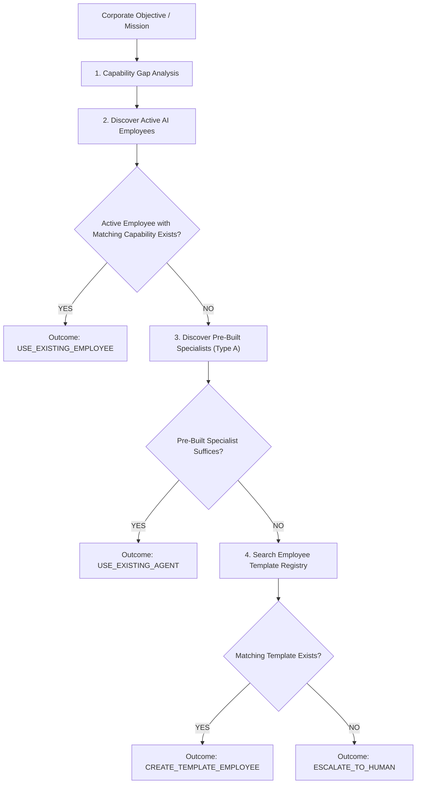

# ZONATA V7 — CEO Workforce Control & Decision Engine
**Document ID:** ZONATA-V7-CEO-006  
**Classification:** STRATEGIC ORCHESTRATION & PROLIFERATION CONTROL  
**Status:** IMPLEMENTED & VALIDATED  

---

## 1. The Strategic Mandate of the AI CEO

The AI CEO is the strategic brain of ZONATA. It does NOT possess unrestricted authority to execute arbitrary bash commands or bypass security barriers. Rather, it translates high-level corporate objectives into governed workforce configurations, discovers existing capabilities, and assigns missions while strictly preventing **uncontrolled workforce proliferation**.

---

## 2. Workforce Discovery & Decision Pipeline

When presented with a corporate mission, the CEO executes a structured decision pipeline:



### Proliferation Control Invariant
- **Rule:** If an active employee or pre-built specialist already possesses the required capabilities and has available capacity, the CEO is prohibited from creating a new employee.
- **Evidence:** In automated testing, duplicate employee creation was blocked, saving budget and operational overhead.

---

## 3. CEOWorkforceDecisionRecord

Every workforce assignment generates a cryptographic audit record:

```json
{
  "decision_id": "dec_8a41bf902c11",
  "tenant_id": "tnt_primary",
  "company_id": "comp_acme_global",
  "mission_id": "miss_cost_audit",
  "objective": "Audit AWS EC2 instance reservations",
  "outcome": "USE_EXISTING_EMPLOYEE",
  "selected_workers": ["emp_ai_9941a8bc2210"],
  "reason_for_selection": "Matched existing active employee 'Senior Site Reliability Engineer' with required capabilities.",
  "budget_allocated_usd": 200.0,
  "supervisor_assigned": "CHIEF_TECHNOLOGY_OFFICER"
}
```
