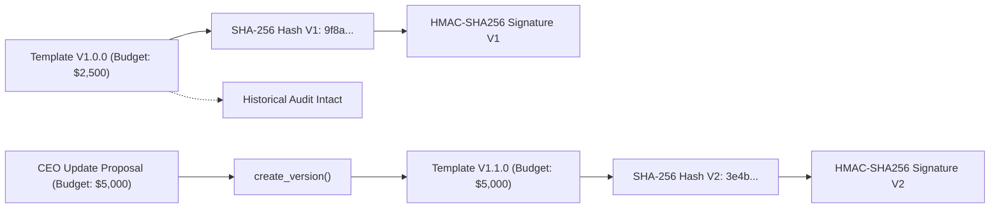

# ZONATA V7 — Employee Template Schema & Immutable Versioning
**Document ID:** ZONATA-V7-SCHEMA-002  
**Classification:** DATA MODEL & SPECIFICATION SPECIFICATION  
**Status:** IMPLEMENTED & VALIDATED  

---

## 1. Formal Specification Model (`EmployeeTemplate`)

An `EmployeeTemplate` defines the complete operational profile of an AI Employee. It is expressed via a strongly typed schema (`core/employee_template.py`) containing 50+ attributes:

```python
@dataclass
class EmployeeTemplate:
    template_id: str                      # Unique template identifier (e.g., tmpl_rev_01)
    tenant_id: str                        # Multi-tenant isolation partition
    company_id: str                       # Owning enterprise company
    project_id: Optional[str]             # Project identifier for Type C templates
    name: str                             # Human-readable title
    version: str                          # SemVer version string (e.g. 1.0.0)
    template_type: str                    # UNIVERSAL or PROJECT_SPECIFIC
    status: str                           # DRAFT, PROPOSED, EVALUATED, APPROVED, ACTIVE
    business_purpose: str                 # Strategic mandate for the role
    role_definition: str                  # Official title and scope
    department: str                       # OPERATIONS, ENGINEERING, GROWTH, FINANCE, etc.
    job_family: str                       # REVENUE, REVOPS, SRE, SOFTWARE, etc.
    responsibilities: List[str]           # Core operational duties
    objectives: List[str]                 # High-level goals
    sop_references: List[Dict[str, Any]]  # Links to ingested SOP documents
    kras: List[Dict[str, Any]]            # Key Result Areas
    kpis: List[Dict[str, Any]]            # Key Performance Indicators
    success_metrics: List[str]            # Quantitative benchmarks for success
    failure_conditions: List[str]         # Constraints triggering rollback/escalation
    required_knowledge: List[str]         # Required domain topics
    knowledge_sources: List[str]          # Whitelisted knowledge bases
    allowed_data_classes: List[str]       # PUBLIC, INTERNAL, CONFIDENTIAL, RESTRICTED
    required_tools: List[str]             # Whitelisted MCP/A2A tools
    allowed_capabilities: List[str]       # Dynamic capability tags
    authority_scope: Dict[str, Any]       # Max risk class, spend ceiling, delegation
    budget_limit: float                   # Hard financial ceiling (USD)
    token_budget: int                     # Maximum tokens per mission cycle
    tool_budget: int                      # Maximum tool invocations per mission
    autonomy_level: int                   # Autonomy level (0 through 5)
    manager_id: Optional[str]             # Default reporting line
    supervisor_id: Optional[str]          # Chief Officer supervisor
    preferred_agents: List[str]           # Pre-built specialists for collaboration
    working_schedule: str                 # 24x7_CONTINUOUS, BUSINESS_HOURS, BATCH
    created_by: str                       # Initiator identity (CEO or Human Owner)
    approved_by: Optional[str]            # Approver identity
    created_at: float                     # Epoch timestamp
    updated_at: float                     # Epoch timestamp
    version_hash: str                     # Canonical SHA-256 hash of specification
    template_signature: str               # HMAC-SHA256 digital signature
```

---

## 2. Immutable Versioning Architecture

Under enterprise regulatory compliance (SOX, SOC 2, ISO 27001), **silent mutation of active templates is strictly prohibited**. 



1. **Version Immutability:** Editing an existing template creates a new row in `employee_template_versions`. The historical version remains permanent and byte-for-byte verifiable.
2. **Deterministic Hash:** Calculated across all operational attributes using sorted-key canonical JSON serialization.
3. **Signed Artifacts:** Every version is sealed with an HMAC signature preventing tampering.
