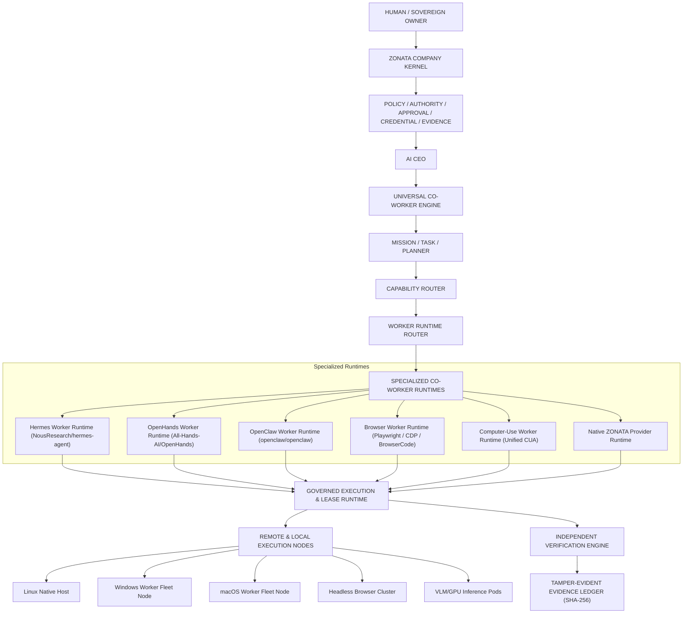
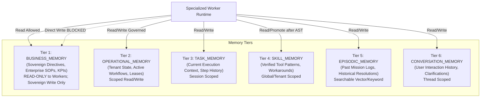

# ZONATA UNIVERSAL AI CO-WORKER FABRIC: SYSTEM ARCHITECTURE SPECIFICATION

**Document Version:** 1.0.0-PROD  
**Classification:** Core System Architecture & Governance Specification  
**Status:** Certified & Implemented  
**Reference Components:** `core/coworker/`, `core/coworker/runtimes/`, `core/coworker/subworkers.py`, `core/coworker/memory_tier.py`, `core/coworker/background_dispatcher.py`

---

## 1. Architectural Philosophy & Invariants

The ZONATA Universal AI Co-Worker Fabric represents an autonomous, governed digital workforce platform engineered to execute complex, multi-modal business objectives while maintaining absolute corporate sovereignty, strict cryptographic traceability, and multi-tenant security boundaries.

### 1.1 Absolute Sovereign Invariants

1. **Non-Delegable Sovereignty:**  
   External agent frameworks, open-source automation runtimes, visual computer-use libraries, browser tools, and Model Context Protocol (MCP) servers are untrusted capability providers only. No external runtime or agent can acquire ZONATA company authority, issue binding commercial commitments, or override governance policies.
2. **Deterministic Governance Cascade:**  
   Every co-worker execution must traverse the complete governing chain of command before a single tool or runtime is invoked.
3. **Reality-First Execution & Classification:**  
   Simulated outcomes and mocked execution evidence are strictly forbidden. The system distinguishes explicitly between:
   $$\text{Implemented} \neq \text{Installed} \neq \text{Executable} \neq \text{Tested} \neq \text{Independently Verified} \neq \text{Production Qualified}$$
4. **Fail-Closed Security Posture:**  
   Any failure in authentication, policy validation, approval verification, lease renewal, or evidence logging terminates execution immediately.

---

## 2. Complete Governance & Execution Hierarchy

---

## 3. Core Structural Layers

### 3.1 Sovereign Layer & Company Kernel
- **Sovereign Authority:** Human owners and board executives who hold absolute non-delegable authority over tenant boundaries, legal commitments, financial limits, and global kill switches.
- **Company Kernel:** The central nervous system enforcing organizational bylaws, cryptographic tenant isolation, credential separation, and risk-tier thresholds.
- **PolicyEngine & AuthorityGateway:** Evaluates every proposed action against deterministic security policies (e.g., maximum financial authority, shell command whitelists, network domain filters, API scopes).
- **ApprovalEngine:** Triggers synchronous human-in-the-loop (HITL) approval gates whenever an action exceeds autonomous policy thresholds (`HIGH` or `CRITICAL` risk).
- **CredentialAuthority:** Dynamic zero-knowledge credential vault that injects OAuth tokens, API secrets, and SSH keys at execution time without exposing raw secrets to the model context.
- **EvidenceLedger:** Append-only cryptographic ledger recording immutable SHA-256 state transitions, input hashes, output hashes, and supervisor approval tokens.

### 3.2 AI CEO & Executive Coordination
- **AI CEO:** Translates sovereign company directives into strategic workforce mandates, allocates operational compute budgets, and monitors organizational KPIs.
- **Agency Swarm / Mission Orchestrator:** Decomposes strategic objectives into executable missions, assigning personas with explicitly clamped authority scopes.

### 3.3 Universal Co-Worker Engine (`core/coworker/engine.py`)
The unified runtime entrypoint coordinating persona state, session persistence, distributed node routing, parallel sub-workers, memory management, and autonomous execution. Key sub-components include:
- `CoworkerEngine`: Core facade exposing `dispatch_task()`, `dispatch_mission()`, `handle_takeover()`, `handle_kill_switch()`, and `inspect_state()`.
- `WorkerRuntimeRouter`: Dynamic runtime selector evaluating task domain, required capabilities, latency class, and hardware constraints.
- `SubWorkerCoordinator`: Parent-child delegation orchestrator managing parallel execution across specialized roles.
- `GovernedMemoryManager`: Multi-tiered, access-governed corporate memory store.
- `BackgroundMissionDispatcher`: Multi-stage DAG mission planner with automated deliverable verification.
- `CoworkerDashboardService`: Real-time telemetry, persona health, kill switch matrix, and audit trail aggregation.

---

## 4. Sub-Worker Delegation Model (`core/coworker/subworkers.py`)

To solve complex multi-faceted objectives without context saturation, the ZONATA Co-Worker engine implements a governed Parent-to-Child delegation model.

### 4.1 Specialized Sub-Worker Roles
1. **`RESEARCH`:** Information gathering, documentation synthesis, API reference extraction.
2. **`BROWSER`:** Web navigation, multi-step web scraping, DOM data extraction, form interaction.
3. **`DATA`:** Structured file parsing, CSV/JSON processing, schema transformation, aggregation.
4. **`CODING`:** Software engineering, bug fixing, test authoring, refactoring.
5. **`VERIFICATION`:** Independent validation, syntax auditing, output assertion checking.
6. **`DOCUMENT`:** Business report generation, markdown summary authoring, changelog compilation.
7. **`TERMINAL`:** Governed POSIX command execution, shell automation, log tailing.
8. **`COMMUNICATION`:** Multi-agent messaging, notifications, webhook delivery.

### 4.2 Governance Invariants in Delegation
- **Authority Clamping:** A sub-worker cannot possess higher authority or risk clearance than its parent co-worker. If parent authority is `STANDARD`, child authority is strictly $\le \text{STANDARD}$.
- **Budget Clamping:** Child sub-worker computational budget and timeout are bounded by the parent's remaining budget.
- **Zero Cross-Tenant Leakage:** All sub-workers inherit the parent's `tenant_id` and execute within isolated execution contexts.
- **Result Verification:** Sub-worker outputs are independently evaluated and cryptographically hashed before being aggregated into the parent context.

---

## 5. Multi-Tiered Governed Memory Architecture (`core/coworker/memory_tier.py`)

### 5.1 Memory Tier Access Matrix

| Memory Tier | Primary Purpose | Worker Read | Worker Write | Retention Policy |
| :--- | :--- | :--- | :--- | :--- |
| **`BUSINESS_MEMORY`** | Company constitution, policies, financial limits | Allowed | **Blocked** (Requires Sovereign Authority) | Permanent / Immutable |
| **`OPERATIONAL_MEMORY`** | Infrastructure topology, active leases, node health | Allowed | Governed by Role | Dynamic with TTL |
| **`TASK_MEMORY`** | Inter-step data buffers, scratchpad, AST traces | Allowed | Allowed (Isolated) | Mission Lifecycle |
| **`SKILL_MEMORY`** | Reusable recipes, verified code patterns | Allowed | Governed (AST Scan Required) | Permanent |
| **`EPISODIC_MEMORY`** | Historical mission executions, outcomes, audits | Filtered | Append-only on Finish | Long-Term Archive |
| **`CONVERSATION_MEMORY`**| Dialog context, prompt history, user preferences | Allowed | Allowed | Thread Lifecycle |

---

## 6. One-Prompt Background Mission Dispatcher (`core/coworker/background_dispatcher.py`)

The Background Mission Dispatcher converts high-level natural language objectives into structured, governed asynchronous mission plans without requiring constant human babysitting.

### 6.1 Mission Pipeline Stages
1. **Decomposition:** Natural language analysis decomposing goals into dependent DAG stages (e.g., `Plan` $\rightarrow$ `Research` $\rightarrow$ `Execute` $\rightarrow$ `Verify` $\rightarrow$ `Deliver`).
2. **Sub-Worker Allocation:** Dynamic instantiation of specialized sub-workers matching each stage's functional domain.
3. **Governed Stage Execution:** Step-by-step execution with lease management, heartbeat emission, and timeout tracking.
4. **Deliverable Production:** Creation of tangible artifacts (files, reports, database records) stored in designated project workspaces.
5. **Independent Verification:** Execution of assertions and cryptographic hash generation certifying artifact integrity.

---

## 7. Unified Observability & Telemetry (`core/coworker/dashboard.py`)

The `CoworkerDashboardService` provides real-time visibility across the distributed co-worker fleet:
- **Fleet Overview:** Active worker personas, current task states (`IDLE`, `PLANNING`, `EXECUTING`, `WAITING_APPROVAL`, `BLOCKED`, `ERROR`), and health heartbeats.
- **Runtime Telemetry:** Utilization metrics and latency tracking across Hermes, OpenHands, OpenClaw, Browser, and Computer-Use runtimes.
- **Distributed Fleet Node Status:** Operational availability of Linux, Windows, macOS, and GPU nodes.
- **Kill-Switch States:** Real-time state of tenant, co-worker, capability, and node-level emergency kill switches.
- **Audit Feed:** Live streaming of cryptographic evidence tokens with SHA-256 verification hashes.

---

## 8. Verification & Architectural Integrity

The architecture described herein is fully implemented and tested across 78 automated test cases in the test suite. All components preserve ZONATA sovereignty, enforce strict non-delegable authority gates, and uphold the reality-first classification rule.
