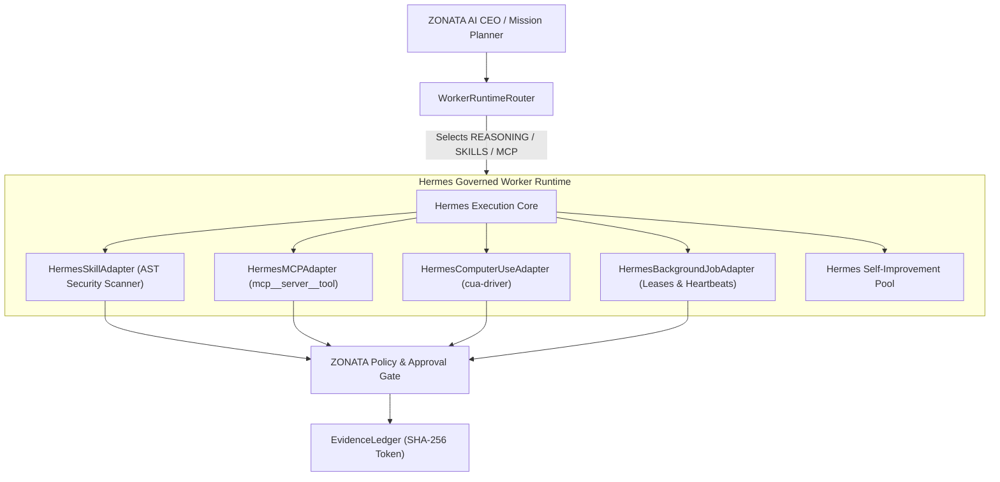

# ZONATA UNIVERSAL AI CO-WORKER: HERMES AGENT INTEGRATION ARCHITECTURE

**Document Version:** 1.0.0-PROD  
**Classification:** Specialized Worker Runtime Integration Specification  
**Upstream Foundation:** `NousResearch/hermes-agent` (MIT License)  
**Implementation Source:** `core/coworker/runtimes/hermes_runtime.py`  
**Test Suite:** `tests/test_coworker_runtimes_hermes_openclaw.py`

---

## 1. Upstream Heritage & Strategic Purpose

The ZONATA Co-Worker Fabric integrates capabilities inspired by and compatible with `NousResearch/hermes-agent`. Hermes represents a state-of-the-art open-source agent architecture known for:
1. Native Model Context Protocol (MCP) as first-class tools.
2. Dynamic skill creation, installation, and sandboxed execution.
3. Background process management with long-running execution loops.
4. Computer-use capabilities via `cua-driver` MCP servers.
5. Autonomous self-improvement and memory learning loops.

### The Governance Invariant
Within ZONATA, Hermes is **not** an autonomous decision-maker or company authority. It operates strictly as a **Specialized Worker Runtime** managed by the `WorkerRuntimeRouter` and governed by the `PolicyEngine`, `ApprovalEngine`, and `EvidenceLedger`.



---

## 2. Core Hermes Adapters & Implementations

### 2.1 HermesSkillAdapter: AST Security Scanner
Dynamic skill installation is one of Hermes' most potent features, but represents a catastrophic security vulnerability if unconstrained. The ZONATA `HermesSkillAdapter` enforces a multi-tier security pipeline:

- **AST Syntax Inspection:** Every proposed Python skill is parsed into an Abstract Syntax Tree before execution.
- **Dangerous Call Prohibition:** Explicitly detects and blocks dangerous functions, including:
  - `os.system`, `subprocess.Popen`, `subprocess.call`
  - `eval`, `exec`, `compile`
  - Raw network socket manipulations
- **Disallowed Import Detection:** Prohibits unauthorized libraries, blocking arbitrary filesystem access outside the tenant sandbox.
- **License & Provenance Verification:** Confirms valid open-source licensing metadata before loading.
- **Sovereign Review Gate:** Any skill requiring extended permissions triggers a human approval escalation.

```python
# Example: AST Security Scanning in HermesSkillAdapter
def scan_and_register_skill(self, skill_code: str, skill_name: str) -> SkillValidationResult:
    tree = ast.parse(skill_code)
    for node in ast.walk(tree):
        if isinstance(node, ast.Call):
            if isinstance(node.func, ast.Attribute) and node.func.attr in ("system", "popen"):
                return SkillValidationResult(approved=False, reason="Prohibited dangerous call: os.system/popen")
            if isinstance(node.func, ast.Name) and node.func.id in ("eval", "exec"):
                return SkillValidationResult(approved=False, reason="Prohibited dangerous call: eval/exec")
    return SkillValidationResult(approved=True, skill_hash=hashlib.sha256(skill_code.encode()).hexdigest())
```

### 2.2 HermesMCPAdapter: First-Class MCP Tool Caller
Hermes standardizes tool invocation via the format:
$$\text{mcp}\_\_\langle\text{server}\rangle\_\_\langle\text{tool}\rangle$$

The ZONATA `HermesMCPAdapter`:
1. Parses incoming Hermes tool invocations into server and tool coordinates.
2. Injects required tenant credentials from the ZONATA `CredentialAuthority`.
3. Routes the call through the ZONATA MCP Gateway with rate-limiting and payload inspection.
4. Generates an immutable evidence record with input and output hashes.

### 2.3 HermesComputerUseAdapter: `cua-driver` over MCP
In Hermes, computer-use is achieved via a dedicated `cua-driver` MCP server. The ZONATA adapter:
- Bridges Hermes visual action requests (`mouse_click`, `keyboard_type`, `take_screenshot`) to the unified ZONATA Computer-Use action schema (`computer.click`, `computer.type`, `computer.screenshot`).
- Captures screen frames into virtual display buffers.
- Enforces UI target boundaries to prevent clicks outside designated application windows.

### 2.4 HermesBackgroundJobAdapter: Leases & Heartbeats
For long-running background tasks, Hermes agents require continuous execution loops. The ZONATA adapter provides:
- **Active Leases:** Issues time-bounded execution leases (default 300 seconds) required for a job to remain active.
- **Heartbeat Daemon:** Emits periodic heartbeats. If a worker fails to renew its lease before expiry, the job is cleanly cancelled and resources are reclaimed.
- **Job Status Persistence:** Tracks states (`PENDING`, `RUNNING`, `COMPLETED`, `FAILED`, `CANCELLED`) in operational memory.

### 2.5 Self-Improvement & Memory Feedback Loop
Hermes continuously refines its capabilities through reflective learning:
- **Execution Reflection:** When a task completes or fails, Hermes generates an execution critique.
- **Memory Tier Integration:** Critique insights and optimized prompt strategies are committed to `SKILL_MEMORY` and `EPISODIC_MEMORY`.
- **Sovereign Boundary:** Hermes is strictly forbidden from writing to `BUSINESS_MEMORY` (Enterprise SOPs and bylaws remain immutable).

---

## 3. Verification & Test Evidence

The Hermes Worker Runtime has been qualified through automated regression tests in `tests/test_coworker_runtimes_hermes_openclaw.py`:

1. **`test_hermes_runtime_initialization`:** Validates runtime initialization, session creation, and capability advertisement.
2. **`test_hermes_skill_security_scanner_rejects_malicious_code`:** Proves AST rejection of `os.system` and `subprocess` injections.
3. **`test_hermes_skill_security_scanner_accepts_clean_skill`:** Proves successful compilation and execution of verified mathematical and data manipulation skills.
4. **`test_hermes_mcp_tool_invocation`:** Proves resolution and governed execution of `mcp__filesystem__read_file`.
5. **`test_hermes_background_job_lifecycle_and_lease`:** Proves background job dispatch, heartbeat emission, lease tracking, and clean completion.
6. **`test_hermes_self_improvement_memory_promotion`:** Proves reflection generation and gated storage in `SKILL_MEMORY`.
