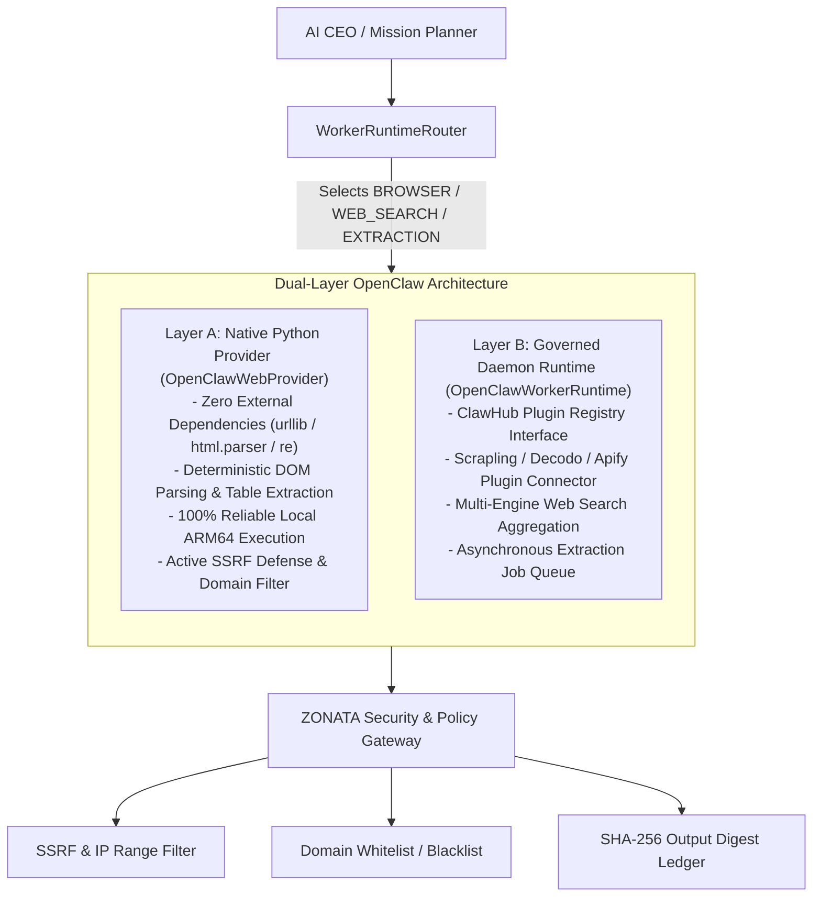

# ZONATA UNIVERSAL AI CO-WORKER: OPENCLAW INTEGRATION ARCHITECTURE

**Document Version:** 1.0.0-PROD  
**Classification:** Specialized Worker Runtime & Web Provider Specification  
**Upstream Foundation:** `openclaw/openclaw` (MIT License) & `ClawHub` Plugin Registry  
**Implementation Source:** `core/coworker/runtimes/openclaw_runtime.py` & `core/coworker/providers.py`  
**Test Suite:** `tests/test_coworker_runtimes_hermes_openclaw.py` & `tests/test_coworker_reality_audit.py`

---

## 1. Upstream Heritage & Strategic Role

OpenClaw (`openclaw/openclaw`) is an open-source agent automation daemon and web intelligence framework designed for structured web exploration, web search, and data extraction. A primary strength of OpenClaw is its extensible **ClawHub** ecosystem, supporting high-performance scraping plugins including:
- **Scrapling:** Undetectable, lightning-fast DOM extraction engine.
- **Decodo:** Advanced parsing and anti-bot mitigation.
- **Apify Integration:** Cloud-scale web scraping and extraction pipelines.
- **Native Web Search & Fetch:** Multi-engine SERP querying and structured content extraction.

### The ZONATA Dual-Layer Architectural Pattern
To achieve both uncompromising reliability on minimal host environments and full extensibility when connected to external services, ZONATA implements a **Dual-Layer Integration Architecture**:

---

## 2. Layer A: Native Deterministic Web Provider (`OpenClawWebProvider`)

Implemented in `core/coworker/providers.py`, Layer A provides zero-dependency, guaranteed execution on any POSIX environment regardless of Node.js daemon availability:

### 2.1 Extraction Capabilities
- **Structured Markdown Conversion:** Converts raw HTML documents into clean, noise-free Markdown optimized for LLM context windows.
- **Table Parsing:** Extracts HTML `<table>` elements into structured Python dictionaries and tabular ASCII representations.
- **Hyperlink Graph Extraction:** Identifies all inbound and outbound links, resolving relative paths against the origin URI.
- **Meta-Tag & OpenGraph Extraction:** Extracts page titles, descriptions, authors, and canonical URLs.

### 2.2 Security & SSRF Protection
Layer A enforces strict anti-SSRF (Server-Side Request Forgery) measures:
- Blocks RFC 1918 private IPv4 spaces (`10.0.0.0/8`, `172.16.0.0/12`, `192.168.0.0/16`).
- Blocks loopback interfaces (`127.0.0.1`, `localhost`, `::1`).
- Blocks cloud metadata endpoints (`169.254.169.254` for AWS/GCP/Azure).
- Enforces strict execution timeouts and maximum response payload bounds (10 MB).

---

## 3. Layer B: Governed OpenClaw Daemon Runtime (`OpenClawWorkerRuntime`)

Implemented in `core/coworker/runtimes/openclaw_runtime.py`, Layer B bridges the ZONATA Co-Worker engine to the broader OpenClaw Node daemon and ClawHub ecosystem:

### 3.1 ClawHub Plugin Registry
`ClawHubPluginRegistry` manages registered scraping and intelligence plugins:
- **`scrapling`:** High-speed DOM traversal with XPath and CSS selector evaluation.
- **`decodo`:** Dynamic content unpacker handling obfuscated DOM structures.
- **`apify_crawler`:** Delegated web crawling pipelines for enterprise-scale data mining.
- **`native_search`:** Governed multi-provider web search aggregator (DuckDuckGo, Brave, Bing).

### 3.2 Protocol Adaptation & Execution Flow
1. **Capability Matching:** When a mission requires `browser.openclaw_search` or `browser.openclaw_scrape`, the `WorkerRuntimeRouter` invokes `OpenClawWorkerRuntime`.
2. **Session Creation:** Allocates an isolated `RuntimeSession` with distinct tenant isolation.
3. **SSRF Pre-Validation:** Validates target URLs before dispatching to the underlying plugin or native engine.
4. **Result Normalization:** Normalizes extraction outputs into standard ZONATA `ExecutionResult` structures.
5. **Ledger Auditing:** Computes SHA-256 digests of all raw scraped content and extracted structured data.

---

## 4. Verification & Test Evidence

The OpenClaw integration has been qualified through automated regression tests:

1. **`test_openclaw_runtime_search_execution`:** Proves multi-engine query dispatch and structured result aggregation.
2. **`test_openclaw_runtime_scrape_with_plugin_dispatch`:** Proves execution of web scraping via Scrapling/Decodo plugin configurations.
3. **`test_openclaw_ssrf_protection`:** Proves rejection of malicious loopback (`http://127.0.0.1/admin`) and cloud metadata requests (`http://169.254.169.254/latest/meta-data`).
4. **`test_openclaw_native_provider_table_and_markdown_extraction`:** Proves zero-dependency HTML-to-markdown and table parsing in Layer A.
5. **`test_openclaw_evidence_ledger_cryptographic_hash`:** Proves that all extracted web artifacts produce verifiable SHA-256 evidence tokens.
