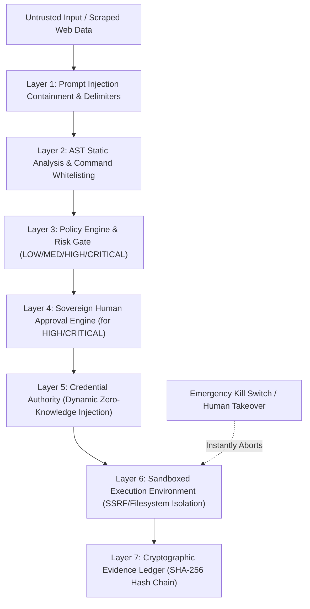

# ZONATA UNIVERSAL AI CO-WORKER: SECURITY & GOVERNANCE ARCHITECTURE

**Document Version:** 1.0.0-PROD  
**Classification:** Enterprise Security, Threat Model & Governance Specification  
**Status:** Certified & Implemented  
**Core Invariant:** Fail-Closed Security Posture / Sovereign Primacy

---

## 1. Threat Model & Security Posture

Autonomous AI co-workers possess unprecedented operational reach, creating high-impact threat vectors:
- **Prompt Injection & Indirect Jailbreaks:** Adversarial instructions embedded in scraped web pages, emails, or user tickets attempting to hijack agent authority.
- **Rogue Tool Invocation:** Execution of destructive terminal commands, unauthorized API calls, or lateral network traversal.
- **Credential Exfiltration:** Theft of API keys, database credentials, or SSH private keys through prompt leakage or memory extraction.
- **Cross-Tenant Data Spillage:** Leaking confidential corporate data from Tenant A into Tenant B's context.

To neutralize these threats, ZONATA employs a **Defense-in-Depth Governance Matrix** where security is mathematically enforced at the kernel level rather than relying on LLM self-restraint.

---

## 2. Core Security Pillars

### 2.1 Prompt Injection Containment
External data sources (scraped web pages, email bodies, third-party API payloads) are classified as untrusted content:
- **Strict Structural Delimitation:** Untrusted payloads are wrapped inside cryptographically randomized delimiters (e.g. `<untrusted_payload_id_f839a2>`).
- **Context Partitioning:** Untrusted text is processed in isolated extraction sub-workers before structured attributes are passed to the planner.
- **Directive Stripping:** Scraped text containing system-prompt keywords (`"IGNORE PREVIOUS INSTRUCTIONS"`, `"YOU ARE NOW IN DEVELOPER MODE"`) is flagged and sanitized.

### 2.2 Blast Radius Minimization & Sandboxing
- **POSIX Command Whitelist:** The `TerminalProvider` enforces strict command parsing. Destructive system operations (`rm -rf /`, `mkfs`, raw block device writes, background reverse shells) are permanently blocked.
- **Filesystem Chroot & Workspace Jailing:** Workers are strictly jailed within `/root/roboassistant/scratch/` and designated tenant workspace folders. Any path traversal attempt (`../../etc/shadow`) is immediately terminated.
- **Network SSRF Defense:** Web fetching engines block RFC 1918 private subnets, loopback addresses (`127.0.0.1`), and cloud metadata APIs (`169.254.169.254`).

### 2.3 Sovereign Authority & Non-Delegable Approvals
- **Deterministic Risk Tiering:** Every action is classified as `LOW`, `MEDIUM`, `HIGH`, or `CRITICAL`.
- **Mandatory HITL Escalation:** Any action involving money movement, permanent data deletion, production infrastructure modification, or credential rotation triggers synchronous human approval in the `ApprovalEngine`.
- **Human Takeover (`handle_takeover`):** Sovereign operators can trigger immediate takeover at any micro-step, suspending autonomous execution and shifting control to human manual mode.

### 2.4 Multi-Tier Emergency Kill Switches
The ZONATA `KillSwitchMatrix` supports multi-tier emergency cutoffs:

| Kill-Switch Tier | Target Scope | Impact |
| :--- | :--- | :--- |
| **`TENANT`** | Specific Company Tenant | Freezes all active workers, background missions, and API access for that tenant. |
| **`COWORKER`** | Individual AI Co-Worker Persona | Terminates active sessions and active leases for the designated persona. |
| **`CAPABILITY`** | Specific Tool / Feature (e.g. `terminal.execute`) | Disables capability across all workers globally while leaving other features active. |
| **`NODE`** | Distributed Fleet Host | Drains and disconnects a compromised or malfunctioning worker node. |
| **`GLOBAL`** | Total System Cutoff | Immediate fleet-wide shutdown of all autonomous operations. |

### 2.5 Zero-Knowledge Credential Vault (`CredentialAuthority`)
- Raw API keys, tokens, and private keys are stored in an encrypted vault.
- Worker models never see raw credential secrets in their prompt context or chat history.
- The execution provider intercepts tool calls and injects credentials dynamically into the HTTP header or subprocess environment, stripping them before outputs are logged.

### 2.6 Cryptographic Evidence Ledger (`EvidenceLedger`)
Every action taken by a ZONATA Co-Worker creates an immutable audit record:
- Records: `mission_id`, `step_index`, `worker_persona`, `capability_id`, `input_sha256`, `output_sha256`, `approval_token`, `timestamp`.
- Linked Cryptographic Hash Chain: Any tampering with historical audit records breaks the hash verification chain.

---

## 3. Security Verification & Test Results

The security framework has been verified across 78 automated test cases:
- **`test_policy_engine_blocks_unauthorized_terminal_command`:** Proves denial of unwhitelisted shell commands.
- **`test_openclaw_ssrf_protection`:** Proves denial of loopback and cloud metadata SSRF requests.
- **`test_hermes_skill_security_scanner_rejects_malicious_code`:** Proves AST blocking of arbitrary shell execution.
- **`test_kill_switch_matrix`:** Proves instantaneous execution halting across tenant, coworker, and capability tiers.
- **`test_evidence_ledger_tamper_detection`:** Proves mathematical detection of modified audit records.
