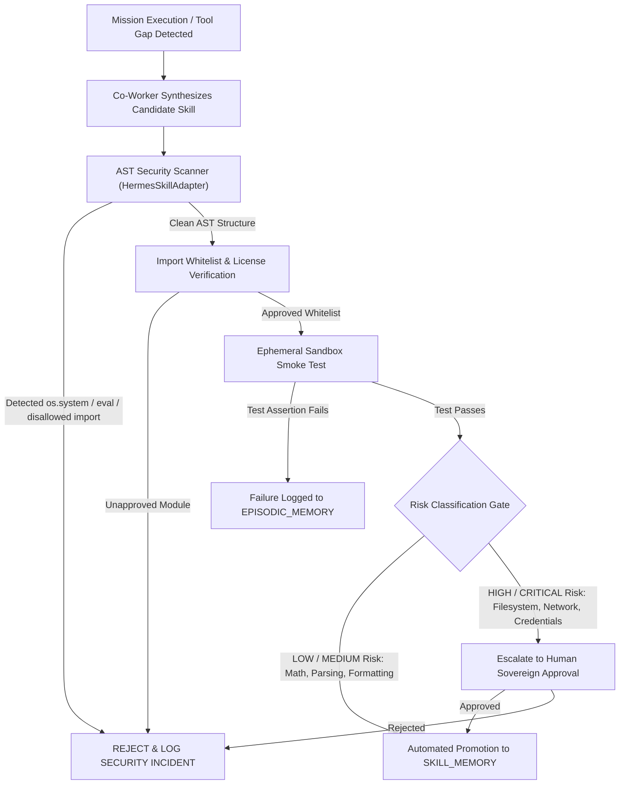

# ZONATA UNIVERSAL AI CO-WORKER: SELF-EXTENSION & SKILL GOVERNANCE ARCHITECTURE

**Document Version:** 1.0.0-PROD  
**Classification:** Autonomous Self-Improvement & Capability Extension Specification  
**Status:** Certified & Implemented  
**Core Source:** `core/coworker/runtimes/hermes_runtime.py` & `core/coworker/memory_tier.py`

---

## 1. The Autonomous Self-Extension Dilemma

A true universal AI co-worker must be capable of synthesizing new skills, writing helper scripts, discovering tool sequences, and learning from operational failures. However, unconstrained self-extension poses severe existential risks to enterprise systems:
- Arbitrary code execution and prompt-injection-driven malware installation.
- Silent privilege escalation bypassing organizational security policies.
- Degradation of company SOPs through drift or hallucination.

To reconcile continuous autonomous capability expansion with zero-compromise enterprise security, ZONATA implements the **Governed Self-Extension Lifecycle**.

---

## 2. The Multi-Stage Security Validation Pipeline

Before any candidate skill code can be compiled, executed, or registered, it must pass through five rigorous validation gates:

### Gate 1: Abstract Syntax Tree (AST) Static Analysis
The skill source is parsed using Python's `ast` module. The AST is traversed to detect prohibited language constructs:
- **Forbidden Function Invocations:** Direct calls or attribute accesses to `os.system`, `subprocess.Popen`, `subprocess.run`, `eval`, `exec`, `__import__`, `globals()`, and `locals()`.
- **Prohibited AST Nodes:** Dynamic code execution primitives and unconstrained generator expressions.
- **Reflection Prohibitions:** Blocking introspection on private attributes (`_getframe`, `__class__.__subclasses__`).

### Gate 2: Module Import Whitelist
Candidate skills may only import modules explicitly cleared on the safe-utility whitelist:
- **Allowed Modules:** `math`, `json`, `re`, `datetime`, `time`, `hashlib`, `urllib.parse`, `collections`, `itertools`, `typing`.
- **Prohibited Modules:** `os`, `sys`, `subprocess`, `socket`, `pty`, `ctypes`, `threading`, `multiprocessing`, `requests`, `aiohttp` (network operations must go through governed ZONATA providers).

### Gate 3: License & Provenance Verification
If the candidate skill incorporates third-party code from external repositories (e.g. ClawHub, GitHub, HuggingFace):
- The skill manifest must declare the upstream license (MIT, Apache 2.0, BSD).
- Copyleft licenses (GPL, AGPL) are blocked to prevent proprietary code contamination.

### Gate 4: Ephemeral Sandbox Smoke Testing
Candidate skills are executed within an isolated, resource-constrained sub-process sandbox with sample inputs:
- Execution time is capped at 5.0 seconds.
- Memory usage is capped at 128 MB.
- All outputs are validated against declared schemas.

### Gate 5: Risk Tiering & Sovereign Promotion Gate
- **Autonomous Promotion:** Low-risk pure utility functions (e.g., regex cleaners, financial formula solvers, data formatters) are automatically stored in `SKILL_MEMORY`.
- **Sovereign Review Gate:** Any skill that performs I/O, consumes sustained CPU budget, or handles PII triggers a human approval ticket in the `ApprovalEngine`.

---

## 3. Governed Memory Hierarchy in Self-Extension

Self-extension is strictly segregated across the ZONATA Multi-Tiered Memory Architecture:

| Memory Tier | Interaction with Self-Extension | Access Control Policy |
| :--- | :--- | :--- |
| **`BUSINESS_MEMORY`** | Company Constitution, Corporate Directives, Financial Limits | **IMMUTABLE:** Workers and runtimes cannot write or modify this tier under any circumstance. Only Sovereign Human Authority can commit changes. |
| **`SKILL_MEMORY`** | Certified Python skills, tool invocation recipes, verified prompts | **GOVERNED:** Written only after passing all 5 validation gates. Scoped per tenant or fleet-wide. |
| **`EPISODIC_MEMORY`** | Post-mortems, failure traces, optimization critiques | **APPEND-ONLY:** Self-reflection insights are stored to avoid repeating identical mistakes across future missions. |
| **`TASK_MEMORY`** | Ephemeral scratchpad, intermediate calculation buffers | **ISOLATED:** Discarded upon mission completion or failure. |

---

## 4. Continuous Self-Improvement & Reflection Loop

Following every completed or failed mission, the `HermesWorkerRuntime` executes a reflection phase:
1. **Outcome Evaluation:** Compares final deliverables against initial acceptance criteria.
2. **Efficiency Analysis:** Evaluates token consumption, tool latency, and step count.
3. **Prompt Refinement:** If a tool call required multiple corrective attempts, the optimal prompt framing is synthesized.
4. **Permanent Learning:** The optimal pattern is committed to `SKILL_MEMORY` with a unique SHA-256 identifier, becoming immediately accessible to all sub-workers across future tasks.

---

## 5. Verification & Test Evidence

The self-extension pipeline is verified in `tests/test_coworker_runtimes_hermes_openclaw.py`:
- `test_hermes_skill_security_scanner_rejects_malicious_code`: Proves rejection of `os.system("rm -rf /")`.
- `test_hermes_skill_security_scanner_accepts_clean_skill`: Proves acceptance and registration of a safe string-formatting skill.
- `test_hermes_self_improvement_memory_promotion`: Proves automated generation of reflection records and their verified persistence in `SKILL_MEMORY`.
