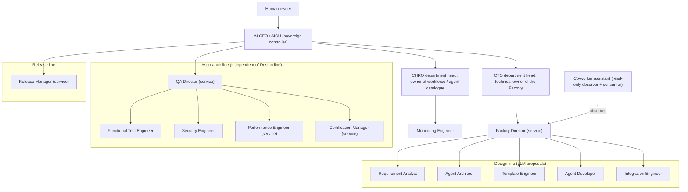

# FACTORY_ORGANISATION — roles, authority, separation of duties

## 1. Decision: agent or service?

**Rule:** a role becomes an **LLM agent** only if its output is a *proposal that a deterministic validator can check*. A role that can approve, certify, release, grant, schedule, or spend is a **deterministic service** (no LLM in the decision path). This is how "the Factory Director cannot approve its own release" becomes structural rather than a policy sentence.

| Role | Form | Why |
|---|---|---|
| Factory Director | **Service** (durable workflow / state machine) | Scheduling and state transitions must be reproducible; an LLM here could be talked into skipping a stage. |
| Requirement Analyst | **LLM agent** → output = Agent Requirement Specification (ARS) validated by schema | Natural language understanding is the whole job. |
| Agent Architect | **LLM agent** + deterministic DAG/permission validators | Design is creative; legality is mechanical (`batch_scheduler.plan`, spec validator). |
| Template Engineer | **Hybrid:** matching/compatibility = service; authoring new templates = LLM agent (DRAFT only) | Matching must be explainable; authoring needs review anyway. |
| Agent Developer | **LLM agent** → spec (data) | Never emits executable backend code. |
| Integration Engineer | **Hybrid:** binding resolution/pinning = service; proposing bindings = LLM | Bindings are permissions; permission arithmetic is deterministic. |
| QA Director | **Service** | Orchestrates independent QA; picks datasets by tier; no judgement. |
| Functional Test Engineer | **Hybrid:** case authoring = LLM (independent principal); execution/scoring = service | Authoring needs imagination; scoring must be repeatable. |
| Security Engineer | **Hybrid:** scanners = service; adversarial case generation = LLM; execution/scoring = service | Attackers are creative; verdicts are not. |
| Performance Engineer | **Service** | Measurements. |
| Certification Manager | **Service** (`gate_eval.py` logic) | Mandatory gates cannot be argued with. |
| Release Manager | **Service** | Submits to ApprovalEngine; publishes only after an approval record exists. |
| Monitoring Engineer | **Hybrid:** collectors/SLO engine = service; improvement analyst = LLM (proposals only) | Production agents never self-modify. |

## 2. Reporting structure

Note the **assurance and release lines report to the AI CEO, not to the Factory Director** — the Director schedules work but has no authority over verdicts.

## 3. Responsibilities, I/O, escalation, failure ownership, permissions

Service principals are `factory.<role>` (kind `service`), each with its own FGA relations. "May" = granted; everything else is denied by default.

| Role | Responsibilities | Inputs → Outputs | Communicates via | Escalates to / when | Failure responsibility | Permission boundary (may / may not) |
|---|---|---|---|---|---|---|
| **Factory Director** | Drive the 13-stage pipeline; assign work to roles; enforce concurrency, quotas, retries; maintain manifest | Authorised request → manifest, job events | Orchestrator (activities/signals) | CTO on repeated stage failure (>N attempts); AI CEO on kill/quota breach | Owns *schedule* failures (stuck jobs, lost workers) — retries, resumes, reports | **May:** read requests, start/cancel jobs, write `af_build`, `af_batch*`. **May not:** approve/decide releases, certify, mint permissions beyond calculator output, write to approval/audit tables, read held-out QA datasets |
| **Requirement Analyst** | NL → ARS: role, mission, responsibilities, outcomes, knowledge/tool/memory needs, performance, permissions requested, reporting lines, cost cap; ask the requester **only essential** questions | NL text, org chart, KRA/KPI links → ARS vN + open questions | Structured output (JSON schema) | Requester (clarification); Director if request is infeasible/out of policy | Owns *misreading the request* (caught by independent QA against ARS) | **May:** read org chart, template catalogue (read), SOP index. **May not:** call tools, read other tenants/companies, write registry |
| **Agent Architect** | Choose single/supervisor/sequential/parallel/hierarchical; split into agents; define contracts and dependency graph; shared knowledge design | ARS → architecture spec + DAG | Structured output → validated by planner | Director when DAG invalid or exceeds quota; AI CEO design approval (R2/R3) | Owns *design defects* (cycles, over-privileged splits) | Same read-only set; cannot grant permissions |
| **Template Engineer** | Find compatible templates/certified agents; propose new template (DRAFT) | ARS+architecture → template resolution report; template proposals | Service API + LLM drafts | Human template reviewers via ApprovalEngine | Owns *poor reuse* (duplicate agents) | **May:** read templates/registry; create DRAFT template versions. **May not:** publish/approve templates, edit APPROVED versions |
| **Agent Developer** | Fill template slots / author spec: identity fields, instructions, workflow, limits, I/O contracts, tests (builder cases) | ARS+arch+template → `zonata.agent/v1` | Structured output → validator | Director on validation failure after K attempts | Owns *spec defects found by QA* | **May:** write `spec` of `BUILDING` versions it created. **May not:** write `permission_profile` (calculator does), read held-out datasets, see evaluator outputs beyond failure summaries |
| **Integration Engineer** | Resolve tools/MCP/A2A/knowledge bindings; pin MCP tool descriptions by hash; propose scopes | Spec requests → `af_tool_binding` candidates | Service + LLM proposals | AI CEO/security approver for grants beyond auto-grant | Owns *broken/over-broad bindings* | **May:** read registry & MCP tool lists. **May not:** grant; bind unregistered servers; handle secret values (refs only) |
| **QA Director** | Select independent datasets by tier; schedule suites; ensure evaluator ≠ builder; collect evidence | Built version → eval runs | Orchestrator | AI CEO when infrastructure prevents mandatory suites | Owns *incomplete test coverage* | **May:** create `af_eval_run`. **May not:** edit specs, edit gate policy, issue certification |
| **Functional Test Engineer** | Author independent functional cases from ARS (incl. held-out 30 %+); run; score | ARS+spec → cases, results | Dataset store (owned by evaluator principal) | QA Director | Owns *unfair/leaky tests* (reviewed in calibration) | **May:** write datasets it owns. **May not:** read builder prompts' hidden reasoning; modify agent |
| **Security Engineer** | Run scanners; generate and run prompt-injection, exfiltration, privilege-escalation, tenant-isolation and tool-abuse cases; open findings | Version + package → findings, suite results | Scanner services; sandboxed runner | Security approver; AI CEO for criticals | Owns *missed vulnerability classes* (corpus gaps tracked) | **May:** open findings, run attacks in staging sandbox. **May not:** waive findings |
| **Performance Engineer** | Latency, throughput, token and cost per task on real profile | Version → perf report | Service | QA Director | Owns *measurement validity* | Read + run in staging only |
| **Certification Manager** | Evaluate `gate_policy.yaml`; assemble bundle; sign; write ledger entry | Evidence → certification (immutable) | Service | AI CEO if policy is ambiguous | Owns *wrong verdicts* (unit-tested; every verdict reproducible from bundle) | **May:** insert `af_certification`. **May not:** skip/relax gates; change thresholds; certify with mock evidence (hard rule G00) |
| **Release Manager** | Submit certified package to ApprovalEngine; after approval publish (atomic for teams), provision, assign | Certification → release record | ApprovalEngine API | AI CEO | Owns *release mechanics* (rollback on publish failure) | **May:** create `af_release` PENDING; publish when `approval_id` valid. **May not:** decide approvals |
| **Monitoring Engineer** | Collect OTel/Langfuse metrics, SLO breaches, feedback, incidents; propose improvements/suspensions | Production telemetry → alerts, improvement proposals | Event bus | AI CEO/Security on incident; owner on degradation | Owns *late detection* | **May:** suspend only via automatic incident rules (see §6) and propose upgrades. **May not:** edit running agents, prompts, permissions, templates |

## 4. Separation of duties (enforced, not advisory)

| Duty pair | Enforcement |
|---|---|
| Requester ≠ approver of release | Service check + DB trigger `af_release_guard` (verified) + FGA (`approver` not derivable from `requester`) |
| Builder ≠ independent evaluator | DB trigger `af_eval_independence` (verified) + distinct service principals; evaluator datasets owned by different principal |
| Factory Director ≠ approver/certifier | Director principal lacks `can_decide_release`, `can_issue_certification` relations |
| Finding waiver ≠ requester ≠ builder | Waiver needs `security_approver`; service checks identity set disjointness |
| Policy (gate/threshold) change ≠ Factory | Only AI CEO + human owner; versioned file; Factory read-only |
| Agent never self-grants | Agent principal has no write relation on any `af_*` object; permission_profile frozen after BUILDING (DB trigger, verified) |

## 5. Communication protocols

- **Control-plane ↔ roles:** each LLM role is invoked as an activity with a **typed input, typed output (JSON-Schema-validated), token/cost budget, timeout and trace id**. Invalid output → retry with the validation error (max 2), then fail the stage; **no free-text hand-offs**.
- **Role ↔ role:** only through persisted artifacts (ARS vN, architecture spec, spec). No role calls another directly; the Director orchestrates (prevents hidden delegation chains).
- **Roles ↔ ZONATA:** through ports, as the role's own service principal; every call is authorised and recorded.
- **Prompt management:** role prompts are files in the repo, versioned, content-hashed; hash recorded in every evidence entry so a verdict can be tied to the exact prompt.
- **Prompt-injection stance for design roles:** user NL and imported repo contents are **data**; roles run with no tools except read-only catalogue/registry lookups.

## 6. Escalation and failure rules

| Condition | Action | Owner |
|---|---|---|
| LLM role output fails validation twice | Stage `FAILED`; item `FAILED`; dependents `BLOCKED` | Director |
| Build worker silent > 60 s | Attempt `LOST`; reschedule (≤3 attempts) | Director |
| Same item fails 3 attempts | Escalate to CTO; batch `PARTIAL` or `FAILED` per release policy | Director → CTO |
| Mandatory gate fails | Version `FAILED_QA` → findings to requester; no release path until fixed in a **new version** | Certification Manager |
| Critical/high finding open | Block publication (no waiver possible) | Security Engineer |
| Budget exhausted | Hard stop; partial spend recorded; requester informed | Director |
| Kill switch (agent/team/batch/tenant/factory) | Immediately cancel workflows, revoke tokens, stop runtimes; evidence | KillSwitchMatrix → Director |
| Production SLO breach for 2 consecutive windows | Mark `DEGRADED`, notify owner; auto-suspend only if the incident rule is zero-tolerance (secret leak, cross-tenant hit, ungranted tool call) | Monitoring Engineer |
| Anything ambiguous about policy | Fail closed; ask AI CEO | Any role |

## 7. Humans and the co-worker assistant

| Actor | Can | Cannot |
|---|---|---|
| Human owner | Everything the matrix lists, final say on R2/R3, kill, policy changes | — |
| AI CEO | Approve R0/R1 (and R2/R3 jointly with human), approve designs, set quotas, kill | Waive a critical/high finding; change constitution alone |
| AI employee (requester) | Request, track, view results, use assigned agents, give feedback | Approve own request; edit agent versions |
| Department heads (CTO/CHRO etc.) | View department requests, assign agents to their department's employees | Approve releases they requested |
| Co-worker assistant | **Observe** factory (read-only), use certified agents assigned to it, submit a request on a user's behalf (company scope needs AI CEO permission) | Approve, certify, publish, alter any factory object |
