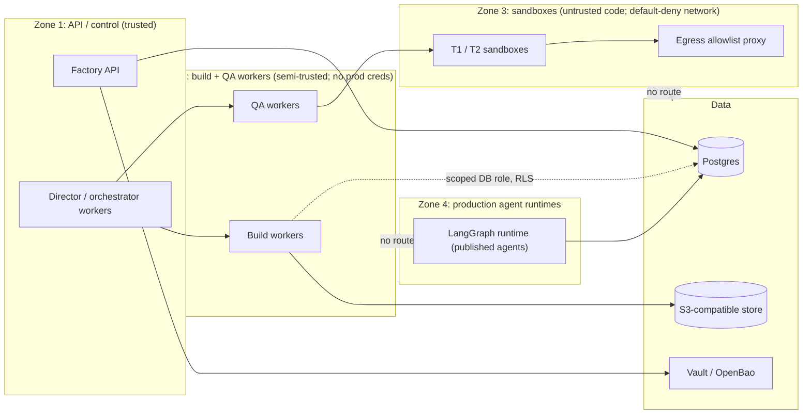

# INFRASTRUCTURE_AND_DEPLOYMENT

> The deployed topology of ZONATA is **unverified** (only: Render staging `zonata-staging` + Neon Postgres, built via Termux, free-tier constraints). Facts about third-party plan limits are `[KNOWLEDGE]` and must be re-checked against the vendors' current pages before relying on them.

## 1. Reuse map (nothing new unless necessary)

| Existing component | Role for the Factory | New infra needed? |
|---|---|---|
| PostgreSQL / Neon | `af_*` tables, RLS, LangGraph checkpoints, DB-queue fallback | No (new schema objects only; app role must be non-owner) |
| Temporal | Manufacturing/monitoring workflows (via `OrchestratorPort`) | Only a reachable cluster/namespace; else DB-queue |
| NATS JetStream | Event fan-out (progress SSE, monitoring); **not** the job source of truth | New streams/subjects `zonata.af.*` |
| MinIO / S3 | Artifact store (behind `ArtifactStorePort`) | **Replace MinIO** (archived) — see OSS doc red flag |
| Vault (or OpenBao) | Signing key, secret refs, per-job credentials | New secret paths `kv/zonata/af/*`, transit key `af-signing` |
| Keycloak | Service principals `factory.*`, agent principals | New clients/roles |
| OpenFGA | Relations (agent, factory_object) | Model additions |
| LangGraph | Runtime for built agents, test runs, LLM design roles | Existing |
| MCP / A2A | Tool and peer connectivity through gateway | Registry entries |
| OpenTelemetry / Langfuse | Traces, metrics, QA scores | New span/metric names; datasets |

## 2. Plane separation and network layout

Rules: build/QA workers cannot reach production runtimes or production data stores except through the Factory API/ports; sandboxes reach nothing except the egress proxy; production runtimes cannot reach build/QA zones. Worker DB access uses a dedicated role (`af_worker`) with privileges only on `af_*`, still under RLS with a per-job `zonata.tenant_id`. Production agents never receive worker credentials.

## 3. Topologies

| Topology | Use | Components |
|---|---|---|
| **A — Free-tier / dev** | Development, demos, mock-model + small real-model QA | One FastAPI app (existing), `DbQueueOrchestrator` in-process worker thread or a second process if the host allows, Neon Postgres, S3-compatible free tier or local filesystem adapter (dev only), no sandbox (T0 only), Langfuse/OTel optional. Expect cold starts/sleep on free web services `[KNOWLEDGE]`; jobs must be **resumable** (they are: durable stage log). |
| **B — Restricted pilot** | A few tenants, real users, R0–R2 | 1 VM (≥4 vCPU/8 GB) for API+workers (Docker Compose), Postgres (managed), Temporal (self-hosted single node or managed) *or* DB-queue, NATS, S3-compatible managed store, OpenBao/Vault, Keycloak+OpenFGA, OTel collector + Langfuse; **separate** small KVM-capable VM for T1/T2 sandboxes if tool authoring/Import lane are wanted |
| **C — Production** | Multi-tenant production | Kubernetes (or equivalent), separate node pools per zone, autoscaled worker pools, microVM hosts for T2, HA Postgres + PITR, HA Temporal, multi-AZ object storage, SIEM export, WAF/API gateway |

## 4. Operational policies

| Topic | Policy |
|---|---|
| Worker scaling | Scale on queue depth × oldest age per class; min 1; max per tenant quota; sandbox workers scale on sandbox queue |
| Job queues | Classes interactive/batch/fleet/maintenance; per-tenant fair queuing; control messages strict priority |
| Concurrency | Table in Multi-Agent doc; enforced by atomic quota counters |
| Retry | Infra: 2 retries (5 s, 30 s back-off + jitter); LLM output: 2 re-prompts; policy/gate failures: 0; worker lost: reschedule ≤3 |
| Failure recovery | Durable stage log; resume at last completed stage; sandbox garbage-collector; reconciler job marks `LOST` builds and cleans artifacts |
| Resource quotas | CPU/mem/pids/time per sandbox; per-build wall-clock cap (default 30 min); per-tenant monthly builds/tokens/cost |
| Model budgets | Per request cap + tenant monthly; hard stop; alerts at 50/80/100 % |
| Artifact retention | Certified 3 y; uncertified 90 d; build logs 180 d; legal hold flag |
| Backup & recovery | Postgres PITR (managed) + nightly logical dump of `af_*` to object storage; ledger Merkle root exported daily to a separate store; artifact store versioning; **restore drill** each quarter (acceptance in Phase 10); RPO ≤ 15 min (managed PITR) / 24 h (dump-only), RTO target 4 h (pilot) — targets, not measured |
| Secrets | Vault/OpenBao paths per tenant; short-lived tokens; rotation of signing key every 12 months or on incident |
| Observability | OTel span names `af.request`, `af.stage.<n>`, `af.qa.<suite>`, `af.runtime.<agent>`; metrics: queue depth/age, build duration, success rate, gate fail counts, cost, sandbox utilisation; Langfuse datasets for QA; alerts → AI CEO/CTO |

## 5. Configuration and feature flags

| Variable | Values | Purpose |
|---|---|---|
| `AF_ENABLED` | `0/1` | Master switch; default 0 until Phase 2 acceptance |
| `AF_ORCHESTRATOR` | `temporal` \| `dbqueue` | Selects `OrchestratorPort` adapter |
| `AF_SANDBOX_TIERS` | `""`, `T1`, `T1,T2` | Empty ⇒ tool authoring, code execution, Import lane **disabled** |
| `AF_REAL_MODEL_PROFILE` | profile name | Profile used for certification-grade QA |
| `AF_SIGNING_KEY_ID` | id | Active Ed25519 key |
| `AF_GATE_POLICY_VERSION` | semver | Pins `gate_policy.yaml` |
| `AF_TENANT_DEFAULT_QUOTAS` | JSON | Initial quotas |
| `AF_UI_ENABLED` | `0/1` | Feature-flags front-end routes |

## 6. What can be validated where (honest matrix)

| Item | Local (laptop/VM) | Free tier | Requires paid / prod-grade | Cannot be honestly claimed without prod-grade |
|---|---|---|---|---|
| Schema, RLS, triggers, calculator, planner, gates | ✅ | ✅ | | |
| Pipeline with fakes/mock model | ✅ | ✅ | | |
| Small real-model QA (tens of cases) | ✅ | ✅ (cost-capped) | | |
| Temporal durability, signals, worker-crash recovery | ✅ dev server | ❌ | ✅ | Crash-recovery *under load* |
| DB-queue crash recovery | ✅ | ✅ | | |
| T1 container sandbox | ✅ on Linux with Docker/Podman | ❌ | ✅ | |
| T2 microVM | ✅ only with KVM | ❌ | ✅ | Escape resistance (needs security review/pentest) |
| Concurrency of 4–12 builds | ✅ small | ❌ (1 worker) | ✅ | **Hundreds** of agents, throughput, soak, tail latency |
| Multi-tenant noisy-neighbour behaviour | partial | ❌ | ✅ | At production scale |
| DR / backup restore | ✅ rehearsal | partial | ✅ | RPO/RTO claims |
| Cost model accuracy | ✅ small sample | ✅ | ✅ | Fleet-scale costs |

**Rule:** a pilot readiness report lists each row as *validated / not validated* with evidence; unvalidated rows are stated, never implied passed.

## 7. Deployment instructions (summary; OpenCode prompt has the full version)

1. Build image(s) from the repo's existing Dockerfile; add worker entrypoint (`python -m agent_factory.worker`) — same image, different command.
2. Apply migrations `001`, `002` (staging first) with the **migration role**; create `af_app`/`af_worker` roles (non-owners); run `001_verify.sql` against staging.
3. Create Vault/OpenBao paths and the signing key; create Keycloak service clients; apply OpenFGA model changes; create NATS subjects (if used).
4. Deploy with `AF_ENABLED=0`; smoke `/health`, `/ready` (must report orchestrator + sandbox tiers truthfully).
5. Enable for an internal tenant (`AF_ENABLED=1`, `AF_UI_ENABLED=1`), run AT suite on staging, then canary tenants.
6. **Rollback:** disable flag (API returns 404/423), stop workers, keep data; migrations are additive so no schema rollback is needed for functional rollback; `down` script exists for full removal in non-prod.
