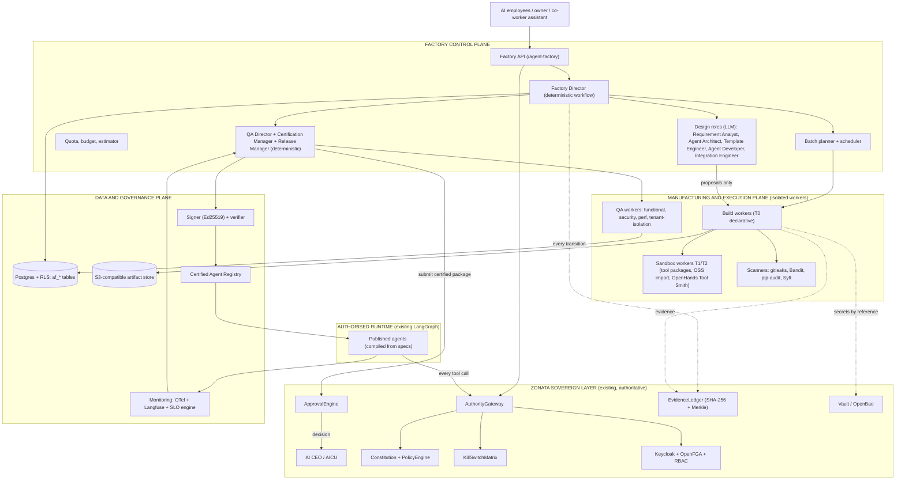
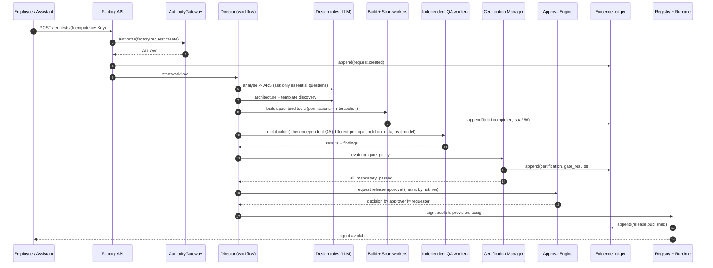
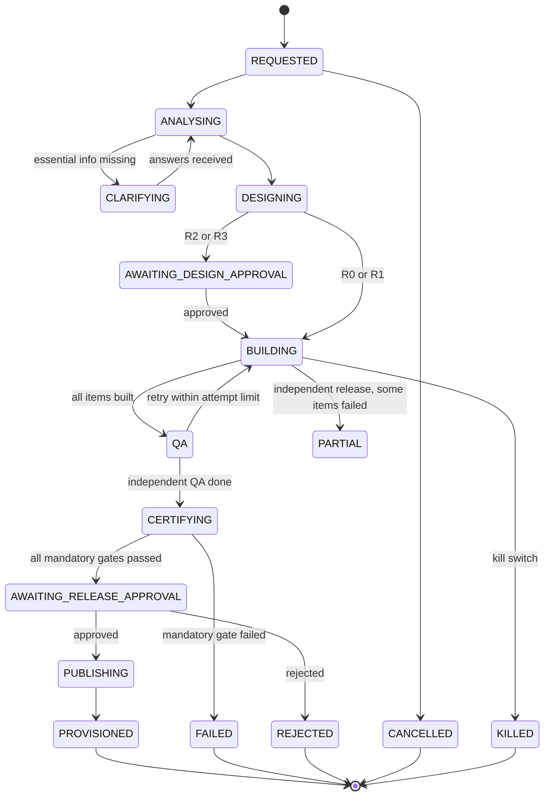

# TARGET_ARCHITECTURE — ZONATA Agent Factory

> **Design status.** Component names of *existing* ZONATA systems are taken from the owner's brief and are **unverified** (see `EXISTING_SYSTEM_AUDIT.md`). The Factory therefore talks to them only through **ports** (§4). Phase 1 binds each port to the real class; the architecture does not change if a binding turns out to be a thin adapter.

## 1. Principles (each has a technical reason)

| # | Principle | Reason |
|---|---|---|
| P1 | **ZONATA is sovereign; the Factory only manufactures.** The Factory has no approval power of its own and no separate identity/audit store. | A parallel authority would be a second source of truth and a bypass path. |
| P2 | **Agents are data (`zonata.agent/v1`), compiled by the runtime; model output never becomes executed backend code.** | Removes the largest attack surface (generated code), keeps builds deterministic and diffable. Code only enters as reviewed *tool packages* inside a sandbox (T1/T2). |
| P3 | **No LLM holds a gate.** Anything that can approve, certify, or release is a deterministic service; LLM roles only propose. | An LLM can be persuaded; a threshold cannot. |
| P4 | **Separation of duties:** requester ≠ builder ≠ independent evaluator ≠ approver, enforced in service code **and** the database. | Brief requirement ("Factory Director must not approve its own release"). |
| P5 | **Capability ≠ authorisation.** Granted permissions = intersection of request, template ceiling, requester authority, tenant policy, AI CEO policy, constitution; re-checked on *every* runtime call. | Prevents privilege creep through templates and delegation. |
| P6 | **One runtime (LangGraph), one orchestrator port, one evidence ledger.** | Avoids framework proliferation (brief rule 15). |
| P7 | **Evidence before effect.** A lifecycle transition without a ledger entry is impossible (`af_lifecycle_event.evidence_ledger_id NOT NULL`). | Auditability as an architectural property. |
| P8 | **Honest capability tiers.** Features needing infrastructure the pilot lacks (sandbox T1/T2, Temporal) are flag-gated off, never faked. | Free-tier reality. |

## 2. Three planes



**Communication boundaries (the only allowed edges)**

| From → To | Channel | Auth | Never allowed |
|---|---|---|---|
| Employee/assistant → Factory API | HTTPS, existing auth | User JWT; tenant from principal | Tenant id from request body |
| Factory API/Director → ZONATA governance | In-process port or internal HTTP | Service principal `factory.*` | Direct writes to approval/audit tables |
| Control plane → workers | Orchestrator (Temporal activity / DB queue) | Signed job token with `tenant_id`, `job_id`, expiry | Workers reading other tenants' rows (RLS + per-job token) |
| Workers → artifact store | S3 API, prefix `tenant/<id>/` | Short-lived pre-signed or scoped credentials | Wildcard buckets |
| Workers → model gateway | Existing gateway | Service principal + per-job budget | Direct provider keys in workers |
| Sandbox (T1/T2) → anything | **Only** the broker's allowlisted egress | None inside sandbox | Secrets, DB, internal network, metadata service |
| Published agent → tools/data | **Through AuthorityGateway on every call** | Agent principal (short-lived) | Direct DB, direct MCP bypass, employee APIs |
| Data plane → control plane | Events (NATS or DB outbox) | — | Mutating specs of released versions |

## 3. Logical components

| Component | Plane | Type | Responsibility | Reuses |
|---|---|---|---|---|
| Factory API | Control | Service | REST contract, validation, idempotency, rate limit, authz calls | Existing API app + auth |
| Factory Director | Control | **Deterministic workflow** (Temporal or DB-queue state machine) | Drives the 13-stage pipeline; no LLM authority | Temporal (existing) |
| Batch planner / scheduler | Control | Library + activity | DAG validation, waves, ready-set, partial-failure propagation (`reference/qa/batch_scheduler.py`, tested) | — |
| Quota/Budget/Estimator | Control | Service | Pre-flight estimate, budget reservation, hard stops | Model gateway usage counters |
| Requirement Analyst, Agent Architect, Template Engineer, Agent Developer, Integration Engineer | Control | **LLM roles as LangGraph graphs** with versioned prompts and strict output schemas | Produce ARS, architecture, spec drafts, bindings | LangGraph, model gateway |
| Spec validator & permission calculator | Control | Deterministic library | Schema + semantic validation; compute granted permissions | Vendored/adapted from bagalsharad (reviewed) |
| Template library | Data | Files + `af_template*` | Versioned, reviewed templates | — |
| Capability catalogue | Data | `af_capability` | Capability manifests, risk tiers | Existing tool/MCP registry |
| Build workers | Execution | Stateless workers | Assemble package, run scanners, store artifacts | Object store |
| Sandbox broker | Execution | Service | Start/stop T1/T2 sandboxes, enforce egress/resources, collect logs | Existing terminal/sandbox (if sound) else VM host |
| QA workers | Execution | Stateless workers | Run independent datasets with real model profile; scoring | Langfuse datasets |
| QA Director | Control | **Deterministic** | Schedules independent QA, collects evidence | — |
| Certification Manager | Control | **Deterministic** (`gate_eval.py`, tested) | Evaluates gate policy; emits certification bundle | EvidenceLedger |
| Release Manager | Control | **Deterministic** | Submits certified package to ApprovalEngine; publishes after approval | ApprovalEngine |
| Signer/Verifier | Data | Library + key from secret store | Ed25519 detached signatures over canonical manifests | Vault/OpenBao |
| Registry | Data | `af_agent*` + API | Certified-agent catalogue, assignment, versions | Workforce service |
| Provisioner | Data | Service | Registers runtime graph, grants, assignment, memory scope | Runtime, identity, workforce |
| Runtime wrapper | Runtime | Thin layer in existing runtime | Compiles `zonata.agent/v1` → LangGraph; wraps every tool/model/A2A call with AuthorityGateway + DLP + budget + kill-switch check | LangGraph (existing) |
| Monitor | Data | Service | SLO evaluation, incident → suspension proposals | OTel, Langfuse |
| Import lane | Execution | Quarantined pipeline | Convert external OSS agents into specs (never run on the host) | Sandbox T2 |

## 4. Ports (the integration seam with existing ZONATA)

Normative Python-style signatures; names of *bound* classes are filled in by Phase 1.

```python
class GovernancePort(Protocol):
    def authorize(self, principal: Principal, action: str, resource: Resource, ctx: dict) -> Decision: ...   # ALLOW | DENY | REQUIRE_APPROVAL(approval_id)
    def request_approval(self, kind: str, subject: Subject, payload: dict, requester: Principal) -> ApprovalRef: ...
    def approval_status(self, ref: ApprovalRef) -> ApprovalStatus: ...        # includes decided_by, decided_at
    def record_evidence(self, event: EvidenceEvent) -> LedgerId: ...          # append-only; returns id
    def verify_evidence(self, ledger_id: LedgerId) -> VerificationResult: ... # hash chain + Merkle inclusion
    def kill_switch_active(self, scope: KillScope, ref: str) -> bool: ...
    def classify_data(self, payload) -> DataClass: ...                        # DLP
class IdentityPort(Protocol):
    def mint_agent_principal(self, tenant: UUID, company: UUID, slug: str, owner: Principal) -> Principal: ...  # kind='agent'
    def revoke_agent_principal(self, p: Principal) -> None: ...
    def issue_short_lived_token(self, p: Principal, scopes: list[str], ttl_s: int) -> str: ...
    def write_relations(self, tuples: list[FgaTuple]) -> None: ...; def delete_relations(...)
class SecretsPort(Protocol):  def resolve(self, ref: str, principal: Principal) -> SecretHandle: ...   # never returns values into prompts/specs
class ModelGatewayPort(Protocol):
    def resolve_profile(self, requirements: ModelRequirements, tenant: UUID, budget: Budget) -> ModelProfile: ...
    def complete(self, profile: str, request: dict, *, budget_token: str, trace: TraceCtx) -> dict: ...
class ToolRegistryPort(Protocol): def get(self, name: str, version: str|None) -> ToolDef: ...; def search(self, **q) -> list[ToolDef]: ...
class McpGatewayPort(Protocol):   def list_tools(self, server_id: str) -> list[ToolDef]: ...; def pin_tool_description(self, tool: ToolDef) -> str: ...; def call(self, principal, server_id, tool, args) -> dict: ...
class MemoryPort(Protocol):       def create_store(self, agent: Principal, scope: str, retention_days: int) -> StoreRef: ...; def purge(self, ref) -> None: ...
class WorkforcePort(Protocol):    def employee(self, id) -> Employee: ...; def department(self, id) -> Dept: ...; def assign(self, agent_id, assignee: Assignee) -> None: ...; def org_chart(self, company) -> OrgChart: ...
class RuntimePort(Protocol):      def deploy(self, version: AgentVersion, channel: str, traffic: int) -> RuntimeRef: ...; def suspend(self, ref) -> None: ...; def stop(self, ref) -> None: ...; def invoke_test(self, ref, task, *, sandboxed=True) -> RunResult: ...
class ArtifactStorePort(Protocol):def put(self, tenant: UUID, kind: str, data: bytes) -> ArtifactRef: ...; def get(self, ref) -> bytes: ...   # content-addressed
class OrchestratorPort(Protocol): def start(self, workflow: str, input: dict, id: str) -> Handle: ...; def signal(self, h, name, payload): ...; def cancel(self, h): ...
class TelemetryPort(Protocol):    def span(self, name, **attrs): ...; def score(self, trace_id, name, value): ...
```

**Rule:** the Factory never imports ZONATA internals outside `adapters/zonata/`. Unit tests use in-memory fakes of the ports; **certification evidence can never come from fakes** (G00).

## 5. Spec → runtime compilation (how an agent actually runs)

1. Registry returns the immutable, **signature-verified** `zonata.agent/v1` (refuse unsigned/modified: `AF-NOT-CERTIFIED`).
2. `SpecCompiler` builds a LangGraph `StateGraph` from `workflow`: `single` → one agent loop; `sequential` → ordered nodes; `parallel` → `Send` fan-out; `supervisor` → supervisor node + specialist subgraphs (in-house implementation of the pattern); `hierarchical` → nested supervisors bounded by `max_delegation_depth`.
3. Every node that touches the outside world is wrapped by `GovernedCall`:
   `kill_switch → budget/limits → AuthorityGateway.authorize(agent principal, action, resource) → DLP(in) → execute → DLP(out) → evidence → telemetry`. `REQUIRE_APPROVAL` maps to a LangGraph `interrupt()`, resuming when the ApprovalEngine decides.
4. Checkpointer = existing Postgres checkpointer, keys namespaced by `tenant_id/agent_id/run_id`.
5. Model calls use `model.requirements` → `ModelGatewayPort.resolve_profile`; fallback only within approved profiles.
6. The agent principal has **no** route to employee APIs (FGA model: no `employee:use` relation for `agent` type).

## 6. Data flows

### 6.1 Single request → published agent



### 6.2 Request state machine



### 6.3 Agent-version lifecycle (registry)

`DRAFT → BUILT → CERTIFIED → APPROVED → PUBLISHED → ACTIVE → (SUSPENDED ⇄ ACTIVE) → DEPRECATED → RETIRED`; versions: `BUILDING → BUILT → CERTIFIED → APPROVED → PUBLISHED → SUPERSEDED | ROLLED_BACK | WITHDRAWN`. Specs are frozen once a version leaves `BUILDING` (DB trigger, verified).

## 7. Module layout (provisional; adapt to repo language/conventions found in Phase 1)

```
<backend>/agent_factory/
  api/            routers/, schemas/ (Pydantic v2), errors.py (RFC 9457), deps.py (tenant ctx, idempotency, rate limit)
  domain/         states.py, events.py, risk.py, ids.py
  ports/          governance.py identity.py secrets.py model_gateway.py tools.py mcp.py memory.py workforce.py runtime.py artifacts.py orchestrator.py telemetry.py
  adapters/zonata/  (binds ports to real ZONATA classes — the ONLY place importing ZONATA internals) + fakes/ for tests
  control/        director.py, planner.py (batch DAG), quota.py, budget.py, estimator.py, workflows/ (temporal) , queue/ (db-queue fallback)
  roles/          requirement_analyst/, agent_architect/, template_engineer/, agent_developer/, integration_engineer/  (LangGraph graphs + versioned prompts)
  spec/           models.py, schema/zonata.agent.v1.schema.json, validator.py, permissions.py, compiler.py
  templates/      library/<category>/<name>/<semver>/ (manifest.yaml, instructions.md, tests/), loader.py, resolver.py
  capabilities/   catalogue/*.yaml, resolver.py
  build/          pipeline.py, stages/, workers.py, sandbox_client.py
  qa/             datasets/ (independent, owned by evaluator principals), runners/, scanners/, redteam/, scoring.py
  cert/           gates.py (from gate_eval.py), policy/gate_policy.yaml, bundle.py, signer.py, verifier.py
  registry/       agents.py, versions.py, release.py, assignment.py, lifecycle.py
  monitor/        collector.py, slo.py, incidents.py
  importer/       quarantine.py, convert.py
  migrations/     001_agent_factory_core.sql (+ 002 FKs)
tests/agent_factory/   unit/, integration/, acceptance/ (AT-01..22), security/, fixtures/
web/               Agents → Marketplace/My requests/Registry tabs; Factory Command Centre (see UI doc)
```

## 8. Where the Factory touches the user's stated design

| Owner's design statement | Architecture element |
|---|---|
| "Everything controlled by AI CEO" | Release approvals, design approvals, policy versions, kill switch all terminate at the AI CEO + human owner per risk tier |
| "Observed by the co-worker" | Co-worker assistant gets a **read-only observer** relation on factory objects (FGA `observer`), can *use* assigned agents, and may submit requests on behalf of a user only with the user's grant (company scope needs AI CEO permission) |
| "One agent to multiple agents at a time" | Batch manifest + DAG planner + worker pool + per-tenant quotas |
| "Accurate and tested" | Independent QA, release gates G01–G13, no mock evidence |
| "Agents can never use employees" | `identity.may_use_employees=false` in schema; FGA type restriction; AT-16 |
| "AI employee builds from templates, else downloads OSS agents" | Template resolver + **Import lane** (quarantine, T2, convert-to-spec, certify) |
| "Tools may be built in-house or used via browser" | Capability `browser.automation` (allowlist) and *tool packages* (sandboxed, reviewed) |
