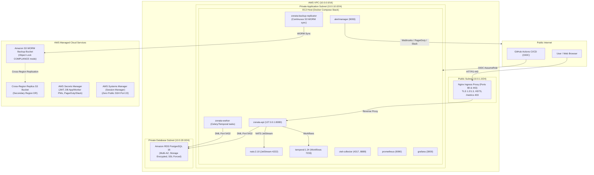

# ZONATA UNIVERSAL AI COMPANY OPERATING SYSTEM
# Cloud Staging Deployment Runbook & Operational Architecture

**Document Version:** 1.0.0-GA  
**Last Updated:** 2026-10-17  
**Target Environment:** AWS Cloud Staging & Production Deployment  

---

## 1. System Architecture & Topology

The ZONATA Cloud Staging architecture preserves the 10-service Docker Compose topology while anchoring stateful services in managed cloud infrastructure:



---

## 2. Infrastructure Cost Estimates & Resource Sizing

### Staging Environment (Cost-Optimized for Verification)
- **EC2 Instance:** `t3.xlarge` (4 vCPU, 16 GB RAM, 80 GB gp3 EBS) — ~$120/month ($0.166/hr).
- **RDS Database:** `db.t4g.micro` (Single-AZ, 20 GB gp3) — ~$15/month ($0.016/hr).
- **S3 Storage:** Primary bucket with 7-day Object Lock — <$5/month.
- **NAT Gateway:** Disabled (EC2 operates via IGW with Elastic IP to avoid ~$32/month NAT gateway charge).
- **Secrets Manager:** 2 secrets — ~$0.80/month.
- **Estimated Total Staging Cost:** **~$140/month** (or ~$4.60/day for on-demand testing).

### Production Environment (High Availability & Enterprise SLA)
- **EC2 Instance:** `t3.2xlarge` or `c6i.2xlarge` (8 vCPU, 32 GB RAM, 200 GB gp3) — ~$240/month.
- **RDS Database:** `db.r6g.xlarge` (Multi-AZ, 100 GB gp3) — ~$520/month.
- **S3 WORM + Cross-Region Replication:** 30-day compliance retention + CRR — ~$25/month.
- **NAT Gateways:** 2 AZs for private subnet isolation — ~$65/month.
- **Application Load Balancer (ALB):** ACM managed TLS certificates — ~$25/month.
- **Estimated Total Production Cost:** **~$875/month**.

---

## 3. Account & Operator Prerequisites

1. **AWS Account Access:**
   - Active AWS account with permissions to provision VPC, EC2, RDS, S3, IAM, and Secrets Manager.
   - Recommended: Dedicated IAM user or role for Terraform with MFA enabled.
2. **Domain Name & DNS:**
   - A registered domain (e.g., via Cloudflare, Route 53, Namecheap, etc.).
   - Ability to create an `A` record pointing to the staging Elastic IP / ALB.
3. **GitHub Repository Administration:**
   - Access to configure GitHub Actions secrets / variables.
   - GitHub Actions OIDC enabled (default in GitHub).
4. **Operational Alerting Receiver:**
   - Incoming Webhook URL from Slack (e.g., `#zonata-alerts`) OR PagerDuty integration key.

---

## 4. Step-by-Step Deployment Procedure

### Step 1: Clone Repository & Verify Working Tree
```bash
git clone https://github.com/sukhrajsingh82673-gif/AI-robo-assistant-saas.git
cd AI-robo-assistant-saas
git checkout engineering/production-readiness-gap-closure
git rev-parse HEAD # Verify candidate commit: 26d553b / docs: 1bc2ca4
```

### Step 2: Configure Staging Terraform Variables
```bash
cd deploy/terraform/environments/staging
cp terraform.tfvars.example terraform.tfvars

# Edit terraform.tfvars with your specific configuration:
# - aws_region                 = "us-east-1"
# - domain_name                = "staging.yourdomain.com"
# - primary_backup_bucket_name = "zonata-staging-worm-backups-ACCOUNT_ID"
```

### Step 3: Initialize & Provision Infrastructure
```bash
terraform init
terraform plan -out=staging.tfplan
terraform apply staging.tfplan
```
*Outputs will display: `staging_public_ip`, `rds_endpoint`, `rds_secret_arn`, `s3_backup_bucket_id`, `github_deployer_role_arn`.*

### Step 4: Configure DNS
Create an `A` record in your DNS provider:
- **Host:** `staging` (or `@` for apex)
- **Target Value:** `${staging_public_ip}`
- **TTL:** 300 seconds

### Step 5: Configure Application Secrets & Environment
Retrieve generated secrets from AWS Secrets Manager:
```bash
aws secretsmanager get-secret-value \
  --secret-id "zonata/staging/app_secrets" \
  --query "SecretString" --output text | jq .
```
Copy and fill in `deploy/compose/.env.staging` based on `deploy/compose/.env.staging.example`.

### Step 6: Execute Staging Deployment Script
```bash
./deploy/scripts/deploy_staging.sh
```

### Step 7: Run Post-Deployment Smoke Test
```bash
./deploy/scripts/smoke_test.sh "http://127.0.0.1:8080" "127.0.0.1"
```

### Step 8: Execute Cloud Disaster Recovery Drill
```bash
python3 deploy/scripts/cloud_restore_drill.sh
```

---

## 5. Rollback Procedure

If any anomaly or failure is detected after deployment, trigger atomic rollback:

```bash
# Automated single-command rollback to previous release commit
./deploy/scripts/rollback.sh
```
*Rollback inspects `/opt/zonata/.previous_deployed_commit`, stops degraded containers, restarts with the previous immutable image tag, and verifies `/readyz` health.*

---

## 6. SRE Operational Verification & Alerting

### Controlled Alert Delivery Verification
Trigger a controlled test alert to verify end-to-end Alertmanager delivery:
```bash
curl -H "Content-Type: application/json" -d '[{
  "labels": {
    "alertname": "TestControlledDeploymentAlert",
    "severity": "warning",
    "tier": "operational_readiness"
  },
  "annotations": {
    "summary": "Controlled staging deployment alert test",
    "description": "Verifying Alertmanager routing to external Slack/PagerDuty endpoint."
  }
}]' http://127.0.0.1:9093/api/v2/alerts
```
Confirm notification arrives in Slack / PagerDuty and is recorded in Alertmanager UI (`http://127.0.0.1:9093`).
