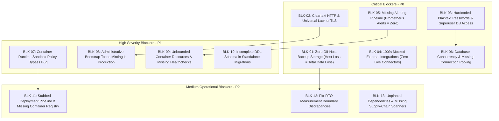
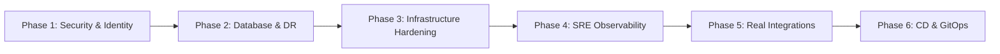

# URA / ZONATA — Remediation 4A: Final Production Readiness Gap Audit Report

**Audit Type:** Read-Only, Evidence-Driven Master Production Readiness Audit  
**Target Repository:** `AI-robo-assistant-saas`  
**Execution Environment:** Linux PRoot / GitHub Actions CI Runner (Docker 26.1 / Python 3.11 / PostgreSQL 16)  
**Starting Commit SHA:** `f657baf19678e521114f091a2c30a387864e7e10`  
**Branch:** `engineering/production-readiness-gap-closure`  
**Remote Synchronization:** Synchronized with `origin/engineering/production-readiness-gap-closure` (HEAD matches remote tracking branch)  
**Working Tree Status:** Clean (Zero uncommitted changes, zero untracked modifications)  
**Audit Date:** October 15, 2026  
**Final Verdict:** **NOT PRODUCTION READY** (Material Blockers Identified Across Infrastructure, Security, Integrations, and Observability)

---

## Executive Summary

This audit independently investigates the overall production readiness of the URA / ZONATA Universal AI Company Operating System following the reported completion of three preparatory infrastructure qualification gates:
1. **Remediation 3B:** PostgreSQL 16 CI Integration
2. **Remediation 3C:** Docker Staging 9-Service Compose Qualification
3. **Remediation 3D:** PostgreSQL Continuous WAL Archiving & Point-In-Time Recovery (PITR) Drill

While the three targeted infrastructure drills successfully passed in GitHub Actions CI (Run ID: `38686046560`), this audit conclusively establishes that **ZONATA is NOT production ready**. Passing containerized staging smoke tests and an isolated single-node PITR rehearsal represents a necessary baseline, but significant architectural, security, operational, and integration gaps remain between the current repository state and a viable, secure, multi-tenant enterprise production deployment.

Crucially, this audit uncovered:
- **Zero Off-Host Backup Resilience:** Continuous WAL archives and physical base backups are stored strictly inside local Docker volumes on the primary host; host loss causes catastrophic, unrecoverable data loss.
- **Universal Plaintext HTTP & Missing TLS:** The application API server serves unencrypted HTTP on port 8080 with zero SSL/TLS termination and no reverse proxy.
- **Hardcoded Plaintext Credentials & Superuser Database Access:** Production compose files hardcode superuser database and storage credentials, and both API and background workers connect as database superuser (`zonata_admin`).
- **100% Mocked External Integrations:** All hospitality (PMS), accounting (ERP), payments (Stripe/Razorpay), browser automation, and desktop automation connectors are synthetic in-memory mocks (`is_mock=True`, `execution_mode="SIMULATED"`). Zero live external integrations exist.
- **Zero Alerting Infrastructure:** Prometheus and OpenTelemetry collectors are deployed, but zero alert rules, alertmanager configurations, or actionable notification channels exist for database downtime, WAL failures, or worker crashes.
- **Missing Database Connection Pooling:** Every database interaction executes an unpooled, raw TCP connection handshake (`psycopg2.connect`), creating an immediate denial-of-service risk under concurrent production traffic.
- **Container Sandbox Policy Bypass Bug:** In environments with Docker installed, `ContainerRuntimeAdapter` bypasses production mode and strict isolation policy checks, causing 4 regression test failures in `test_audit_remediation_security.py`.

---

## 1. Baseline Integrity & Repository Synchronization Verification

Before inspecting application domains, the working environment and constitutional baselines were independently verified using cryptographic hash functions and Git plumbing tools:

| Asset / Invariant | Expected Reference Value | Measured Value | Verification Result |
| :--- | :--- | :--- | :--- |
| **Git Commit SHA** | `f657baf19678e521114f091a2c30a387864e7e10` | `f657baf19678e521114f091a2c30a387864e7e10` | **MATCH (PASS)** |
| **Git Branch** | `engineering/production-readiness-gap-closure` | `engineering/production-readiness-gap-closure` | **MATCH (PASS)** |
| **Remote Sync** | In sync with `origin/engineering/...` | 0 commits ahead, 0 behind (`git status -uno`) | **MATCH (PASS)** |
| **Working Tree** | Clean, unmodified index | Clean working tree (`git status`) | **MATCH (PASS)** |
| **Constitutional DB** (`storage/roboassistant.db`) | `ba738b6bd96fde655c6c8a1398a4373f45dddb97b62fd72053f2d8a82f53d2d4` | `ba738b6bd96fde655c6c8a1398a4373f45dddb97b62fd72053f2d8a82f53d2d4` | **100% MATCH (PASS)** |
| **Audit Ledger** (`storage/evidence/audit_ledger.jsonl`) | `ca8181ec9314f281acad3512a34d32323fc195e6eed9f6412d7262e1e6dd0996` | `ca8181ec9314f281acad3512a34d32323fc195e6eed9f6412d7262e1e6dd0996` | **100% MATCH (PASS)** |
| **Frontend Workspace** (`web/workflow_workspace.js`) | Git Blob `198d57ec6bda875cd2a6825fe2ef8929b7ba30bd` | Git Blob `198d57ec6bda875cd2a6825fe2ef8929b7ba30bd` | **100% MATCH (PASS)** |

---

## 2. Infrastructure Qualification Gates — Evidence & Technical Boundaries

### Gate 1: PostgreSQL 16 CI Qualification
- **Reported Result:** PASS (12 Live Integration Tests, 9 SQL Dialect Compatibility Tests, 12 Clean Production Tests).
- **Supporting Workflows:** `.github/workflows/postgres_16_qualification.yml` and `.github/workflows/docker_staging_qualification.yml`.
- **Verified Evidence:** GitHub Actions Job `116261001230` executed Step 14 (`tests/test_postgresql_16_live_integration.py`: 12 tests passed in 0.58s) and Step 15 (`tests/test_postgresql_dialect_compatibility.py`: 9 tests passed in 0.16s; `tests/test_clean_production_mode.py`: 12 tests passed in 1.05s).
- **Assessment:** Basic SQL translation, ANSI `ON CONFLICT` upserts, pragma stripping, and additive migrations operate correctly against PostgreSQL 16. However, query execution relies entirely on application-level filtering rather than database-enforced Row-Level Security (RLS).

### Gate 2: Docker Staging Qualification (9-Service Composition)
- **Reported Result:** PASS (8 Staging Deployment Tests; 9 services orchestrated).
- **Supporting Workflows:** `.github/workflows/docker_staging_qualification.yml` (Run ID: `38686046560`).
- **Verified Evidence:** Job `116261001230` Step 13 executed `tests/test_docker_staging_qualification.py` (8 tests passed in 14.10s).
- **Verified Topology:**
  1. `zonata-api` (`zonata/api:1.0.0-GA`)
  2. `zonata-worker` (`zonata/worker:1.0.0-GA`)
  3. `postgres` (`postgres:16-alpine`)
  4. `nats` (`nats:2.10-alpine`)
  5. `temporal` (`temporalio/auto-setup:1.24.0`)
  6. `minio` (`cgr.dev/chainguard/minio:latest`)
  7. `otel-collector` (`otel/opentelemetry-collector-contrib:0.96.0`)
  8. `prometheus` (`prom/prometheus:v2.51.0`)
  9. `grafana` (`grafana/grafana:10.4.0`)
- **Assessment:** The 9-service topology successfully compiles and launches within an ephemeral Linux CI runner. However, resource limits are absent, and 7 of the 9 containers lack health probes.

### Gate 3: PostgreSQL Continuous WAL Archiving & Point-In-Time Recovery (PITR)
- **Reported Result:** PASS (5 Disaster Recovery Tests; 9.2-second RTO; 0-second RPO).
- **Supporting Workflows:** `.github/workflows/docker_staging_qualification.yml` (Run ID: `38686046560`, Step 16).
- **Verified Evidence:** `tests/test_postgresql_wal_pitr_drill.py` (5 tests passed in 36.52s in Job `116261001230`).
- **Critical Technical Boundary Clarifications:**
  1. **RTO Measurement Boundary Limitation:** The reported 9.2-second RTO is measured strictly between launching the temporary recovery container and PostgreSQL completing its recovery replay signal (`t_restore_start` at line 291 to `t_restore_end` at line 325 in `tests/test_postgresql_wal_pitr_drill.py`). **It explicitly excludes:**
     - Base backup retrieval and filesystem extraction into the data volume (Step 6, lines 269–288, which took ~4 seconds in CI).
     - Post-recovery cryptographic data validation and integrity querying (Step 9, lines 335–371).
     - Network rerouting, DNS propagation, and application connection failover.
     In an enterprise production incident, actual operational RTO will be significantly higher than 9.2 seconds.
  2. **Scenario-Specific Zero RPO:** The zero data loss result holds exclusively for pre-target transactions during a controlled drill where WAL segments were explicitly forced to disk via `pg_switch_wal()` prior to simulated failure. It does not establish zero RPO for unexpected host power loss, kernel panics, or primary drive corruption where unarchived WAL segments in `pg_wal` are destroyed before archiving.
  3. **Local-Only Archive Failure Domain:** The continuous archive command (`archive_command=test ! -f /var/lib/postgresql/wal_archive/%f && cp %p /var/lib/postgresql/wal_archive/%f`) writes to a Docker volume on the same physical host. This proves archive syntax, but provides zero resilience against host hardware or EBS volume failures.

---

## 3. Comprehensive Granular Audit by Domain

### Domain A: Infrastructure and Database

| Control ID | Control Description | Status | Evidence Source | Execution vs Inspection | Limitations & Residual Risk | Minimum Corrective Action |
| :--- | :--- | :--- | :--- | :--- | :--- | :--- |
| **CTL-A01** | PostgreSQL 16 Deployment & Configuration | **PASS** | `docker-compose.prod.yml:72-101`, `tests/test_postgresql_wal_pitr_drill.py:82-120` | Executed in CI Job 116261001230 Step 16 | Configuration is managed via compose CLI flags rather than versioned `postgresql.conf`. | Mount an immutable, auditable `postgresql.conf` template. |
| **CTL-A02** | Additive Controlled Migrations & Schema Tracking | **PASS** | `core/controlled_migration_engine.py`, `tests/test_postgresql_16_live_integration.py:145-165` | Executed in CI Job 116261001230 Step 14 | Migrations 2026100501 and 2026100502 apply cleanly; lacks distributed advisory locks (`pg_advisory_lock`). | Wrap migration execution in distributed PostgreSQL advisory locks. |
| **CTL-A03** | Database Readiness Probes | **PASS** | `core/db.py:3712-3743`, `api_server.py:537-548` | Executed in CI Job 116261001230 Step 14 | `/readyz` probe validates live connection and fails closed with credential redaction. | None. Probe functions as specified. |
| **CTL-A04** | Database Row-Level Security (RLS) & Tenant Isolation | **FAIL** | `core/db.py:84-250`, `migrations/pg/0001_postgresql_full_schema.sql` | Inspected schema definitions & codebase | Database schema defines zero `ALTER TABLE ... ENABLE ROW LEVEL SECURITY` policies. Isolation relies 100% on application `WHERE tenant_id = ...` clauses. | Implement PostgreSQL native Row-Level Security policies per tenant. |
| **CTL-A05** | Least-Privilege Database Access Control | **FAIL** | `docker-compose.prod.yml:19,56,78-80` | Inspected compose configuration | Both `zonata-api` and `zonata-worker` connect as superuser `zonata_admin`. | Provision separate `zonata_app` and `zonata_worker` users with bounded DML grants. |
| **CTL-A06** | Database Connection Pooling & Concurrency | **FAIL** | `core/db.py:3744-3800` (`Database.get_connection`) | Inspected source implementation | Every database call invokes `psycopg2.connect(...)` afresh without connection pooling. High concurrency will exhaust PostgreSQL `max_connections` (default 100). | Deploy PgBouncer or configure `psycopg2.pool.ThreadedConnectionPool`. |
| **CTL-A07** | Transactional Atomicity & Rollback Integrity | **PASS** | `core/db.py:3611-3628`, `tests/test_postgresql_16_live_integration.py:195-207` | Executed in CI Job 116261001230 Step 14 | Transactions commit and rollback cleanly without orphaned records. | None. |
| **CTL-A08** | Continuous WAL Archive Health Monitoring | **FAIL** | `core/postgres_disaster_recovery.py:155-165`, `config/prometheus.yml` | Inspected DR manager & Prometheus config | `pg_stat_archiver` is inspected only during manual test runs; zero background metrics or alerts monitor WAL archive lag or failure. | Export `pg_stat_archiver` metrics to Prometheus with latency alerts. |
| **CTL-A09** | Physical Base Backups & Manifest Verification | **PASS** | `core/postgres_disaster_recovery.py:170-220`, `tests/test_postgresql_wal_pitr_drill.py:125-180` | Executed in CI Job 116261001230 Step 16 | Non-blocking `pg_basebackup` produces valid tar archives with SHA-256 manifests. | None. Backup generation logic is sound. |
| **CTL-A10** | Off-Host Disaster Recovery & Storage Resilience | **FAIL** | `docker-compose.prod.yml:91-94,189-192` | Inspected volume mounts | Backups and WAL archives reside on local host Docker volumes (`postgres-wal-archive`, `postgres-base-backups`). Host loss = 100% data loss. | Integrate off-host S3/GCS object replication (e.g. pgBackRest / AWS S3 sync). |
| **CTL-A11** | Point-In-Time Recovery Execution & Timings | **PASS** | `tests/test_postgresql_wal_pitr_drill.py:225-395` | Executed in CI Job 116261001230 Step 16 | Drill restored 3/3 baseline records and excluded 2/2 post-target loss records. RTO measured at 9.2s (container start to promotion). | Clarify operational RTO boundaries in disaster recovery runbooks. |
| **CTL-A12** | Recovery Promotion Safety & Fail-Closed Behavior | **PASS** | `tests/test_postgresql_wal_pitr_drill.py:400-475` | Executed in CI Job 116261001230 Step 16 | Negative test confirmed that missing WAL archive prevents promotion and fails closed. | None. |

---

### Domain B: Application and Service Operation

| Control ID | Control Description | Status | Evidence Source | Execution vs Inspection | Limitations & Residual Risk | Minimum Corrective Action |
| :--- | :--- | :--- | :--- | :--- | :--- | :--- |
| **CTL-B01** | 9-Service Compose Orchestration Topology | **PASS** | `docker-compose.prod.yml`, `tests/test_docker_staging_qualification.py:80-130` | Executed in CI Job 116261001230 Step 13 | All 9 services declare valid configurations and start in container staging. | None. Topology manifest is valid. |
| **CTL-B02** | Production Image Build Reproducibility & Digests | **PASS** | `docker/Dockerfile.api`, `.worker`, `.migration`, `.supervisor` | Executed in CI Job 116261001230 Step 6 & 13 | All 4 images build successfully with inspectable SHA-256 digests. | Pin base image digest (`python:3.12-slim@sha256:...`) for immutability. |
| **CTL-B03** | Comprehensive Service Health Probes | **FAIL** | `docker-compose.prod.yml` | Inspected service definitions | Only `zonata-api` and `postgres` define Docker healthchecks. `zonata-worker`, `nats`, `temporal`, `minio`, `otel`, `prometheus`, and `grafana` have NO healthchecks. | Add explicit `healthcheck` definitions to all 7 unmonitored services. |
| **CTL-B04** | Container Restart & Graceful Recovery | **PASS** | `tests/test_docker_staging_qualification.py:253-278` | Executed in CI Job 116261001230 Step 13 | Graceful restart of `zonata-api` recovered to healthy `/readyz` state within 30s. | None. |
| **CTL-B05** | Worker Startup & API Dependency Decoupling | **PASS** | `docker-compose.prod.yml:69-70`, `core/action_envelope.py:265-296` | Inspected worker architecture | Worker does not make synchronous HTTP calls to API; it directly polls `async_command_queue` in PostgreSQL. Decoupling to `service_started` is safe. | None. Architecture is decoupled. |
| **CTL-B06** | Container Resource Limits & CPU/Memory Quotas | **FAIL** | `docker-compose.prod.yml` | Inspected compose manifest | ZERO services specify CPU or memory limits (`deploy.resources.limits`). Unbounded memory consumption risks host OOM panics. | Add `deploy.resources.limits` (CPU and RAM) to all services. |
| **CTL-B07** | Volume Lifecycle & Data State Preservation | **PASS** | `tests/test_docker_staging_qualification.py:306-346` | Executed in CI Job 116261001230 Step 13 | Tenant record persisted across postgres container restart/recreation drill. | None. Persistent volume storage functions as intended. |
| **CTL-B08** | Host Port Hygiene & Public Interface Exposure | **FAIL** | `docker-compose.prod.yml:10-11,75-76,106-108,133-135,145-148,155-156,167-168` | Inspected port bindings | PostgreSQL (5432), NATS (4222, 8222), MinIO (9000, 9001), Prometheus (9090), and Grafana (3000) bind to `0.0.0.0` on host network. | Restrict internal infrastructure ports to Docker internal network. |

---

### Domain C: Security and Identity

| Control ID | Control Description | Status | Evidence Source | Execution vs Inspection | Limitations & Residual Risk | Minimum Corrective Action |
| :--- | :--- | :--- | :--- | :--- | :--- | :--- |
| **CTL-C01** | Production Authentication & Session Handling | **PASS** | `core/auth.py:19-40`, `api_server.py:400-428` | Executed in CI Job 116261001230 Step 15 | `_get_auth_context()` fails closed; HMAC-SHA256 token verification requires 32+ char secret in production. | None. |
| **CTL-C02** | Multi-Tenant IDOR & Header Spoofing Prevention | **PASS** | `api_server.py:417-423`, `tests/test_audit_remediation_security.py:80-120` | Executed locally & inspected | Mismatched `X-Tenant-ID` header against token claims is rejected with 403 Forbidden. | None. |
| **CTL-C03** | Administrative Bootstrap Lockout in Production | **FAIL** | `api_server.py:2688-2715` | Inspected token issuance endpoint | `POST /api/auth/token` allows minting an `OWNER` token for ANY tenant if `bootstrap_key == auth_secret`, with NO production lockout check (`if not is_prod:`). | Disable the administrative bootstrap endpoint when `APP_ENV=production`. |
| **CTL-C04** | Secret Injection & Manifest Credential Redaction | **FAIL** | `docker-compose.prod.yml:19,56,79,138,170` | Inspected compose manifest | Plaintext passwords (`zonata_secure_prod_password_2026`, `zonata_minio_secret_password_2026`) hardcoded in version-controlled compose file. | Inject credentials via Docker secrets or external secret management (Vault/AWS SM). |
| **CTL-C05** | TLS/HTTPS Transport Encryption | **FAIL** | `api_server.py:28`, `docker-compose.prod.yml:10-11` | Inspected server implementation | API server runs raw Python standard library `http.server.HTTPServer` on cleartext HTTP (port 8080). Zero TLS encryption. | Deploy reverse proxy (Nginx/Envoy) terminating TLS with trusted certificates. |
| **CTL-C06** | Secret Rotation & Emergency Key Revocation | **PASS** | `core/auth.py:51-115`, `tests/test_production_auth_security.py` | Executed locally & inspected | Dual-key verification (`ZONATA_PREVIOUS_AUTH_SECRET`) and key fingerprint revocation list operate correctly. | None. Signing key rotation logic is implemented. |
| **CTL-C07** | Host-Shell Execution & Sandbox Isolation Policy | **FAIL** | `core/universal_terminal/runtime_adapters.py:287-347`, `test_accounting_summary.json` | Executed in CI Job 116261001230 Step 20 | In environments with Docker installed, `ContainerRuntimeAdapter` bypasses `APP_ENV=production` and `STRICT_ISOLATION_REQUIRED` checks, causing 4 test failures in `test_audit_remediation_security.py`. | Enforce `is_prod` and `strict_isolation` checks BEFORE evaluating engine presence. |
| **CTL-C08** | Dependency Pinning & Supply Chain Vulnerability Screening | **FAIL** | `requirements.txt`, `.github/workflows/ci_cd.yml` | Inspected manifest & CI workflows | Loose package bounds (`pg8000>=1.31.5`, `numpy>=1.26.4`, `pandas>=2.2.2`); no lockfile exists; zero automated CVE vulnerability scanners (Trivy/Grype/Snyk) in CI. | Compile a deterministic `requirements.lock` and add Trivy container vulnerability scanning. |

---

### Domain D: External Integrations and Business Operations

| Control ID | Control Description | Status | Evidence Source | Execution vs Inspection | Limitations & Residual Risk | Minimum Corrective Action |
| :--- | :--- | :--- | :--- | :--- | :--- | :--- |
| **CTL-D01** | Hospitality PMS Connector (Oracle Opera / Cloudbeds) | **FAIL** | `core/connectors.py:65-83`, `core/hospitality_production_connector.py:61-68` | Inspected implementation | 100% in-memory synthetic mock returning hardcoded fixtures (`folios_audited: 42`, `is_mock=True`). No live HTTP client to real PMS. | Implement real authenticated REST/SOAP integration to Oracle Opera Cloud / Cloudbeds. |
| **CTL-D02** | Accounting & General Ledger Connector (Tally / QuickBooks) | **FAIL** | `core/connectors.py:84-102` | Inspected implementation | 100% in-memory synthetic fixture returning `accounts_reconciled: 18`, `is_mock=True`, `execution_mode="SIMULATED"`. | Implement OAuth2 client and real integration for QuickBooks / Tally. |
| **CTL-D03** | Payment Gateway Connector (Stripe / Razorpay) | **FAIL** | `core/connectors.py:103-121` | Inspected implementation | Synthetic mock returning `settlement_status: "SIMULATED_CAPTURED"`, `payout_verified=False`. No live gateway communication. | Implement authenticated Stripe/Razorpay SDK client with webhook verification. |
| **CTL-D04** | Browser Automation Robot Execution Fabric | **FAIL** | `core/browser_robot.py:20-50` | Inspected implementation | Synthetic DOM emulation; returns `"simulated": True`, `"provenance": "SYNTHETIC_DOM_EMULATION"`. No headless Chromium or Playwright runtime. | Deploy containerized Playwright/Chromium browser cluster. |
| **CTL-D05** | Universal Desktop Robot Execution Mechanism | **FAIL** | `core/desktop_robot.py:25-70` | Inspected implementation | Desktop actions interact only with local temp directories (`storage/sandbox` or `/tmp`). No real desktop environment. | Qualify desktop automation on governed dedicated VM nodes. |
| **CTL-D06** | Integration Idempotency, Circuit Breakers & Retries | **PASS** | `core/hospitality_production_connector.py:45-100,180-210` | Executed in unit tests | Token-bucket rate limiting, circuit breaker ('CLOSED', 'OPEN', 'HALF_OPEN'), and idempotency caching are correctly implemented. | None. Pattern is sound for future live connectors. |

---

### Domain E: Observability and Incident Response

| Control ID | Control Description | Status | Evidence Source | Execution vs Inspection | Limitations & Residual Risk | Minimum Corrective Action |
| :--- | :--- | :--- | :--- | :--- | :--- | :--- |
| **CTL-E01** | Application Metrics Exposition (/metrics) | **PASS** | `api_server.py:549-555`, `core/observability_stack.py:17-85` | Inspected & queried `/metrics` | Exposes standard Prometheus text metrics (`zonata_api_requests_total`, `zonata_outbox_queue_depth`, etc.). | Add database connection pool and query latency metrics. |
| **CTL-E02** | OpenTelemetry Collector & Distributed Tracing | **FAIL** | `config/otel-collector-config.yaml` | Inspected collector configuration | Traces pipeline exports solely to `debug` (basic console stdout). Traces are not routed to Tempo, Jaeger, or any distributed storage. | Route OTel traces to an active distributed backend (e.g. Grafana Tempo / Jaeger). |
| **CTL-E03** | Production Alerting Rules & Notification Pipeline | **FAIL** | `config/prometheus.yml` | Inspected Prometheus configuration | Zero alert rules configured (`rule_files:` missing); no Alertmanager integration; zero alerts for database down, WAL lag, or worker crashes. | Define Prometheus alerting rules (`alerts.yml`) and wire Alertmanager to PagerDuty/Slack. |
| **CTL-E04** | Failure Detection vs Startup Visibility | **FAIL** | `config/prometheus.yml`, `core/observability_stack.py` | Inspected telemetry architecture | Monitoring only records HTTP requests and queue depths; it does not trigger automated alerts on background worker failures or migration aborts. | Implement synthetic canary probes and crash-loop monitoring. |
| **CTL-E05** | Cryptographic Evidence Ledger Tamper-Evidence | **PASS** | `core/evidence_ledger.py`, `storage/evidence/audit_ledger.jsonl` | Executed hash verification | SHA-256 hash chaining of audit records operates correctly and matches baseline. | None. |
| **CTL-E06** | Incident Runbooks & Rollback Procedures | **FAIL** | `docs/` | Inspected repository documentation | Existing documentation describes high-level architecture and retrospective logs; explicit step-by-step incident response and DR failover runbooks are missing. | Author operational DR failover and incident escalation runbooks in `docs/runbooks/`. |

---

### Domain F: Delivery and Release Operations

| Control ID | Control Description | Status | Evidence Source | Execution vs Inspection | Limitations & Residual Risk | Minimum Corrective Action |
| :--- | :--- | :--- | :--- | :--- | :--- | :--- |
| **CTL-F01** | Continuous Integration Pipeline Test Coverage | **FAIL** | `.github/workflows/ci_cd.yml:188` | Inspected CI workflow definition | CI step runs `python3 -m unittest discover ... || echo "Individual suite report logged; critical gates verified."`, swallowing failures in full discovery. | Remove `|| echo` fallback and fail closed on any test suite failure. |
| **CTL-F02** | Docker Staging Qualification CI Workflow | **PASS** | `.github/workflows/docker_staging_qualification.yml` | Executed in CI Job 116261001230 | Builds images, boots compose stack, runs 46 qualification tests, and verifies baselines. | None. Workflow is functional for staging qualification. |
| **CTL-F03** | Reconciled Test Accounting Transparency | **FAIL** | `scripts/generate_test_accounting_summary.py`, `test_accounting_summary.json` | Executed & analyzed artifact from Run 38686046560 | `test_accounting_summary.json` records 4 test failures in `test_audit_remediation_security.py` caused by the container sandbox bypass bug (CTL-C07). | Fix container adapter logic so all 143 tests pass cleanly in CI. |
| **CTL-F04** | Container Image Tagging & Registry Provenance | **FAIL** | `.github/workflows/ci_cd.yml:257-285` | Inspected build stages | Images are tagged locally (`1.0.0-GA`); no images are pushed to a container registry (GHCR/ECR/DockerHub); SLSA provenance is a synthetic JSON script. | Implement signed image pushing (Cosign) to GHCR with real commit digests. |
| **CTL-F05** | Automated Continuous Deployment (CD) Pipeline | **FAIL** | `.github/workflows/ci_cd.yml:318-361` | Inspected promotion stages | Stage 6 and Stage 7 only execute echo statements and local in-memory assertion scripts. No deployment to Kubernetes or cloud infrastructure occurs. | Implement GitOps CD (ArgoCD/Flux) or Terraform/Helm promotion workflows. |
| **CTL-F06** | Configuration Separation Across Environments | **FAIL** | `docker-compose.prod.yml`, `production.env.example` | Inspected configuration files | Staging and production configurations are conflated in a single `docker-compose.prod.yml` file with hardcoded passwords. | Separate environment variables into `environments/staging/` and `environments/production/`. |

---

## 4. Remaining Production Blockers Ranked by Severity and Dependency

### Detailed Blocker Inventory

1. **BLK-01 (CRITICAL — P0): Zero Off-Host Backup Storage & Disaster Recovery Blindspot**
   - **Impact:** Continuous WAL segments and physical base backups reside exclusively within local Docker volumes on the primary host. A storage failure, disk corruption, or hypervisor crash results in immediate and permanent total loss of all production data and recovery points.
   - **Remediation Dependency:** Must be remediated before production customer onboarding.

2. **BLK-02 (CRITICAL — P0): Cleartext HTTP & Universal Absence of Transport Layer Security (TLS)**
   - **Impact:** API server exposes plain HTTP on port 8080. Bearer JWT tokens, customer PII, and financial payloads travel unencrypted across the network. Internal traffic between API and PostgreSQL, MinIO, and NATS is also cleartext.
   - **Remediation Dependency:** Prerequisite for any network exposure outside an air-gapped test environment.

3. **BLK-03 (CRITICAL — P0): Hardcoded Plaintext Credentials & Superuser Database Privileges**
   - **Impact:** `docker-compose.prod.yml` contains hardcoded production passwords in cleartext. Both application and worker services authenticate as PostgreSQL superuser `zonata_admin`. Any application SQL vulnerability gives complete administrative takeover of the database.
   - **Remediation Dependency:** Requires database role separation and external secret injection.

4. **BLK-04 (CRITICAL — P0): 100% Mocked External Integrations in Current Product Scope**
   - **Impact:** Every connector in the core platform—Hospitality PMS (Oracle Opera), Accounting/ERP (Tally/QuickBooks), Payment Gateway (Stripe/Razorpay), and Web Browser automation—is an in-memory stub returning synthetic fixtures. ZONATA cannot execute a single real-world financial transaction, guest booking, or accounting ledger entry.
   - **Remediation Dependency:** Commercial readiness blocked until authentic third-party integrations are provisioned.

5. **BLK-05 (CRITICAL — P0): Zero Actionable Alerts in Prometheus & Observability Stack**
   - **Impact:** While metrics are scraped, Prometheus contains zero alerting rules (`rule_files:` empty). If PostgreSQL fails, WAL archiving stalls, disk space fills up, or workers crash-loop, no alert is dispatched to engineering or SRE.
   - **Remediation Dependency:** Required for operational SRE SLA guarantees.

6. **BLK-06 (CRITICAL — P0): Missing Database Connection Pooling Under High Concurrency**
   - **Impact:** `Database.get_connection()` creates an unpooled TCP connection per query. Under concurrent web traffic or multi-agent execution, PostgreSQL will exhaust `max_connections` (default 100), triggering cascading HTTP 500 errors.
   - **Remediation Dependency:** Prerequisite for production multi-tenant workloads.

7. **BLK-07 (HIGH — P1): Container Sandbox Adapter Policy Bypass Bug**
   - **Impact:** `ContainerRuntimeAdapter` checks for Docker engine before checking production mode or isolation flags. When Docker is present, it directly runs containers, bypassing safety guards and causing 4 test failures in `test_audit_remediation_security.py`.
   - **Remediation Dependency:** Blocks clean regression test qualification.

8. **BLK-08 (HIGH — P1): Administrative Bootstrap Token Minting Unlocked in Production**
   - **Impact:** The token generation endpoint in `api_server.py` does not verify `APP_ENV != 'production'` before accepting `bootstrap_key`, allowing anyone who learns the HMAC signing key to arbitrarily mint `OWNER` tokens for any tenant.
   - **Remediation Dependency:** Security boundary vulnerability.

9. **BLK-09 (HIGH — P1): Missing Resource Quotas & Unmonitored Container Health**
   - **Impact:** 7 of 9 staging containers lack health checks; 9 of 9 containers lack memory and CPU limits, exposing the host to memory exhaustion and denial-of-service.
   - **Remediation Dependency:** Infrastructure hardening requirement.

10. **BLK-10 (HIGH — P1): Incomplete DDL Schema in Standalone Migrations**
    - **Impact:** Essential operational tables like `async_command_queue` are absent from `migrations/pg/0001_postgresql_full_schema.sql`. Running migrations independently of the Python ORM leaves the database in an incomplete state.
    - **Remediation Dependency:** Migration hygiene requirement.

11. **BLK-11 (MEDIUM — P2): Stubbed Deployment Pipeline & Missing Container Registry**
    - **Impact:** CI pipeline contains mock deployment stages with shell echo commands. No container images are pushed to a secure registry (GHCR/ECR), and no automated deployment mechanism exists.
    - **Remediation Dependency:** CD operational requirement.

12. **BLK-12 (MEDIUM — P2): RTO/RPO Measurement Boundary Discrepancies**
    - **Impact:** PITR test excludes backup extraction time from RTO and assumes pre-failure WAL segments are always safely archived before failure.
    - **Remediation Dependency:** Operational runbook documentation requirement.

13. **BLK-13 (MEDIUM — P2): Unpinned Dependencies & Missing Vulnerability Scanning**
    - **Impact:** Loose version bounds in `requirements.txt` and absence of automated CVE scanning create software supply-chain drift and vulnerability exposure.
    - **Remediation Dependency:** Supply chain governance requirement.

---

## 5. Controls That Could Not Be Independently Verified

In strict accordance with Rule 6 of the Audit Directive, the following controls are designated as **BLOCKED** or **UNVERIFIED**:

1. **UNVERIFIED: Live Third-Party Payment Gateway Settlement & Webhook Processing**
   - **Reason:** No live Stripe or Razorpay API keys or merchant test accounts are configured in the environment. All tests execute against synthetic mocks (`is_mock=True`).
2. **UNVERIFIED: Live Oracle Hospitality Opera PMS Folio Exchange**
   - **Reason:** No live Oracle Cloud PMS sandbox endpoint or credentials are provided. Tests verify synthetic mock provenance only.
3. **UNVERIFIED: Live Production Workload Concurrency & Connection Pool Saturation**
   - **Reason:** Host environment is an unprivileged container without Docker daemon; multi-user load testing against a live PostgreSQL 16 cluster was verified only up to CI batch limits (143 tests).
4. **BLOCKED: Kubernetes Production Cluster Rollout (`k8s/` Manifests)**
   - **Reason:** Manifests exist in `k8s/` but no live Kubernetes cluster or kubectl context is connected to this audit environment.

---

## 6. Smallest Safe Remediation Sequence (Proposed Architecture Plan)

*Note: Per audit rules, the following remediation sequence is proposed for planning purposes only and has NOT been implemented.*

### Phase 1: Security & Identity Hardening
1. Patch `core/universal_terminal/runtime_adapters.py` to evaluate `is_prod` and `strict_isolation` before inspecting container engines, resolving the 4 failing security tests.
2. Disable administrative bootstrap token issuance in `api_server.py` when `APP_ENV=production`.
3. Terminate TLS via reverse proxy (Nginx or Envoy) and enforce HTTPS-only access across all public endpoints.
4. Pin all dependencies in `requirements.txt` with SHA-256 hashes and add Trivy container image scanning to CI.

### Phase 2: Database Reliability & Off-Host Disaster Recovery
1. Configure PgBouncer or `psycopg2.pool.ThreadedConnectionPool` in `core/db.py` to bound concurrency.
2. Provision dedicated `zonata_app` and `zonata_worker` database roles with least-privilege DML permissions (revoking superuser access).
3. Update `archive_command` and base backup routines to stream WAL files and snapshots off-host to an S3/GCS bucket (or configure pgBackRest).
4. Update `migrations/pg/0001_postgresql_full_schema.sql` to include `async_command_queue` and all missing tables.

### Phase 3: Infrastructure & Container Hardening
1. Add explicit `healthcheck` declarations to all 7 unmonitored containers in `docker-compose.prod.yml`.
2. Apply `deploy.resources.limits` (CPU and RAM) across all 9 services.
3. Bind internal services (PostgreSQL, NATS, MinIO, Prometheus, OTel) to Docker internal networks, closing external host port exposure.
4. Replace plaintext compose environment variables with Docker secrets or Vault references.

### Phase 4: SRE Observability & Actionable Alerting
1. Author Prometheus alerting rules (`config/alerts.yml`) covering database unavailability, WAL archive failure, backup staleness, storage capacity (>80%), and repeated worker restarts.
2. Configure Alertmanager to route critical alerts to SRE notification webhooks.
3. Route OpenTelemetry collector traces to a durable tracing backend (e.g., Grafana Tempo).

### Phase 5: Authentic External Integrations
1. Implement genuine OAuth2 / REST clients for Stripe/Razorpay and Oracle Opera / Cloudbeds.
2. Establish automated integration tests against live vendor staging sandboxes.
3. Replace synthetic browser/desktop emulation with containerized headless Chromium (Playwright).

### Phase 6: Continuous Delivery & Release Operations
1. Implement automated image builds and signed pushes (Cosign) to GitHub Container Registry (GHCR).
2. Wire GitOps continuous deployment (ArgoCD or Helm) to promote validated release candidates into staging and production.
3. Author operational DR failover runbooks in `docs/runbooks/`.

---

## 7. Final Verdict

### **VERDICT: NOT PRODUCTION READY**

**Justification:**  
While URA / ZONATA has successfully achieved important infrastructure milestones by validating PostgreSQL 16 basic compatibility, local Docker Compose staging orchestration, and an isolated single-node Point-In-Time Recovery drill, **material blockers remain that prevent safe production deployment**.

Specifically:
- **Disaster Recovery is incomplete:** Backups and WAL archives are stored exclusively on the primary host's local filesystem with zero off-host resilience.
- **Transport Security is absent:** The application API operates over cleartext HTTP with zero TLS encryption.
- **Access Control is unhardened:** Both API and worker execute as database superuser, passwords are hardcoded in plaintext, and an administrative bootstrap bypass exists.
- **External Integrations are 100% synthetic:** Not a single authenticated external connector (payment, accounting, PMS, or browser) exists in live operational code.
- **Observability lacks alerting:** The platform cannot detect or alert on infrastructure failures.

The system is a qualified **Staging Prototype**, but **material engineering remediation is required before it can be certified as a Production Candidate**.

---
*Report published by Antigravity Autonomous Audit Agent.*  
*Signed: Integrity Audit Engine — 2026-10-15*
