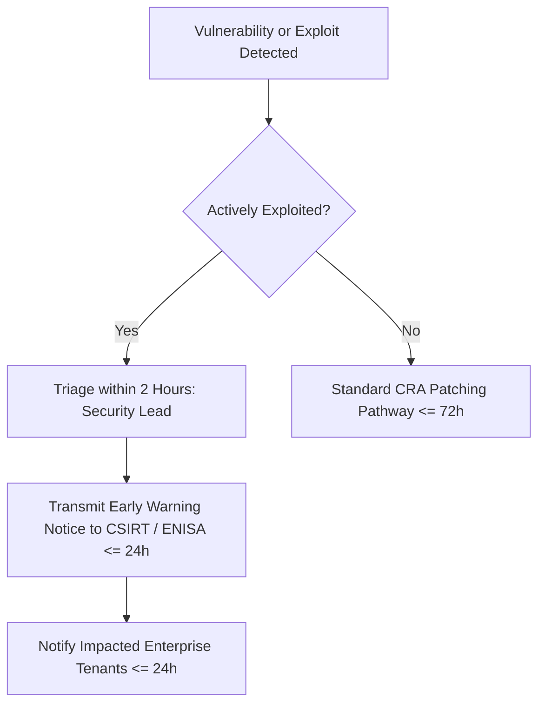

# Cyber Resilience Act (CRA) Incident & Vulnerability Handling Runbook

## Regulation Context
**Governing Regulation:** Regulation (EU) 2024/2847 (Cyber Resilience Act - CRA), Articles 11, 14, and Annex I.  
**Scope:** Covers all software components, microservices, Edge Gateway, and third-party dependencies of the ZONATA Platform.

---

## 1. 24-Hour Early Warning Workflow (CSIRT / ENISA)
Under CRA Article 11(1), any actively exploited vulnerability or severe security incident impacting software with digital elements must be notified to the designated Computer Security Incident Response Team (CSIRT) and ENISA within **24 hours** of awareness:



### Required Early Warning Payload Fields
1. **Product Name & Version:** ZONATA AI Company OS (v9.0.0).
2. **CRA Vulnerability ID / CVE:** Assigned identifier or draft CSIRT ticket.
3. **Exploitation Indicator:** Indicator of active exploitation in the wild (e.g., suspicious payload at Edge Gateway).
4. **Initial Mitigating Action:** Engagement of OpenFeature kill-switch or edge IP block.

---

## 2. 72-Hour Full Incident Notification
Within **72 hours** of incident confirmation, submit the formal incident report:
1. Detailed root-cause analysis (SBOM component, commit hash).
2. Remediation patch release (container tag and git commit).
3. Impact assessment across tenant data residency regions.
4. Corrective actions taken to prevent recurrence.

---

## 3. Immediate Mitigation Playbook
1. **Engage Emergency Kill-Switch:**
   ```bash
   # Disables vulnerable module or marketplace package tenant-wide in < 1 second
   python3 -c "from core.flags import OpenFeatureProvider; p = OpenFeatureProvider(); p.engage_kill_switch('vulnerable_feature', 'CRA Article 11 active exploit', 'security_lead')"
   ```
2. **Rotate Credentials & Secrets:**
   - Invalidate support access grants via `SupportGrantEngine.revoke_grant()`.
   - Rotate webhook signing secrets.
3. **Tenant Security Advisory:**
   - Dispatched to all registered Tenant Owners via trusted email and Console notification banner.
