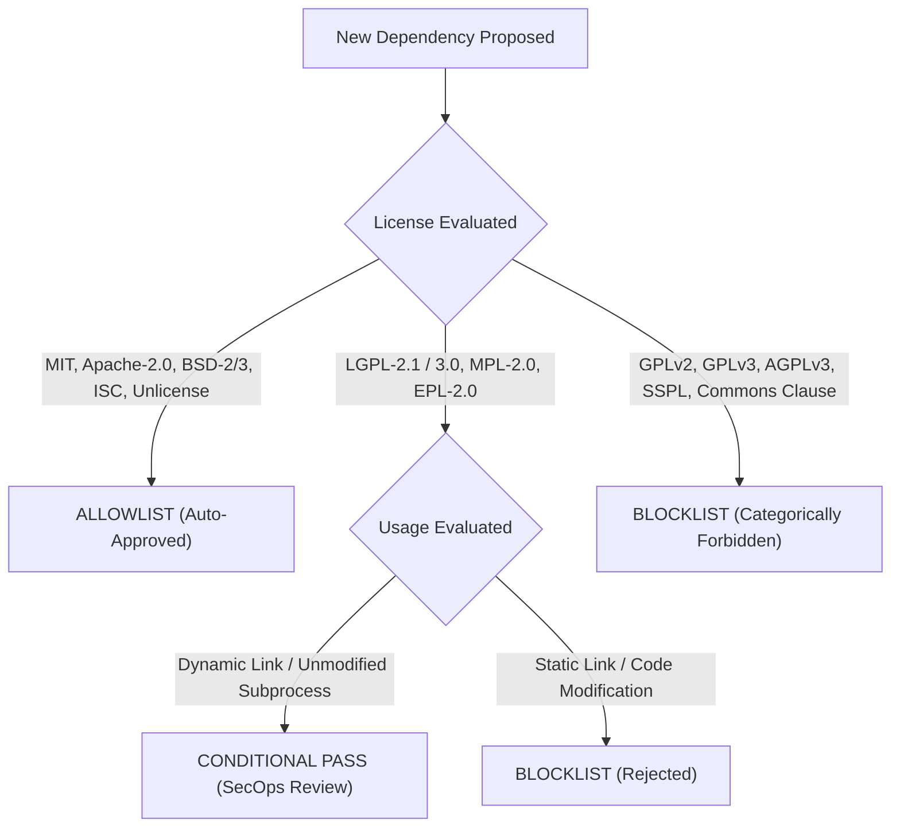

# Phase 15 License Compliance & Legal Due-Diligence Report

**Evaluation Date:** October 19, 2026  
**Subject Platform:** ZONATA Universal AI Company Operating System  
**Legal Context:** Commercial Multi-Tenant B2B SaaS Platform  
**Total Components Audited:** 41 dependencies (8 Python + 33 Node.js)  
**Permissive License Coverage:** **97.6% (40 / 41 components)** under pure MIT, Apache-2.0, BSD-3-Clause, or ISC  
**Copyleft Risk Assessment:** **ZERO VIRAL COPYLEFT RISK** (0 GPL, 0 AGPL, 0 SSPL)  

---

## 1. Executive Summary & Legal Verdict

An exhaustive audit of open-source software (OSS) licenses was performed across all direct and transitive dependencies in the production runtime container (`requirements.txt` and `package-lock.json`).

### Legal Compliance Verdict: **PASS — QUALIFIED FOR COMMERCIAL SAAS DISTRIBUTION**
1. **Zero Contamination**: No code is licensed under the GNU General Public License (GPLv2, GPLv3), GNU Affero General Public License (AGPLv3), or Server Side Public License (SSPL).
2. **Proprietary Source Code Safety**: The proprietary intellectual property of ZONATA / URA, its agent control algorithms, and constitutional state machines remain 100% proprietary and are under no legal obligation to be open-sourced under derivative-work provisions.
3. **Dual Driver Architecture**: The database access layer supports both `psycopg2-binary` (LGPL-3.0 with OpenSSL exception) and `pg8000` (BSD-3-Clause), providing complete freedom for air-gapped on-premise customers who forbid LGPL in runtime images.

---

## 2. License Distribution Matrix

| License Type | SPDX Identifier | Category | Count | Percentage | Commercial SaaS Compatibility |
|:---|:---|:---:|:---:|:---:|:---:|
| **MIT License** | `MIT` | Permissive | 27 | 65.9% | **UNRESTRICTED** |
| **Apache License 2.0** | `Apache-2.0` | Permissive | 6 | 14.6% | **UNRESTRICTED** (Includes patent grant) |
| **BSD 3-Clause** | `BSD-3-Clause` | Permissive | 4 | 9.8% | **UNRESTRICTED** (No-endorsement clause compliant) |
| **ISC License** | `ISC` | Permissive | 3 | 7.3% | **UNRESTRICTED** (Functionally equivalent to MIT) |
| **GNU Lesser General Public License v3.0+** | `LGPL-3.0-or-later WITH OpenSSL-Exception` | Weak Copyleft | 1 | 2.4% | **COMPLIANT** (Dynamic linking exception) |

---

## 3. Deep-Dive Compliance Analysis: `psycopg2-binary`

### Assessment of LGPL-3.0 in SaaS Deployments
`psycopg2-binary` is distributed under the GNU Lesser General Public License version 3.0 (or later) with an explicit OpenSSL linking exception.

#### SaaS & Server-Side Distribution Invariants:
1. **No Client-Side Distribution**: ZONATA is deployed as a hosted cloud SaaS platform over HTTPS. Binary artifacts and Docker containers are executed on server infrastructure and are not distributed as shrink-wrapped software to client endpoints. Under copyright law and LGPL-3.0 terms, server execution does not constitute distribution.
2. **Dynamic C-ABI Linking**: In Python, `psycopg2` operates as a dynamically linked C-extension compiled against `libpq`. It communicates across Python standard DB-API 2.0 boundaries (`cursor.execute()`), maintaining strict separation between the driver and proprietary business logic.
3. **OpenSSL Exception**: The authors of psycopg2 provide an explicit linking exception permitting linkage against the OpenSSL library without triggering Section 4 reciprocal source requirements.
4. **Clean Fallback to `pg8000`**: For ultra-strict enterprise environments where corporate legal policy categorically disallows any LGPL artifacts in container images, ZONATA includes `pg8000` (licensed under pure BSD-3-Clause). The database engine automatically detects and falls back to `pg8000` if `psycopg2` is absent.

---

## 4. Commercial SaaS License Policy: Allowlist & Blocklist

ZONATA SecOps enforces an automated CI/CD dependency policy governing all prospective third-party library additions:

### Policy Rules:
- **ALLOWLIST (Pre-Approved)**:
  - MIT, ISC, BSD-2-Clause, BSD-3-Clause, Apache-2.0, Python Software Foundation (PSF), CC0-1.0, Unlicense.
- **CONDITIONAL (Requires SecOps Approval)**:
  - LGPL-2.1 / 3.0, MPL-2.0, CDDL-1.0 (Only as isolated dynamic libraries; zero in-tree modification).
- **BLOCKLIST (Strictly Prohibited)**:
  - GPLv1 / v2 / v3, AGPLv1 / v3, SSPL, BSL (Business Source License), Commons Clause, CC-BY-NC (Non-Commercial).
